# AFI Vision Builder 🚀

<p align="center">
  <b>Enterprise Visual Node-Graph Platform for Real-Time AI Computer Vision Pipelines, Multi-Camera CCTV Analytics & Operational Dashboards</b>
</p>

<p align="center">
  
  
  
  
  
  
  
  
</p>

<p align="center">
  <a href="#-fitur-unggulan-terbaru">Fitur Unggulan</a> •
  <a href="#-tur-antarmuka--showcase-visual">Tur Antarmuka</a> •
  <a href="#-instalasi--eksekusi-1-click">Instalasi Cepat</a> •
  <a href="#-katalog-70-node-lengkap">Katalog 70+ Node</a> •
  <a href="#-arsitektur-sistem">Arsitektur</a> •
  <a href="#-pengujian-kualitas-unit--e2e">Pengujian Kualitas</a> •
  <a href="#-lisensi--pengembang">Lisensi</a>
</p>

---

## 🌟 Overview Aplikasi

**AFI Vision Builder** adalah platform visual tanpa coding (*low-code / zero-code*) untuk merancang, menguji, dan mendeploy pipeline Computer Vision & AI secara real-time. Dengan antarmuka node-graph berbasis kabel kurva Bézier yang intuitif, Anda dapat menyambungkan input video/kamera industri, inferensi model AI (YOLO, RF-DETR, SAM 3, VLM), pelacakan objek, analitik poligon multi-zona, hingga dashboard operasional multi-kamera CCTV secara terpadu.

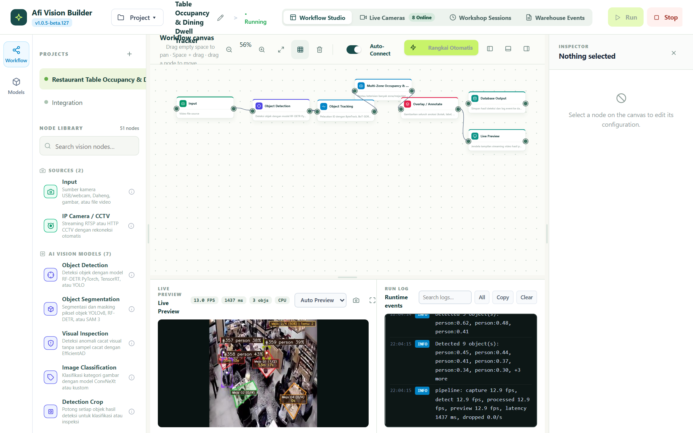

---

## ✨ Fitur Unggulan Terbaru

### 🍽️ 1. Restaurant Table Occupancy & Dining Dwell Time Tracker
- **Pemantauan Meja Restoran/Kafe Real-Time**: Deteksi otomatis status keterisian meja (`VACANT` ➔ `CONFIRMING` ➔ `OCCUPIED` ➔ `PENDING_VACANT`).
- **Compact Centroid Timer Overlay**: Indikator durasi duduk tamu (`1s`, `4m 12s`) diletakkan tepat di titik tengah meja dengan kartu glassmorphism semi-transparan, tidak menghalangi tampilan makanan/tamu.
- **Tahan Terhadap Flicker & Video Loop**: State Machine tangguh dengan toleransi *grace period* saat tamu bergerak atau terhalang sejenak.
- **Template Siap Pakai**: Tersedia template alur kerja 4 meja restoran (VIP, 4-seat, 2-seat) di Projects Hub.

### 📐 2. Interactive In-Canvas Multi-Zone & Polygon Editor
- **Gambar Poligon Area Langsung di Atas Video**: Buat area ROI (*Region of Interest*) langsung dari frame live preview atau grid kalibrasi.
- **Draggable Vertex Handles**: Geser titik sudut, tambah titik baru di garis tepi, atau hapus titik sudut poligon dengan interaksi klik visual.
- **Multi-Area Management**: Kelola banyak area sekaligus (misal: Meja 1-4, Bay Workshop 1-5, Pintu Gerbang) lengkap dengan kapasitas maksimum dan batas waktu overstay.

### 📹 3. Multi-Camera Operations Matrix (8-Stream CCTV Grid)
- **Monitoring Simultan 8 Kamera RTSP**: Menampilkan streaming langsung 5 Workshop Bays (`WS-01` s/d `WS-05`) dan 3 Warehouse Gates (`WH-01` s/d `WH-03`).
- **Grid Layout Switcher**: Ganti tampilan dalam 1 klik antara mode **1 Fokus**, **4 Grid (2x2)**, atau **9 Matrix (3x3)**.
- **Filter Kategori Kamera**: Filter cepat tampilan berdasarkan area (*All*, *Workshop Bays*, *Warehouse Gates*).
- **Direct Workflow Binding**: Setiap kartu kamera dilengkapi status koneksi workflow dan tombol cepat untuk membuka alur kerja terkait di Studio.

### ⏱️ 4. Workshop Work Duration Sessions Dashboard
- **Rekap Durasi Kerja Otomatis**: Menghitung waktu mulai, waktu selesai, dan durasi efektif kerja di setiap bay workshop tanpa bergantung pada tracking ID transien.
- **KPI Metrics Card**: Ringkasan Total Sesi, Total Jam Kerja, Rata-rata Durasi/Sesi, dan Jumlah Ban/Objek terproses.
- **Filter Shift Kerja**: Filter data berdasarkan Shift Pagi, Shift Siang, Shift Malam, atau seluruh shift dengan pencarian live bay.
- **Ekspor CSV 1-Klik**: Unduh seluruh riwayat sesi kerja ke format spreadsheet CSV.

### 🚪 5. Warehouse Gate Exit Events & ERP Sync Logs
- **Deteksi Transisi Keluar Sah (Inside-to-Outside)**: Memverifikasi pergerakan fisik objek dari dalam gudang melintasi gerbang ke luar, mencegah *false alarm* akibat objek yang sekadar hilang dari pandangan kamera.
- **Status Integrasi ERP**: Pelacakan status sinkronisasi kejadian (*Delivered*, *Queued*, *Failed*) dengan nomor referensi DO/SJ.
- **Filter Gerbang & Status**: Filter log berdasarkan gerbang spesifik (`WH-01`, `WH-02`, `WH-03`) dan ekspor rekaman kejadian ke CSV.

### 🎨 6. Roboflow-Style Overlay / Annotate Inspector
- **Manajemen Layer Anotasi Terpadu**: Kendalikan seluruh tampilan visual di satu node inspector modern.
- **Pilihan Layer Lengkap**: Bounding box (warna & ketebalan kustom), Label dinamis (`{class} {confidence}`), Confidence score, Status badge, Custom text, Heatmap, dan Panah arah gerak (*Direction Arrow*).
- **Layer Reorder & Toggle**: Urutkan tumpukan layer ke atas/bawah, sembunyikan/tampilkan per layer, serta hapus layer dengan cepat.

### 🧠 7. Central Model Registry & Hub
- **Repositori Model Terpusat**: Manajemen seluruh bobot model AI yang terpasang di sistem (`.pt`, `.onnx`, `.engine`, `.tflite`).
- **Tabel Metadata Lengkap**: Menampilkan informasi Engine inferensi, Format, Task, Versi, Ukuran file, dan Status ketersediaan.
- **Upload Modal Drag-and-Drop**: Unggah custom model buatan sendiri langsung dari peramban web.

### 🤖 8. AI Agent & Vision-Language Model (VLM)
- **Penalaran Multimodal Tingkat Lanjut**: Kirim frame tangkapan kamera ke model VLM (OpenAI GPT-4o/5, 9router, atau OpenRouter) untuk analisis visual mendalam, deteksi cacat kompleks, dan inspeksi SOP industri.
- **Keamanan Kredensial**: API Key disanitasi secara otomatis dan dapat dimuat aman dari environment server (`.env`).

### 🎯 9. Multi-Model Consensus & Tracking Stability Enhancements
- **Detections Consensus**: Menggabungkan prediksi dari 2 atau lebih model AI (misal: YOLOv8 + RF-DETR) dengan teknik *IoU Clustering & Agreement Ratio Voting* untuk memangkas *false positive* pada lingkungan industri ekstrem.
- **Track Class Lock**: Mengunci kelas dominan dari suatu track ID setelah diverifikasi beberapa frame, mengeliminasi flicker kelas (*label jittering*).
- **EMA Bounding Box Stabilizer**: Penghalusan posisi koordinat bounding box menggunakan *Exponential Moving Average* untuk visualisasi yang kokoh tanpa jitter.
- **Per-Class Confidence Thresholding**: Ambang batas akurasi per kelas (misal: `person:0.80, helmet:0.40, tire:0.50`) untuk deteksi presisi tinggi.

### 📏 10. Spatial Measurement & Physical Dimension Calibration
- **Real-World Distance Measurement**: Mengukur jarak spasial Euclidean antar pasangan objek (misal: jarak antar pekerja atau kendaraan) dengan kalibrasi *pixel-to-metric* (cm, meter, inch) serta alarm kedekatan (*proximity alert*).
- **Size Measurement**: Menghitung lebar, tinggi, dan luas fisik objek secara presisi dengan toleransi batas minimum/maksimum untuk *quality control* dimensi produk.

### 🔬 11. Classical Computer Vision & Camera Health Monitoring
- **Camera Focus Score**: Penilaian ketajaman fokus lensa kamera industri secara real-time berbasis variansi operator Laplacian (mendukung pemantauan ROI spesifik) dengan alarm otomatis saat lensa buram atau kotor.
- **Auto Rotate Edges**: Deteksi otomatis kemiringan sudut objek dominan menggunakan kontur OpenCV (`minAreaRect`) dan perataan sudut frame/crop otomatis (*deskewing*).

### ⚡ 12. Video Kinematics & Velocity Calculation
- **Real-Time Velocity Calculator**: Menghitung kecepatan fisik objek bergerak ($v = \frac{\Delta s}{\Delta t}$) dalam satuan **km/h**, **m/s**, atau **mph** dari lintasan centroid historis lengkap dengan batas alarm kecepatan berlebih (*overspeed alarm*).
- **Path Deviation Monitoring**: Memantau lintasan pergerakan objek terhadap koridor virtual (garis polyline panduan) dengan ambang toleransi deviasi maksimum (*cross-track error*).

### 🧠 13. Advanced Spatial Logic & Compute Optimization
- **Overlap Analysis**: Pengecekan spasial parent-child (apakah objek anak berada di dalam objek induk, misal: Helm pada bagian atas tubuh pekerja) dengan syarat minimal rasio overlap dan alarm APD/K3.
- **Delta Frame Filter (Compute Throttler)**: Penghematan beban CPU/GPU hingga **70%+** pada pemantauan area statis dengan memblokir pemrosesan saat tidak ada pergerakan signifikan dan fallback heartbeat otomatis.
- **Switch-Case Dynamic Router**: Percabangan alur kerja multi-jalur berdasarkan kelas objek atau atribut untuk arsitektur pipeline kompleks.
- **Dynamic Zone Tracking**: Poligon zona ROI otomatis bergeser mengikuti pergerakan unit anchor (misal: bak truk atau forklift yang berpindah posisi).

### 🔍 14. Dual-Model Evaluation & State Difference Comparator
- **Model Comparison Diff**: Membandingkan hasil inferensi 2 model AI sekaligus dalam mode **Side-by-Side** (2 layar berdampingan) atau **Diff Overlay** (1 layar dengan pewarnaan diferensial: hijau = konsensus/sepakat, cyan = Model A, magenta = Model B) lengkap dengan skor Agreement Ratio.
- **Detections Difference (State Comparator)**: Membandingkan kondisi objek saat ini terhadap snapshot baseline acuan untuk mendeteksi barang yang hilang (*removed/theft*), barang baru ditambahkan (*added/unauthorized*), atau aset tetap (*unchanged*) lengkap dengan alarm selisih otomatis.

### 🎨 15. Motion Trail & Sci-Fi Halo Glow Corner Brackets
- **Motion Trace (Track Tail)**: Menggambar ekor lintasan pergerakan objek selama $N$ frame terakhir dengan efek *fade alpha* gradasi elegan.
- **Corner Brackets & Halo Glow**: Gaya visual kotak pembatas modern ala Roboflow dengan siku sudut presisi dan bayangan berpendar semi-transparan (*halo glow*).

### 📊 16. Operational Rollup & Tabular Data Formatter
- **Data Aggregator (Rolling Window Rollup)**: Akumulasi statistik metrik operasional (*count*, *sum duration*, *avg duration*, *max occupancy*) dalam rentang jendela waktu dinamis (misal: per 15 menit, per jam, atau per shift kerja).
- **CSV Formatter**: Ekspor data tabular kejadian dan pelacakan ke format CSV terstruktur dengan dukungan alias kolom, pilihan delimiter kustom, serta penyimpanan otomatis ke disk lokal.

### ☁️ 17. Cloud Object Sinks, Multi-Channel Alerts & Hardware PTZ
- **S3 Cloud Storage Sink**: Pengunggahan foto bukti kejadian atau crop deteksi langsung ke bucket AWS S3, MinIO, atau Ceph Object Storage dengan kompresi JPEG terkalibrasi dan URL publik aman.
- **Notification Dispatcher**: Penyebaran pesan peringatan dan foto frame kejadian multi-kanal ke Telegram Bot, Slack Incoming Webhooks, WhatsApp Business API, atau REST Webhook dengan jeda *cooldown throttling* anti-spam.
- **PTZ Camera Controller (ONVIF Continuous Move)**: Pengendali motor kamera PTZ fisik jaringan LAN (*Auto-Following*) untuk mengarahkan kamera mengikuti pergerakan target (person, forklift, unit) dengan filter *deadzone* anti-getar.

### 🔤 18. Ultra-Lightweight ONNX Optical Character Recognition (OCR)
- **Model Ultra-Ringan & Cepat (~10 MB Total)**: Mengintegrasikan model ONNX mobile DBNet text detection (`ppocrv3_det.onnx` ~2.4 MB) dan MobileNetV3 CTC text recognition (`ppocrv3_en_rec.onnx` ~7.8 MB) yang berjalan ultra-cepat pada CPU (~5-15ms) tanpa dependensi runtime besar.
- **Dual-Mode Text Extraction**: Mendukung pemindaian teks di seluruh frame (*Full-frame*) atau hanya membaca teks di dalam bounding box objek downstream (misal: kotak nomor plat kendaraan `license_plate`, barcode/resi, atau kemasan).
- **Character Whitelist Filtering**: Penguncian karakter spesifik (misal: hanya angka `0-9` atau huruf kapital & angka) untuk pembacaan plat nomor otomatis (ANPR), kode serial suku cadang, dan nomor peti kemas tanpa noise.

### ⚡ 19. n8n-Style Node Activation (1-Click Toggle Switch) & Live Execution Logs
- **1-Click Toggle Switch di Kanvas**: Aktifkan atau nonaktifkan (bypass) node secara instan melalui sakelar toggle visual di header setiap kartu node kanvas maupun di panel Inspector, tanpa perlu menghapus node atau mencabut kabel edge.
- **Bypass / Pass-Through Mode (Wire)**: Node yang dinonaktifkan (`enabled: false`) otomatis berubah gaya visual (translucent semi-transparan dengan garis putus-putus dan badge `[BYPASSED]`), namun **tetap meneruskan data aliran frame/deteksi** ke node downstream sehingga pipeline alur kerja tidak terputus.
- **Tab Inspector "Data & Logs"**: Tab inspeksi khusus ala n8n yang menampilkan:
  - **Telemetry HUD Real-Time**: Status eksekusi (`ACTIVE` / `BYPASSED` / `ERROR`), latensi pemrosesan per-frame dalam milidetik (`ms`), jumlah item/objek terdeteksi, dan waktu eksekusi terakhir.
  - **Input Payload / Metadata Viewer**: Payload JSON input lengkap yang masuk ke node secara collapsible.
  - **Output Payload / Telemetry Viewer**: Payload JSON output hasil eksekusi node (misal: bounding box deteksi, atribut kalkulasi, label teks) siap inspeksi.
  - **Tombol Salin & Refresh 1-Klik**: Tombol `📋 Copy Full JSON Payload` untuk menyalin struktur data lengkap ke clipboard pengembang dan tombol `🔄 Refresh`.
- **Live Node Status Bar Footer**: Setiap kartu node di kanvas dilengkapi footer status bar real-time yang menampilkan indikator status hidup (`● ACTIVE 12.4ms`, `● BYPASSED`, atau `● ERROR`) tanpa membebani performa browser.

### 🎥 20. Live YouTube CCTV & Video Stream Input (`yt-dlp`)
- **Streaming YouTube Langsung di Node Input**: Masukkan URL YouTube (video rekaman CCTV, live camera, maupun YouTube Shorts) langsung ke node `Input` via mesin integrasi `yt-dlp`.
- **Pemilihan Resolusi Stream Dinamis**: Pilihan resolusi yang fleksibel (`Auto`, `360p`, `480p`, `720p`, `1080p`) untuk menyesuaikan dengan bandwidth jaringan dan kemampuan CPU/GPU.
- **Auto-Reconnect & Auto-Loop**: Otomatis menyambung kembali jika koneksi internet terputus dan mengulang video dari awal jika rekaman telah selesai.

### 🏭 21. 5 Template Produksi Nyata Industri (Production-Ready Templates)
- **1-Click Siap Pakai di Projects Hub**: Tersedia 5 template alur kerja lengkap dengan video stream nyata dan penjelasan praktis *"🎯 Fungsi & Kegunaan"*:
  1. **Smart Traffic Flow & Vehicle Counter**: Deteksi mobil, motor, bus, truk; pemisahan lajur arah (Utara/Selatan), HUD volume, dan logging database.
  2. **Restaurant Table Occupancy & Dining Dwell Tracker**: Pemantauan meja F&B, timer keterisian meja terpusat, dan alert overstay.
  3. **Assembly Line & Workshop Cycle Timer**: Pengukuran durasi siklus kerja per operator di workstation dan deteksi waktu idle.
  4. **Warehouse Dock & Forklift Safety Guard**: Verifikasi keluar-masuk gerbang gudang dan batas zona aman pejalan kaki vs forklift.
  5. **Retail Checkout Queue & Hotspot Analyzer**: Analisis antrean kasir supermarket dan alert otomatis panggil kasir cadangan saat antrean > 3 orang.

### 📁 22. Topbar Project Switcher & Modern SaaS Projects Hub
- **Project Switcher Dropdown di Topbar**: Berpindah antar proyek alur kerja seketika via dropdown `[📁 Project ▾]` dengan filter pencarian live nama proyek dan badge aktif `AKTIF`.
- **Halaman Awal Hub Modern (Bento Style)**: Hero banner SaaS v1.0.5, Quick Stats Strip (Total Proyek, Template Industri, Kamera Online, Visual AI Nodes), grid proyek tersimpan dengan menu aksi titik 3 (Buka, Ganti Nama, Hapus), dan tombol `Buka Workflow →`.
- **Category Filter Pills**: Filter cepat kategori solusi industri (*Manufaktur & QC*, *Retail & Restoran*, *Gudang & Logistik*, *Keamanan & Akses*, *AI Vision*, *Trafik & Smart City*).

### 🌐 23. YOLO-World Open-Vocabulary Zero-Shot Detector (CLIP Text Prompting)
- **Deteksi Objek Berbasis Teks Natural Language**: Deteksi objek apa pun tanpa perlu melatih model baru (*zero training*) atau mengunggah checkpoint kustom lokal.
- **Fleksibilitas Luar Biasa**: Cukup ketik daftar label yang diinginkan (misal: `"forklift, safety vest, pallet, helmet"`), inferensi didukung oleh model resmi `yolov8s-worldv2.pt` dan CLIP text embeddings.
- **Kecepatan Tinggi & Efisien**: Model didownload otomatis pada pemakaian pertama dan di-cache secara permanen di direktori weights lokal.

### ☁️ 24. Roboflow Universe Hosted Inference API Integration
- **Akses 50.000+ Model Computer Vision**: Jalankan model AI publik maupun private dari Roboflow Universe langsung ke pipeline deteksi & segmentasi.
- **Tanpa Unduh File Bobot Besar**: Cukup masukkan Model ID (format: `project/version` seperti `warehouse-safety/3`) dan Roboflow API Key.
- **Preflight & Inspection Aman**: Endpoint `/api/models/inspect` otomatis mengenali cloud model ID tanpa melempar error 404.
- **Form Inspector Khusus**: Field label dinamis *"Roboflow Universe Model ID"* dengan pembersihan tombol upload fisik lokal yang tidak relevan.

### 📐 25. Penyelarasan Presisi Kabel Kanvas (Wire & Port Center Alignment)
- **Kabel Menempel Sempurna**: Titik awal dan akhir kurva Bézier kabel koneksi node dihitung secara akurat menempel di tengah lingkaran port input dan output node kanvas pada semua tingkat zoom dan panning.
- **Subtle Instant Delete Button**: Tombol hapus kabel interaktif yang bersih dan hanya muncul saat kursor didekatkan ke garis kabel.

### ⚡ 26. Model Quantizer & Optimizer (TFLite INT8/FP16 & ONNX Dynamic INT8)
- **Kompresi & Akselerasi Model Otomatis**: Kuantisasi model AI langsung dari Central Model Registry Hub untuk memangkas ukuran model hingga **75%** dan mempercepat inferensi pada perangkat CPU, Edge, Raspberry Pi, dan NPU.
- **Format Presisi Fleksibel**:
  - **TFLite INT8**: Kuantisasi bobot dan aktivasi ke integer 8-bit dengan kalibrasi representatif sintetis otomatis tanpa perlu mengunggah dataset manual.
  - **TFLite FP16**: Kuantisasi half-precision 16-bit untuk penghematan ukuran 50% dengan retensi akurasi deteksi mendekati 100%.
  - **ONNX Dynamic INT8**: Kuantisasi dinamis integer 8-bit untuk eksekusi ultra-cepat di x86/ARM CPU via ONNX Runtime.
- **Alur Kerja Terpadu 1-Klik**: Hasil kuantisasi langsung menampilkan ringkasan metrik kompresi (ukuran awal vs akhir, rasio penghematan), tombol `[🎯 Terapkan ke Node Aktif]` untuk langsung dipasang ke node deteksi aktif, dan tombol `[💾 Unduh File]` untuk mengunduh bobot terkuantisasi.
- **Runtime Universal Terkalibrasi**: Custom model inference engine secara otomatis mengenali kuantisasi INT8, mengaplikasikan *scale & zero-point normalization*, serta mengekstrak tensor deteksi YOLO 2D/3D secara adaptif.

### 🎛️ 27. Universal Header Actions & Profile Management
- **Menu Opsi Lanjutan (`...`)**: Dropdown terintegrasi untuk *Import Workflow JSON*, *Export Workflow JSON*, *Salin JSON Workflow ke Clipboard*, *Pusatkan Kanvas (Fit View)*, *Kosongkan Kanvas (Clear)*, serta tautan cepat ke *Dokumentasi Swagger API (/docs)*.
- **Pusat Notifikasi Real-Time (`🔔`)**: Panel notifikasi interaktif dengan badge dot dinamis merah saat ada kejadian baru, filter tab (*Semua*, *Alerts*, *Sistem*), tombol *Tandai Dibaca*, tombol *Bersihkan*, serta integrasi live dengan event pipeline.
- **Pengaturan Studio & Pipeline (`⚙️ Settings`)**: Dialog modal pengaturan komprehensif untuk *Device Compute* (Auto/CPU/CUDA), *FPS Throttling*, *VLM Model API Keys* (OpenAI, 9router, Ollama), dan *Webhook Sink ERP*.
- **Pusat Bantuan & Panduan (`Help`)**: Dialog modal interaktif berisikan tabel *Pintasan Keyboard* lengkap (<kbd>Space</kbd>+Drag, <kbd>Ctrl+S</kbd>, <kbd>Ctrl+Enter</kbd>, dll.), *Panduan Cepat 5 Langkah*, ringkasan *Katalog Node*, serta info versi sistem.
- **Profil Pengguna Enterprise (`AN`)**: Avatar interaktif dengan kartu profil **Anas Khadafi** (*Lead Vision Engineer & Admin*), status live server, pintasan 1-klik ke *Model Quantizer*, *Sinkronisasi Sistem*, dan *Kunci Sesi*.

---

## 📸 Tur Antarmuka & Showcase Visual

### 1. Projects & Templates Hub
Halaman awal untuk mengelola seluruh proyek alur kerja, membuka proyek terkini, mengimpor alur kerja JSON, dan memilih template siap pakai industri (Restaurant Dwell Tracker, Bottle Inspection, dll).
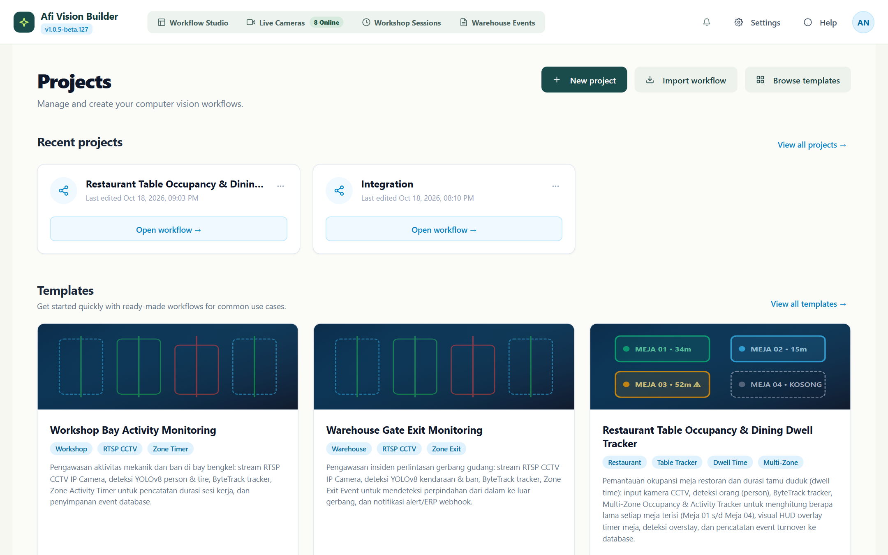

---

### 2. Workflow Studio Canvas
Kanvas node-graph interaktif dengan kabel Bézier halus, auto-connect cerdas, zoom & pan mulus, panel library 50+ node, status runtime Python, dan inspector parameter berlabel Bahasa Indonesia.
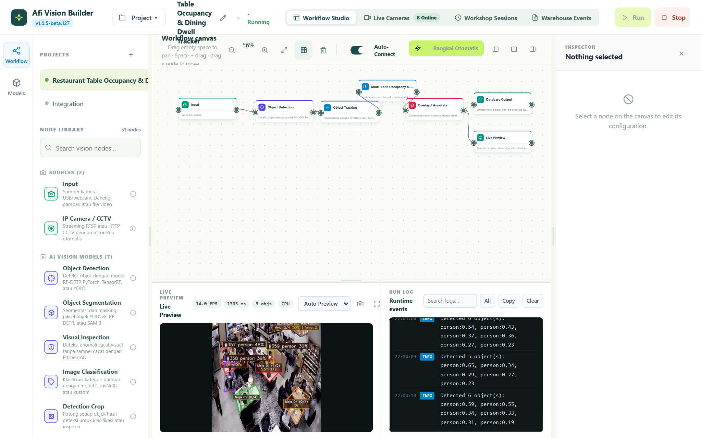

---

### 3. Live Execution: Restaurant Table Occupancy & Dining Dwell Tracker
Pipeline video CCTV Kafe berjalan secara live pada CPU/GPU, menampilkan deteksi YOLOv8 + ByteTrack dengan timer durasi duduk tamu (`1s`, `4m 12s`) di tengah meja secara elegan tanpa menutupi makanan.


---

### 4. Interactive Multi-Zone Polygon Editor
Editor poligon interaktif di atas frame video live: operator dapat memilih area meja/bay, menggeser titik sudut (*vertex handles*), menambah area baru, dan menyetel kapasitas maksimal.
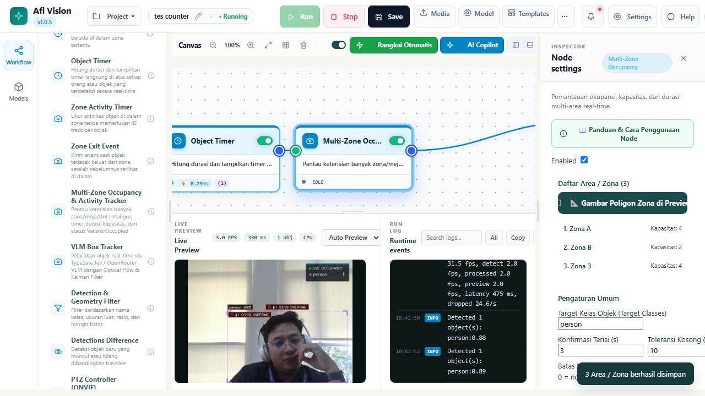

---

### 5. Roboflow-Style Overlay / Annotate Inspector
Panel inspector modern bergaya Roboflow untuk menambahkan layer anotasi (kotak pembatas, label kelas, heatmap, skor akurasi) dengan pengaturan warna, posisi, dan ketebalan interaktif.
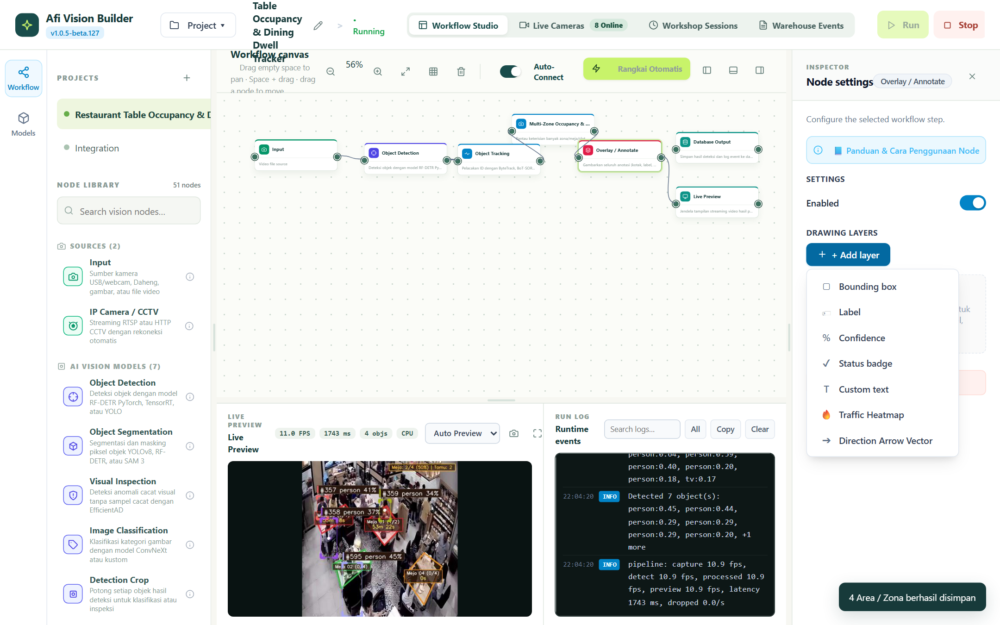

---

### 6. Multi-Camera Operations Matrix (8-Bay CCTV Grid)
Matriks pemantauan terpusat untuk 8 kamera CCTV industri (5 Bay Workshop + 3 Gerbang Warehouse) dengan opsi tampilan 1 Fokus, 4 Grid, dan 9 Matrix lengkap dengan FPS live meter.
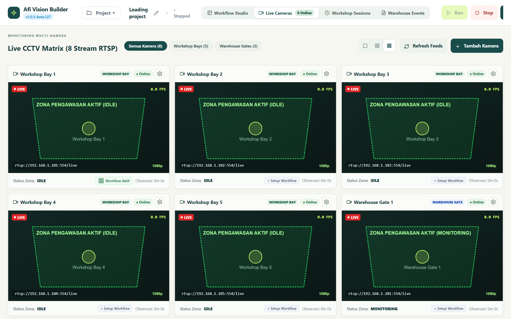

---

### 7. Modern Camera Settings & Workflow Auto-Binding
Dialog konfigurasi kamera CCTV kontras tinggi dengan fitur *Auto-generate Workflow* dari template industri dan tombol shortcut langsung `[📐 Gambar Poligon Area]`.
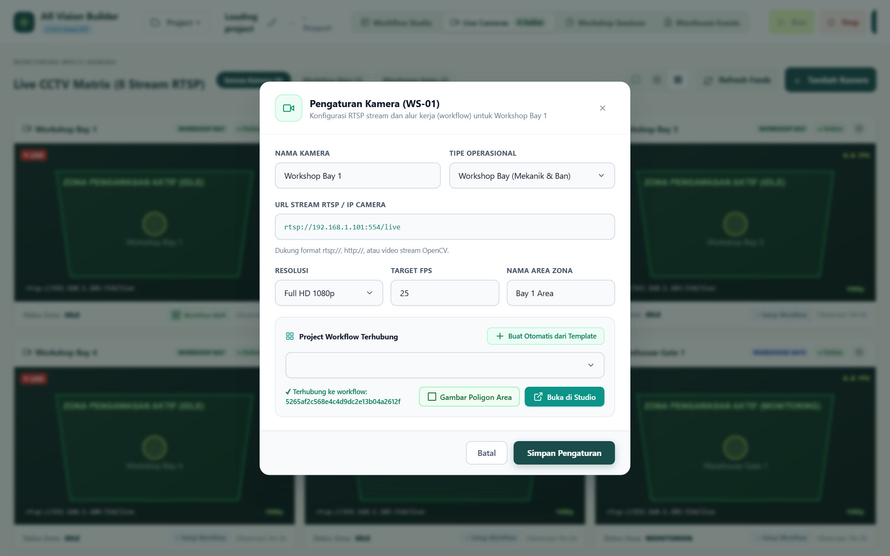

---

### 8. Workshop Work Duration Sessions Dashboard
Dashboard analitik sesi kerja bengkel/workshop: kartu ringkasan KPI, filter shift (Pagi, Siang, Malam), pencarian live bay, dan tombol ekspor CSV untuk integrasi laporan.
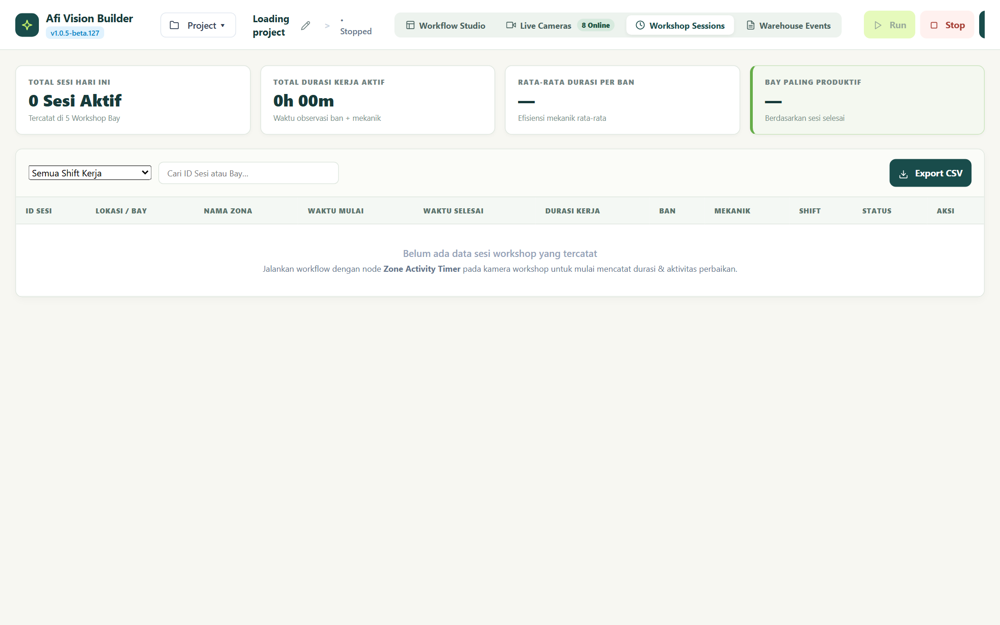

---

### 9. Warehouse Gate Exit Events & ERP Logs
Log kejadian keluar gerbang gudang dengan verifikasi transisi fisik dari dalam ke luar gerbang, status pengiriman ERP (*Delivered* / *Queued*), filter pintu gerbang, dan ekspor CSV.
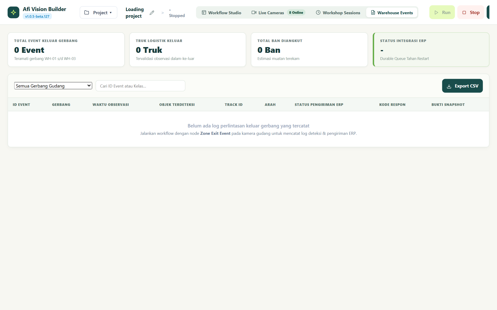

---

### 10. Central Model Registry Manager
Panel manajemen model AI terpusat dengan tabel metadata terstruktur (YOLOv8, YOLOv11, ONNX, TensorRT, RF-DETR), status aktif, serta modal upload model baru.
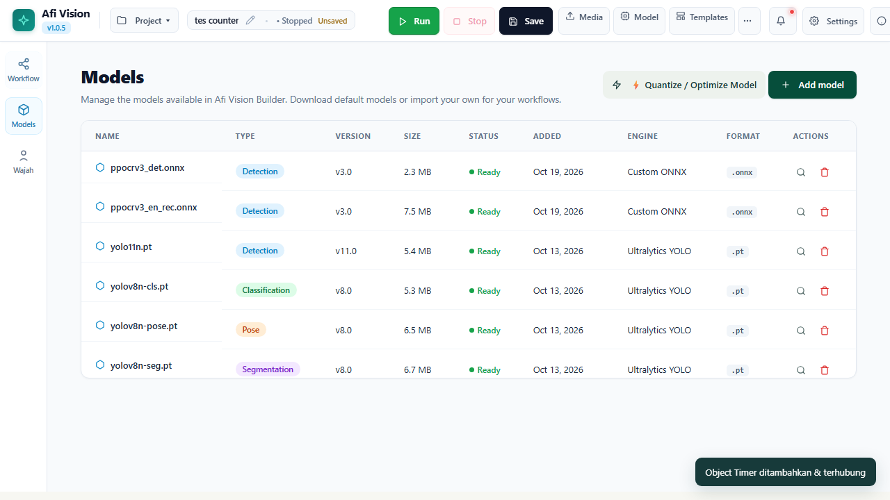

---

### 11. Model Quantizer & Optimizer Tool (TFLite & ONNX)
Alat visual terintegrasi di Model Registry untuk mengompresi model AI ke presisi INT8 / FP16 dengan kalibrasi sintetis otomatis, menampilkan rasio kompresi, unduh file, dan tombol 1-klik terapkan ke node aktif.
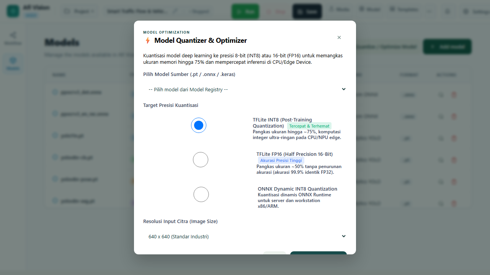

---

## ⚡ Instalasi & Eksekusi (1-Click)

### 🪟 Pengguna Windows (Disarankan)

AFI Vision Builder dirancang portabel dengan skrip launcher otomatis:

1. **Persyaratan**: Pastikan **Python 3.10, 3.11, atau 3.12** terpasang *(Centang "Add Python to PATH" saat instalasi)*.
2. **Instalasi Dependensi (Cukup 1x di awal)**:
   Klik dua kali berkas:
   ```cmd
   install.bat
   ```
   > Skrip ini otomatis membuat virtual environment (`.venv`), memasang PyTorch, Ultralytics, Supervision, OpenCV, FastAPI, dan seluruh modul pendukung.
3. **Menjalankan Aplikasi**:
   Klik dua kali berkas:
   ```cmd
   run.bat
   ```
   > Server lokal akan langsung aktif dan otomatis membuka peramban web ke:  
   > 👉 **http://127.0.0.1:8765**

---

### 🐧 Pengguna Linux & macOS

1. Berikan izin eksekusi pada berkas skrip:
   ```bash
   chmod +x install.sh run.sh
   ```
2. Jalankan instalasi:
   ```bash
   ./install.sh
   ```
3. Jalankan aplikasi:
   ```bash
   ./run.sh
   ```

---

## 🧩 Katalog 70+ Node Lengkap

Seluruh node dikelompokkan ke dalam 5 kategori fungsional dengan parameter berlabel Bahasa Indonesia dan panduan interaktif:

| Kategori | Node Siap Pakai | Fungsi & Deskripsi Utama |
| :--- | :--- | :--- |
| 📹 **Sources (Input)** | `Web Camera`, `IP Camera (RTSP)`, `Daheng Industrial Camera`, `Video File`, `Static Image`, `YouTube Live Stream (yt-dlp)` | Akuisisi citra/streaming frame dari berbagai tipe kamera fisik, live video URL YouTube, dan berkas multimedia. |
| 🧠 **AI Vision Models** | `Ultralytics YOLO`, `YOLO-World (Zero-Shot)`, `Roboflow Universe (Model ID)`, `RF-DETR Object Detection`, `SAM 3 Segmentation`, `ConvNeXt Classifier`, `EfficientAD Anomaly`, `ONNX Model`, `TFLite Model`, `AI Agent (VLM Multimodal)`, `Detections Consensus`, `Model Comparison Diff`, `OCR Text Reader (ONNX)` | Deteksi objek real-time, zero-shot open-vocabulary text prompt via CLIP, hosted inference Roboflow Universe 50.000+ model, segmentasi instan, klasifikasi citra, inspeksi anomali cacat visual, analisis multimodal VLM, konsensus multi-model, komparasi dual-model side-by-side & diff overlay, dan OCR ONNX PP-OCRv3/v4. |
| 🎯 **Tracking, Kinematics & Spatial** | `ByteTrack`, `BoT-SORT`, `OC-SORT`, `Multi-Zone Occupancy & Table Tracker`, `Zone Activity Timer`, `Zone Exit Event`, `Multi-Line Counter (A↔B)`, `Object Counter`, `Dwell Time Zone`, `ROI Filter (Polygon Area)`, `Distance Measurement`, `Size Measurement`, `Velocity Calculator`, `Path Deviation`, `Detections Difference`, `Dynamic Zone Tracking`, `PTZ Controller (ONVIF)` | Pelacakan ID konsisten objek bergerak, penghitungan keluar-masuk garis dua arah, timer durasi terisi meja restoran, verifikasi transisi gerbang, kalkulasi jarak fisik & ukuran objek dengan kalibrasi cm, perhitungan kecepatan km/h, koridor deviasi lintasan, komparator selisih status sebelum vs sesudah (baseline comparator), dan auto-following kamera PTZ fisik. |
| 🎨 **Preprocessing, Classical CV & Drawing** | `Overlay / Annotate (Layers)`, `Resize Frame`, `Crop Region`, `Rotate & Flip`, `Color Convert`, `Brightness & Contrast (CLAHE)`, `Blur & Sharpen`, `Perspective Correction`, `Privacy Blur`, `Camera Focus Score`, `Auto Rotate Edges`, `Python Script Editor` | Manipulasi citra, night-vision CLAHE, sensor otomatis wajah/plat nomor, compositing anotasi gambar (termasuk Motion Trail fading dan Halo Glow corner brackets), penilaian ketajaman fokus lensa kamera (Laplacian variance), perataan sudut kemiringan kontur otomatis, dan script Python kustom. |
| 🔀 **Logic, Flow & Outputs** | `If / Else Branch`, `Compare Value`, `Confidence Threshold`, `Timer Delay`, `Debounce Filter`, `Rate Limiter`, `AND / OR Gate`, `Trigger Once`, `Overlap Analysis`, `Delta Frame Filter`, `Switch-Case Router`, `Live Preview`, `Event Alert Popup`, `Image / Crop Exporter`, `SQLite Database Logger`, `HTTP Webhook`, `Data Aggregator (Rollup)`, `CSV Formatter`, `S3 Cloud Sink`, `Notification Dispatcher` | Percabangan logika alur kerja, gerbang pembanding angka, inspeksi kepatuhan APD (overlap parent-child), penghemat komputasi 70%+ via delta frame, router multi-jalur switch-case, penampil preview real-time, perekaman event ke SQLite database, webhook REST API, akumulasi rollup statistik waktu, ekspor tabular CSV, sink cloud AWS S3/MinIO, dan notifikasi instan Telegram/Slack/WhatsApp. |

---

## 🏗️ Arsitektur Sistem

```text
afivisionbuilder/
├── 📁 engine/                     # Core Runtime Computer Vision & AI Engine
│   ├── core.py                    # Pipeline execution loop, threading, & Node Graph dispatcher
│   ├── multi_zone_occupancy.py    # Multi-Zone table tracking, FSM states, & geometric centroid testing
│   ├── project_nodes.py           # Specialized nodes (Zone Activity Timer, Zone Exit Event, Dynamic Zone)
│   ├── detections_consensus.py    # Multi-model consensus voting & IoU bounding box clustering
│   ├── model_comparison.py        # Dual-model side-by-side & diff overlay evaluation
│   ├── detections_difference.py   # State difference comparator (added, removed, unchanged)
│   ├── spatial_measurement.py     # Real-world distance measurement & physical object sizing
│   ├── classical_cv.py            # Laplacian camera focus score & auto-rotate deskewing
│   ├── video_kinematics.py        # Centroid velocity calculation & path corridor deviation
│   ├── advanced_logic.py          # Overlap analysis, delta frame throttler, & switch-case router
│   ├── data_aggregation.py        # Sliding window metrics rollup & CSV tabular exporter
│   ├── cloud_sinks.py             # S3 Object Storage sink & multi-channel notification dispatcher
│   ├── ptz_controller.py          # ONVIF continuous move PTZ auto-follower & deadzone filter
│   ├── ocr_engine.py              # Ultra-lightweight ONNX OCR engine (PP-OCRv3/v4)
│   ├── roboflow_tracker.py        # Track Class Lock & EMA bounding box stabilizer
│   ├── ai_agent.py                # VLM multimodal agent (Decision, Detector, Strict Classifier)
│   ├── custom_model_runtime.py    # YOLO / YOLO-World / Roboflow Universe / PyTorch Fallback Manager
│   ├── vlm_box_tracker.py         # Multimodal Vision-Language Model interface
│   ├── node_catalog.py            # Registry 70+ Node, metadata, & skema parameter
│   ├── main.py                    # Algoritma image processing OpenCV, YouTube resolver & spatial filters
│   └── camera_daheng.py           # Driver SDK kamera industri Daheng
├── 📁 static/                     # Frontend Single Page Application (SPA)
│   ├── index.html                 # Struktur markup Studio, Dashboard, & Hub
│   ├── app.js                     # State management, Bézier canvas routing, & UI interactions
│   ├── style.css                  # Desain visual modern, tema dark, & glassmorphism
│   └── logo.png                   # Brand identitas AFI Vision Builder
├── 📁 docs/                       # Dokumentasi Teknis & Showcase Media
│   ├── PRD.md                     # Product Requirements Document
│   ├── TASK_LIST.md               # Riwayat pengerjaan, handoff log, & roadmap
│   └── screenshots/               # Koleksi 10 tangkapan layar antarmuka resolusi tinggi
├── 📁 tests/                      # Automated E2E Test Suites (@e2e-dev/web & Playwright)
│   ├── yolo_world_roboflow.e2e.ts         # YOLO-World zero-shot prompt & Roboflow Universe E2E
│   ├── template_youtube_sources.e2e.ts    # 5 Production templates & YouTube stream input E2E
│   ├── wire_port_alignment.e2e.ts         # Canvas wire alignment & port center connection E2E
│   ├── project_switcher.e2e.ts            # Topbar project switcher dropdown E2E
│   ├── hub_redesign.e2e.ts                # Modern Hub landing page & template cards E2E
│   ├── ocr_reader.e2e.ts                  # OCR Text Reader ONNX pipeline E2E
│   ├── phase5_sinks_and_aggregation.e2e.ts # S3 sink, notifications, aggregator, & PTZ E2E
│   ├── vlm_and_visualization.e2e.ts        # Model comparison diff & state difference E2E
│   ├── consensus_and_filter.e2e.ts         # Model consensus & confidence filter E2E
│   ├── spatial_and_classical_cv.e2e.ts     # Spatial measurement & focus score E2E
│   ├── advanced_logic_and_kinematics.e2e.ts # Kinematics, overlap, delta filter E2E
│   ├── restaurant_cafe_running.e2e.ts      # Video pipeline & live table dwell time tracking
│   ├── template_restaurant_table.e2e.ts    # Template instansiasi meja restoran
│   ├── dashboard_operations.e2e.ts         # 8-camera matrix, workshop sessions, & warehouse events
│   ├── camera_settings_workflow.e2e.ts     # Camera modal, auto-binding, & polygon drawing
│   ├── multi_zone_occupancy.e2e.ts         # Visual polygon editor & inspector verification
│   ├── node_overlay_annotate.e2e.ts        # Overlay layers inspector verification
│   ├── projects_and_models_hub.e2e.ts      # Hub landing page & Model registry
│   ├── test_yolo_world_roboflow.py         # Pytest unit tests YOLO-World & Roboflow Universe
│   └── unit/                               # Pytest Unit Test Suites (157/157 Passed)
│       ├── test_ocr_node.py
│       ├── test_phase5_sinks_and_aggregation.py
│       ├── test_vlm_and_visualization.py
│       ├── test_detections_consensus.py
│       ├── test_spatial_and_classical_cv.py
│       ├── test_video_kinematics_and_advanced_logic.py
│       └── test_nodes.py
├── 📁 data/                       # Penyimpanan Lokal Terisolasi
│   ├── models/                    # Bobot model AI lokal (.pt, .onnx)
│   ├── projects/                  # File alur kerja JSON proyek
│   ├── cameras.json               # Konfigurasi 8 kamera CCTV industri
│   ├── outputs/                   # Folder hasil ekspor frame & crop event
│   └── visonode.db                # SQLite database log sesi & event
├── 📄 server.py                   # REST API & WebSocket Streaming Server (FastAPI / Starlette)
├── 📄 e2e.config.ts               # Konfigurasi pengujian otomatis E2E
├── 📄 requirements.txt            # Daftar pustaka Python terverifikasi
├── ⚙️ install.bat / run.bat       # Skrip instalasi & launcher otomatis Windows
└── ⚙️ install.sh / run.sh         # Skrip instalasi & launcher Linux/macOS
```

---

## 🧪 Pengujian Kualitas (Unit & E2E Tests)

AFI Vision Builder menerapkan standar rekayasa perangkat lunak ketat dengan pengujian berlapis:

- **168 Unit Tests (100% Passed)**: Pengujian unit menyeluruh via Pytest untuk menguji logika fungsional internal (FSM multi-zone, tracking, konsensus model, kalibrasi jarak, variansi Laplacian, kalkulator kecepatan, throttler delta, komparasi model dual-stream, state comparator, rolling window aggregation, CSV formatting, S3 mock upload, notification cooldown, ONVIF PTZ velocity deadzone, pengenalan teks ONNX OCR, zero-shot YOLO-World text prompting, integrasi Roboflow Universe hosted inference, serta engine kuantisasi model TFLite INT8/FP16 & ONNX Dynamic INT8).
- **25+ Automated E2E Test Suites**: Menguji seluruh fungsionalitas dari perspektif pengguna nyata menggunakan runner modern `e2e` dengan engine Playwright dan model AI `cx/gpt-5.6-luna`.
- **Verifikasi Real-Browser & Visual**: Memvalidasi kelayakan kanvas flow, video stream live, modal pengaturan kamera, editor poligon, filter shift, dan ekspor CSV.
- **Tangkapan Layar Otomatis**: Setiap proses pengujian secara otomatis mendokumentasikan bukti screenshot visual ke folder `.e2e/artifacts/`.

Jalankan pengujian unit:
```bash
.venv\Scripts\pytest tests/ -v
```

Jalankan seluruh pengujian E2E:
```bash
npm run test:e2e
```
Atau jalankan skenario spesifik:
```bash
npx e2e run tests/model_quantizer.e2e.ts
```

---

## 🛠️ Persyaratan Sistem

- **Sistem Operasi**: Windows 10/11 (64-bit), Ubuntu 20.04/22.04 LTS, atau macOS.
- **Prosesor**: Minimal Intel Core i5 / AMD Ryzen 5 (disarankan 6 core ke atas).
- **RAM**: Minimal 8 GB (disarankan 16 GB untuk multi-camera matrix).
- **GPU (Opsional)**: NVIDIA GeForce GTX 1060 ke atas dengan CUDA 11.8 / 12.x untuk inferensi real-time maksimal. *Jika tidak ada GPU, aplikasi otomatis menggunakan akselerasi CPU dengan mulus.*

---

## 📄 Lisensi & Pengembang

Dikembangkan dengan dedikasi tinggi oleh **Anas Khadafi** ([@Annaskhadafi](https://github.com/Annaskhadafi)) dan tim untuk kebutuhan inspeksi visual industri, analitik CCTV cerdas, dan automasi Computer Vision modern.

Hak Cipta © 2026 **AFI Vision Builder**. Seluruh hak cipta dilindungi undang-undang.
