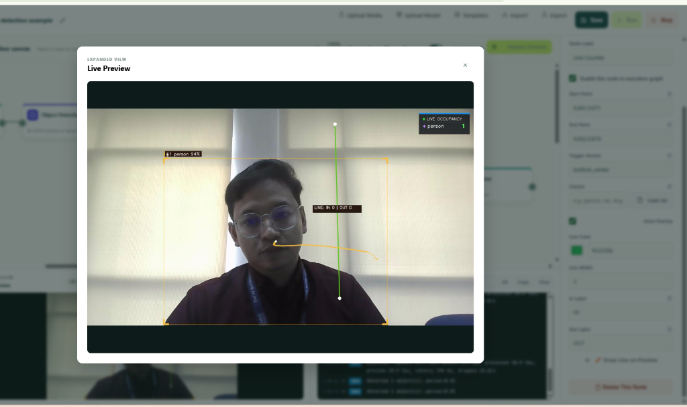
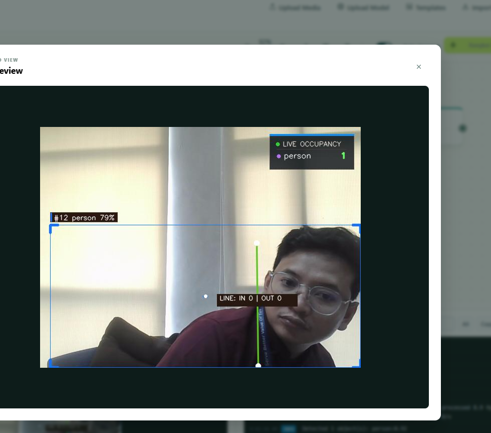
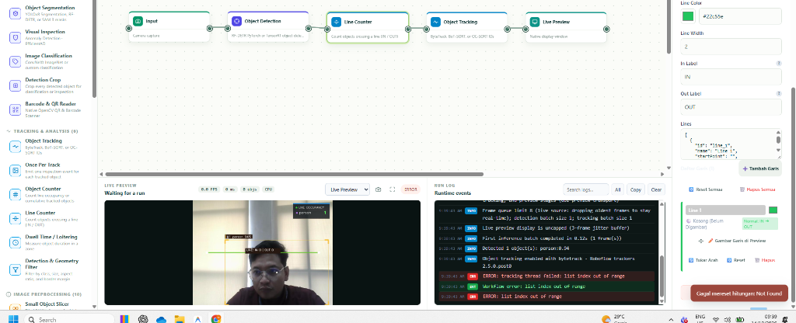

<h1 align="center">AFI Vision Builder 🚀</h1>

<p align="center">
  <b>Platform Visual Node-Graph untuk Rancang Bangun & Deployment Pipeline Computer Vision & AI Real-Time</b>
</p>

<p align="center">
  
  
  
  
  
  
</p>

<p align="center">
  <a href="#-fitur-utama">Fitur Utama</a> •
  <a href="#-tangkapan-layar-showcase">Tangkapan Layar</a> •
  <a href="#-instalasi--menjalankan-1-click">Instalasi Cepat</a> •
  <a href="#-katalog-44-node">Katalog 44 Node</a> •
  <a href="#-arsitektur-sistem">Arsitektur</a> •
  <a href="#-panduan-penggunaan">Panduan</a>
</p>

---

## 📸 Overview Antarmuka



---

## 🌟 Fitur Utama

- 🎨 **Visual Node-Graph Canvas**: Susun pipeline Computer Vision kompleks dengan metode *drag-and-drop* kabel Bézier interaktif tanpa perlu coding manual.
- 🧩 **44 Node Siap Pakai**: Ekosistem node komprehensif mulai dari berbagai sumber kamera, model AI mutakhir, pelacak objek, filter spasial, pemrosesan citra, hingga logika percabangan.
- 🚀 **Zero-Code Multi-Line Counting & Spatial Analytics**: Menghitung objek keluar-masuk (IN/OUT) dengan multi-garis virtual, zona waktu diam (*dwell time*), dan filter area polygon (*ROI*).
- 🧠 **Dukungan Multi-Model AI**: Integrasi instan dengan YOLOv8, YOLOv11 (Deteksi & Segmentasi), RF-DETR, SAM 3, ConvNeXt, EfficientAD Anomaly Detection, ONNX Runtime, dan TFLite.
- ⚡ **Akselerasi Otomatis (CUDA & CPU Fallback)**: Menggunakan akselerasi GPU NVIDIA jika tersedia, dan otomatis beralih (*graceful fallback*) ke CPU jika CUDA tidak terdeteksi.
- 🎛️ **Kontrol Input Interaktif**: Slider visual dengan pembatasan nilai otomatis (*auto-clamp*), input numerik presisi, dan kanvas gambar ROI langsung di atas video live.
- 🇮🇩 **Panduan Interaktif Terintegrasi**: Setiap node dilengkapi tombol informasi (ℹ️) berbahasa Indonesia yang menjelaskan fungsi, cara kerja, parameter, dan contoh skenario industri.
- 📦 **1-Click Portable Launcher**: Disediakan skrip `.bat` otomatis untuk Windows dan `.sh` untuk Linux/macOS untuk instalasi dan eksekusi sekali klik.

---

## 🖼️ Tangkapan Layar (Showcase)

### 1. Dashboard Utama & Real-Time Tracking Inspector
Tampilan visual pipeline yang sedang berjalan aktif, menampilkan visualisasi bounding box, confidence score, tracking ID, occupancy count, serta panel log inspector.


### 2. Multi-Line Bidirectional Counting & Analytics
Konfigurasi penghitungan objek melintasi garis dua arah (IN/OUT) dengan visualisasi jalur gerak (*trajectory*), multi-gate monitoring, dan log statistik real-time.



### 3. Video Pipeline Execution & Preview
Eksekusi alur kerja pemrosesan video dengan rendering visual resolusi tinggi, penyesuaian threshold confidence, dan visualisasi status node.



---

## ⚡ Instalasi & Menjalankan (1-Click)

### 🪟 Pengguna Windows (Disarankan)

AFI Vision Builder menyediakan berkas batch otomatis sehingga Anda tidak perlu mengetik perintah terminal:

#### 1. Persiapan
Pastikan **Python 3.10, 3.11, atau 3.12** telah terpasang di komputer Anda.  
*(PENTING: Centang opsi **"Add Python to PATH"** saat instalasi Python)*.

#### 2. Instalasi Dependensi (Cukup 1x di awal)
Klik dua kali berkas:
```text
install.bat
```
> Skrip ini otomatis membuat virtual environment (`.venv`), memperbarui pip, dan memasang seluruh pustaka (FastAPI, OpenCV, PyTorch, Ultralytics, dll).

#### 3. Menjalankan Aplikasi
Klik dua kali berkas:
```text
run.bat
```
> Server lokal akan langsung aktif dan peramban web default Anda otomatis membuka:  
> 👉 **http://127.0.0.1:8765**

---

### 🐧 Pengguna Linux & macOS

1. Berikan izin eksekusi pada skrip:
   ```bash
   chmod +x install.sh run.sh
   ```

2. Jalankan instalasi dependensi:
   ```bash
   ./install.sh
   ```

3. Jalankan aplikasi:
   ```bash
   ./run.sh
   ```

---

## 🧩 Katalog 44 Node

AFI Vision Builder membagi node ke dalam 7 kategori fungsional:

| Kategori | Node | Deskripsi |
| :--- | :--- | :--- |
| 📹 **Input Sources** | `Web Camera`, `IP Camera (RTSP/HTTP)`, `Daheng Industrial Camera`, `Video File`, `Static Image` | Akuisisi frame dari webcam, streaming CCTV/RTSP, kamera industri GigE/USB3, file video MP4/MKV, atau foto. |
| 🧠 **AI & Vision Models** | `Ultralytics YOLO`, `RF-DETR Object Detection`, `SAM 3 Segmentation`, `ConvNeXt Classifier`, `EfficientAD Anomaly`, `ONNX Model`, `TFLite Model` | Deteksi objek real-time, segmentasi instan, klasifikasi gambar, inspeksi cacat anomali visual, dan eksekusi custom model ONNX/TFLite. |
| 🎯 **Object Tracking** | `ByteTrack`, `BoT-SORT (Motion Compensation)`, `OC-SORT` | Menetapkan ID konsisten pada objek yang bergerak melintasi frame dengan kompensasi getaran kamera. |
| 📊 **Analytics & Spatial** | `Multi-Line Counter (A↔B)`, `Object Counter`, `Dwell Time Zone`, `ROI Filter (Polygon Area)` | Penghitungan kendaraan/orang melintasi garis dua arah, total objek, waktu tunggu/diam di dalam zona, dan isolasi area pantau. |
| 🔀 **Logic & Branching** | `If / Else Branch`, `Compare Value`, `Confidence Threshold`, `Timer Delay`, `Debounce Filter`, `Rate Limiter`, `AND / OR Logic Gate`, `Trigger Once` | Sistem percabangan cerdas berdasarkan kuantitas, skor keyakinan, penjadwalan interval, dan pencegahan double-trigger. |
| 🎨 **Image Processing** | `Resize Frame`, `Crop Region`, `Rotate & Flip`, `Color Convert`, `Brightness & Contrast (CLAHE)`, `Blur & Sharpen`, `Perspective Correction`, `Privacy Blur` | Preprocessing citra, night vision enhancement, filter Gaussian/Median/Bilateral, perataan sudut pandang, serta sensor otomatis wajah dan plat nomor. |
| 📤 **Outputs & Storage** | `Live Canvas Preview`, `Event Alert Popup`, `Image / Crop Exporter`, `SQLite Database Logger`, `HTTP Webhook` | Penampil frame real-time, notifikasi popup, penyimpanan tangkapan gambar kejadian ke disk, pencatatan log ke SQLite, dan integrasi API webhook ke sistem luar. |

---

## 🏗️ Arsitektur Sistem

```text
afivisionbuilder/
├── 📁 engine/                  # Core Runtime Computer Vision & AI
│   ├── core.py                 # Pipeline loop, Frame Manager, Node Graph Execution
│   ├── custom_model_runtime.py # YOLO/PyTorch/CUDA Fallback Manager
│   ├── main.py                 # Algoritma pemrosesan citra, filter, dan tracking
│   └── camera_daheng.py        # Driver SDK kamera Daheng Industrial
├── 📁 static/                  # Frontend Single Page Application
│   ├── index.html              # Struktur UI dan Canvas Editor
│   ├── app.js                  # Engine Graph, Drag & Drop, Wire Routing, Interactive UI
│   ├── style.css               # Tema Dark Mode, Palet Warna, dan Komponen Visual
│   └── logo.png                # Brand Logo AFI Vision Builder
├── 📁 docs/                    # Dokumentasi & Aset Media
│   └── screenshots/            # Tangkapan layar resolusi tinggi untuk showcase
├── 📁 data/                    # Penyimpanan Data Lokal
│   ├── models/                 # Tempat penyimpanan bobot model (.pt, .onnx)
│   ├── projects/               # Penyimpanan file workflow JSON
│   ├── outputs/                # Folder penyimpanan gambar tangkapan event/crop
│   └── uploads/                # Berkas video dan citra uji yang diunggah
├── 📄 server.py                # Backend REST API & WebSocket Streaming (FastAPI)
├── 📄 desktop_app.py           # Peluncur mode aplikasi desktop mandiri
├── 📄 requirements.txt         # Daftar dependensi modul Python
├── ⚙️ install.bat              # Skrip instalasi otomatis untuk Windows
├── ⚙️ run.bat                  # Skrip eksekusi cepat untuk Windows
├── ⚙️ install.sh               # Skrip instalasi untuk Linux / macOS
└── ⚙️ run.sh                  # Skrip eksekusi untuk Linux / macOS
```

---

## 💡 Panduan Singkat Merancang Alur Kerja

1. **Pilih Sumber Input**: Tarik node `Video File` atau `Web Camera` ke kanvas editor.
2. **Tambahkan Model Deteksi**: Hubungkan output gambar dari node input ke input `Ultralytics YOLO` atau `RF-DETR`.
3. **Pasang Pelacak Objek (Tracker)**: Sambungkan output deteksi ke node `ByteTrack` untuk memberikan ID unik pada setiap objek.
4. **Tambahkan Analitik Garis / Zona**: Sambungkan ke `Multi-Line Counter` untuk menghitung orang atau kendaraan yang lewat. Atur koordinat garis langsung pada kanvas.
5. **Percabangan Logika & Aksi**: Tambahkan node `If / Else` atau `Compare Value`. Jika jumlah hitungan lebih dari nilai tertentu, teruskan ke `Event Alert` atau `HTTP Webhook` untuk notifikasi otomatis.
6. **Lihat Hasilnya**: Sambungkan output ke node `Live Preview` dan klik tombol **Run Workflow** (▶️).

---

## 🛠️ Persyaratan Sistem

- **Sistem Operasi**: Windows 10/11 (64-bit), Ubuntu 20.04/22.04 LTS, atau macOS.
- **Prosesor**: Intel Core i5 / AMD Ryzen 5 ke atas.
- **RAM**: Minimal 8 GB (Disarankan 16 GB).
- **GPU (Opsional)**: NVIDIA GeForce GTX 1060 ke atas dengan driver CUDA terpasang (untuk performa inferensi real-time maksimal). Jika tidak ada GPU, aplikasi otomatis menggunakan CPU dengan mulus.

---

## 📄 Lisensi & Kontributor

Dikembangkan oleh **Anas Khadafi** ([@Annaskhadafi](https://github.com/Annaskhadafi)) dan tim untuk kebutuhan inspeksi visual, pemantauan CCTV cerdas, dan automasi industri berbasis AI.

Hak Cipta © 2026 AFI Vision Builder. Seluruh hak cipta dilindungi undang-undang.
