# AFI Vision Builder 🚀

<p align="center">
  <b>Platform Grafis Visual Terpadu untuk Alur Kerja Computer Vision Real-Time, Analitik Multi-Kamera CCTV, dan Dasbor Operasional Industri</b>
</p>

<p align="center">
  
  
  
  
  
  
  
  
</p>

<p align="center">
  <a href="#-fitur-unggulan-terbaru">Fitur Unggulan</a> •
  <a href="#-tur-antarmuka--showcase-visual">Tur Antarmuka</a> •
  <a href="#-instalasi--eksekusi-1-click">Instalasi Cepat</a> •
  <a href="#-katalog-80-node-lengkap">Katalog 89+ Node</a> •
  <a href="#-arsitektur-sistem">Arsitektur</a> •
  <a href="#-pengujian-kualitas-unit--e2e">Pengujian Kualitas</a> •
  <a href="#-lisensi--pengembang">Lisensi</a>
</p>

---

## 🌟 Gambaran Umum Aplikasi

**AFI Vision Builder** memfasilitasi perancangan, pengujian, dan penerapan alur kerja *computer vision* tanpa kode secara visual. Melalui kanvas diagram alir berbasis kabel kurva Bézier yang intuitif, pengguna dapat memadukan umpan kamera industri, inferensi model AI (YOLO26 NMS-Free, RF-DETR, SAM 3, VLM), pelacakan objek, analitik poligon multi-area, hingga dasbor pemantauan operasional multi-kamera CCTV secara terpadu.


---

## ✨ Fitur Unggulan Terbaru

### 🍽️ 1. Restaurant Table Occupancy & Dining Dwell Time Tracker
- **Pemantauan Meja Restoran dan Kafe Real-Time**: Mendeteksi otomatis status keterisian meja (`VACANT` ➔ `CONFIRMING` ➔ `OCCUPIED` ➔ `PENDING_VACANT`).
- **Indikator Durasi Terpusat (Centroid Timer)**: Durasi duduk tamu (`1s`, `4m 12s`) diletakkan tepat di titik tengah meja dengan kartu transparan bersih, sehingga tidak menghalangi tampilan makanan atau aktivitas tamu.
- **Tahan Kedipan dan Perulangan Video**: Mesin status yang andal dengan tenggang waktu toleransi (*grace period*) saat tamu bergerak atau terhalang sejenak.
- **Template Siap Pakai**: Tersedia alur kerja siap pakai untuk 4 meja restoran (VIP, 4 kursi, 2 kursi) di Projects Hub.

### 📐 2. Interactive In-Canvas Multi-Zone & Polygon Editor
- **Menggambar Area Poligon Langsung pada Video**: Membuat area pantau ROI (*Region of Interest*) langsung dari bingkai pratinjau atau kisi kalibrasi.
- **Titik Sudut Interaktif (Draggable Handles)**: Menggeser titik sudut, menambah titik baru di sepanjang garis batas, atau menghapus titik poligon dengan klik visual.
- **Manajemen Multi-Area**: Mengelola banyak area sekaligus (misalnya Meja 1-4, Bay Workshop 1-5, Pintu Gerbang) lengkap dengan kapasitas maksimal dan batas durasi tinggal (*overstay*).

### 🎨 3. No-Code Web Dashboard Builder (Elementor & Google Looker Style)
- **Konsolidasi Dasbor Terpadu (Menggantikan Tab Terpisah Live Camera, Session & Warehouse)**: Seluruh pemantauan CCTV multi-kamera, rekap durasi sesi kerja workshop, dan log pergerakan gudang kini terintegrasi secara modular dalam satu antarmuka dasbor visual tanpa-kode. Navigasi utama atas disederhanakan menjadi **Studio**, **Dashboard (Builder)**, dan **Fleet Hub**.
- **Widget Live CCTV Player Modular**: Menampilkan siaran langsung kamera industri dengan pengalih saluran instan (dropdown selector), pita thumbnail kamera (*scrollable filmstrip*), dan mode patroli otomatis (*auto-patrol*).
- **Kartu Metrik KPI & Durasi Sesi**: Ringkasan total sesi kerja, akumulasi jam kerja aktif, efisiensi rata-rata, dan status operasional real-time langsung terhubung ke telemetri nyata (*DataBus*).
- **Tabel Log Kejadian & Integrasi Logistik**: Rekap kejadian keluar-masuk gerbang, verifikasi status pengiriman ERP (*Delivered*, *Queued*), filter interaktif, dan ekspor data CSV/Excel 1-klik.
- **Desain Bebas Drag-and-Drop**: Pengaturan tata letak visual dengan snap-to-grid, panel inspektur 3 tab (Konten, Gaya, Lanjutan), efek Glassmorphism, kustomisasi tipografi, dan tema modern.

### 🎨 4. Roboflow-Style Overlay / Annotate Inspector
- **Manajemen Layer Anotasi Terpadu**: Kendalikan seluruh tampilan visual di satu node inspector modern.
- **Pilihan Layer Lengkap**: Bounding box (warna & ketebalan kustom), Label dinamis (`{class} {confidence}`), Confidence score, Status badge, Custom text, Heatmap, dan Panah arah gerak (*Direction Arrow*).
- **Layer Reorder & Toggle**: Urutkan tumpukan layer ke atas/bawah, sembunyikan/tampilkan per layer, serta hapus layer dengan cepat.

### 🧠 5. Central Model Registry & Hub
- **Repositori Model Terpusat**: Manajemen seluruh bobot model AI yang terpasang di sistem (`.pt`, `.onnx`, `.engine`, `.tflite`).
- **Tabel Metadata Lengkap**: Menampilkan informasi Engine inferensi, Format, Task, Versi, Ukuran file, dan Status ketersediaan.
- **Upload Modal Drag-and-Drop**: Unggah custom model buatan sendiri langsung dari peramban web.

### 🤖 6. AI Agent & Vision-Language Model (VLM)
- **Penalaran Multimodal Tingkat Lanjut**: Kirim frame tangkapan kamera ke model VLM (OpenAI GPT-4o/5, 9router, atau OpenRouter) untuk analisis visual mendalam, deteksi cacat kompleks, dan inspeksi SOP industri.
- **Keamanan Kredensial**: API Key disanitasi secara otomatis dan dapat dimuat aman dari environment server (`.env`).

### 🎯 7. Multi-Model Consensus & Tracking Stability Enhancements
- **Detections Consensus**: Menggabungkan prediksi dari 2 atau lebih model AI (misal: YOLOv8 + RF-DETR) dengan teknik *IoU Clustering & Agreement Ratio Voting* untuk memangkas *false positive* pada lingkungan industri ekstrem.
- **Track Class Lock**: Mengunci kelas dominan dari suatu track ID setelah diverifikasi beberapa frame, mengeliminasi flicker kelas (*label jittering*).
- **EMA Bounding Box Stabilizer**: Penghalusan posisi koordinat bounding box menggunakan *Exponential Moving Average* untuk visualisasi yang kokoh tanpa jitter.
- **Per-Class Confidence Thresholding**: Ambang batas akurasi per kelas (misal: `person:0.80, helmet:0.40, tire:0.50`) untuk deteksi presisi tinggi.

### 📏 8. Spatial Measurement & Physical Dimension Calibration
- **Real-World Distance Measurement**: Mengukur jarak spasial Euclidean antar pasangan objek (misal: jarak antar pekerja atau kendaraan) dengan kalibrasi *pixel-to-metric* (cm, meter, inch) serta alarm kedekatan (*proximity alert*).
- **Size Measurement**: Menghitung lebar, tinggi, dan luas fisik objek secara presisi dengan toleransi batas minimum/maksimum untuk *quality control* dimensi produk.

### 🔬 9. Classical Computer Vision & Camera Health Monitoring
- **Camera Focus Score**: Penilaian ketajaman fokus lensa kamera industri secara real-time berbasis variansi operator Laplacian (mendukung pemantauan ROI spesifik) dengan alarm otomatis saat lensa buram atau kotor.
- **Auto Rotate Edges**: Deteksi otomatis kemiringan sudut objek dominan menggunakan kontur OpenCV (`minAreaRect`) dan perataan sudut frame/crop otomatis (*deskewing*).

### ⚡ 10. Video Kinematics & Velocity Calculation
- **Real-Time Velocity Calculator**: Menghitung kecepatan fisik objek bergerak ($v = \frac{\Delta s}{\Delta t}$) dalam satuan **km/h**, **m/s**, atau **mph** dari lintasan centroid historis lengkap dengan batas alarm kecepatan berlebih (*overspeed alarm*).
- **Path Deviation Monitoring**: Memantau lintasan pergerakan objek terhadap koridor virtual (garis polyline panduan) dengan ambang toleransi deviasi maksimum (*cross-track error*).

### 🧠 11. Advanced Spatial Logic & Compute Optimization
- **Overlap Analysis**: Pengecekan spasial parent-child (apakah objek anak berada di dalam objek induk, misal: Helm pada bagian atas tubuh pekerja) dengan syarat minimal rasio overlap dan alarm APD/K3.
- **Delta Frame Filter (Compute Throttler)**: Penghematan beban CPU/GPU hingga **70%+** pada pemantauan area statis dengan memblokir pemrosesan saat tidak ada pergerakan signifikan dan fallback heartbeat otomatis.
- **Switch-Case Dynamic Router**: Percabangan alur kerja multi-jalur berdasarkan kelas objek atau atribut untuk arsitektur pipeline kompleks.
- **Dynamic Zone Tracking**: Poligon zona ROI otomatis bergeser mengikuti pergerakan unit anchor (misal: bak truk atau forklift yang berpindah posisi).

### 🔍 12. Dual-Model Evaluation & State Difference Comparator
- **Model Comparison Diff**: Membandingkan hasil inferensi 2 model AI sekaligus dalam mode **Side-by-Side** (2 layar berdampingan) atau **Diff Overlay** (1 layar dengan pewarnaan diferensial: hijau = konsensus/sepakat, cyan = Model A, magenta = Model B) lengkap dengan skor Agreement Ratio.
- **Detections Difference (State Comparator)**: Membandingkan kondisi objek saat ini terhadap snapshot baseline acuan untuk mendeteksi barang yang hilang (*removed/theft*), barang baru ditambahkan (*added/unauthorized*), atau aset tetap (*unchanged*) lengkap dengan alarm selisih otomatis.

### 🎨 13. Motion Trail & Sci-Fi Halo Glow Corner Brackets
- **Motion Trace (Track Tail)**: Menggambar ekor lintasan pergerakan objek selama $N$ frame terakhir dengan efek *fade alpha* gradasi elegan.
- **Corner Brackets & Halo Glow**: Gaya visual kotak pembatas modern ala Roboflow dengan siku sudut presisi dan bayangan berpendar semi-transparan (*halo glow*).

### 📊 14. Operational Rollup & Tabular Data Formatter
- **Data Aggregator (Rolling Window Rollup)**: Akumulasi statistik metrik operasional (*count*, *sum duration*, *avg duration*, *max occupancy*) dalam rentang jendela waktu dinamis (misal: per 15 menit, per jam, atau per shift kerja).
- **CSV Formatter**: Ekspor data tabular kejadian dan pelacakan ke format CSV terstruktur dengan dukungan alias kolom, pilihan delimiter kustom, serta penyimpanan otomatis ke disk lokal.

### ☁️ 15. Cloud Object Sinks, Multi-Channel Alerts & Hardware PTZ
- **S3 Cloud Storage Sink**: Pengunggahan foto bukti kejadian atau crop deteksi langsung ke bucket AWS S3, MinIO, atau Ceph Object Storage dengan kompresi JPEG terkalibrasi dan URL publik aman.
- **Notification Dispatcher**: Penyebaran pesan peringatan dan foto frame kejadian multi-kanal ke Telegram Bot, Slack Incoming Webhooks, WhatsApp Business API, atau REST Webhook dengan jeda *cooldown throttling* anti-spam.
- **PTZ Camera Controller (ONVIF Continuous Move)**: Pengendali motor kamera PTZ fisik jaringan LAN (*Auto-Following*) untuk mengarahkan kamera mengikuti pergerakan target (person, forklift, unit) dengan filter *deadzone* anti-getar.

### 🔤 16. Ultra-Lightweight ONNX Optical Character Recognition (OCR)
- **Model Ultra-Ringan & Cepat (~10 MB Total)**: Mengintegrasikan model ONNX mobile DBNet text detection (`ppocrv3_det.onnx` ~2.4 MB) dan MobileNetV3 CTC text recognition (`ppocrv3_en_rec.onnx` ~7.8 MB) yang berjalan ultra-cepat pada CPU (~5-15ms) tanpa dependensi runtime besar.
- **Dual-Mode Text Extraction**: Mendukung pemindaian teks di seluruh frame (*Full-frame*) atau hanya membaca teks di dalam bounding box objek downstream (misal: kotak nomor plat kendaraan `license_plate`, barcode/resi, atau kemasan).
- **Character Whitelist Filtering**: Penguncian karakter spesifik (misal: hanya angka `0-9` atau huruf kapital & angka) untuk pembacaan plat nomor otomatis (ANPR), kode serial suku cadang, dan nomor peti kemas tanpa noise.

### ⚡ 17. n8n-Style Node Activation (1-Click Toggle Switch) & Live Execution Logs
- **1-Click Toggle Switch di Kanvas**: Aktifkan atau nonaktifkan (bypass) node secara instan melalui sakelar toggle visual di header setiap kartu node kanvas maupun di panel Inspector, tanpa perlu menghapus node atau mencabut kabel edge.
- **Bypass / Pass-Through Mode (Wire)**: Node yang dinonaktifkan (`enabled: false`) otomatis berubah gaya visual (translucent semi-transparan dengan garis putus-putus dan badge `[BYPASSED]`), namun **tetap meneruskan data aliran frame/deteksi** ke node downstream sehingga pipeline alur kerja tidak terputus.
- **Tab Inspector "Data & Logs"**: Tab inspeksi khusus ala n8n yang menampilkan:
  - **Telemetry HUD Real-Time**: Status eksekusi (`ACTIVE` / `BYPASSED` / `ERROR`), latensi pemrosesan per-frame dalam milidetik (`ms`), jumlah item/objek terdeteksi, dan waktu eksekusi terakhir.
  - **Input Payload / Metadata Viewer**: Payload JSON input lengkap yang masuk ke node secara collapsible.
  - **Output Payload / Telemetry Viewer**: Payload JSON output hasil eksekusi node (misal: bounding box deteksi, atribut kalkulasi, label teks) siap inspeksi.
  - **Tombol Salin & Refresh 1-Klik**: Tombol `📋 Copy Full JSON Payload` untuk menyalin struktur data lengkap ke clipboard pengembang dan tombol `🔄 Refresh`.
- **Live Node Status Bar Footer**: Setiap kartu node di kanvas dilengkapi footer status bar real-time yang menampilkan indikator status hidup (`● ACTIVE 12.4ms`, `● BYPASSED`, atau `● ERROR`) tanpa membebani performa browser.

### 🎥 18. Live YouTube CCTV & Video Stream Input (`yt-dlp`)
- **Streaming YouTube Langsung di Node Input**: Masukkan URL YouTube (video rekaman CCTV, live camera, maupun YouTube Shorts) langsung ke node `Input` via mesin integrasi `yt-dlp`.
- **Pemilihan Resolusi Stream Dinamis**: Pilihan resolusi yang fleksibel (`Auto`, `360p`, `480p`, `720p`, `1080p`) untuk menyesuaikan dengan bandwidth jaringan dan kemampuan CPU/GPU.
- **Auto-Reconnect & Auto-Loop**: Otomatis menyambung kembali jika koneksi internet terputus dan mengulang video dari awal jika rekaman telah selesai.

### 🏭 19. 5 Template Produksi Nyata Industri (Production-Ready Templates)
- **1-Click Siap Pakai di Projects Hub**: Tersedia 5 template alur kerja lengkap dengan video stream nyata dan penjelasan praktis *"🎯 Fungsi & Kegunaan"*:
  1. **Smart Traffic Flow & Vehicle Counter**: Deteksi mobil, motor, bus, truk; pemisahan lajur arah (Utara/Selatan), HUD volume, dan logging database.
  2. **Restaurant Table Occupancy & Dining Dwell Tracker**: Pemantauan meja F&B, timer keterisian meja terpusat, dan alert overstay.
  3. **Assembly Line & Workshop Cycle Timer**: Pengukuran durasi siklus kerja per operator di workstation dan deteksi waktu idle.
  4. **Warehouse Dock & Forklift Safety Guard**: Verifikasi keluar-masuk gerbang gudang dan batas zona aman pejalan kaki vs forklift.
  5. **Retail Checkout Queue & Hotspot Analyzer**: Analisis antrean kasir supermarket dan alert otomatis panggil kasir cadangan saat antrean > 3 orang.

### 📁 22. Topbar Project Switcher & Modern SaaS Projects Hub
- **Project Switcher Dropdown di Topbar**: Berpindah antar proyek alur kerja seketika via dropdown `[📁 Project ▾]` dengan filter pencarian live nama proyek dan badge aktif `AKTIF`.
- **Halaman Awal Hub Modern (Bento Style)**: Hero banner SaaS v1.0.5, Quick Stats Strip (Total Proyek, Template Industri, Kamera Online, Visual AI Nodes), grid proyek tersimpan dengan menu aksi titik 3 (Buka, Ganti Nama, Hapus), dan tombol `Buka Workflow →`.
- **Category Filter Pills**: Filter cepat kategori solusi industri (*Manufaktur & QC*, *Retail & Restoran*, *Gudang & Logistik*, *Keamanan & Akses*, *AI Vision*, *Trafik & Smart City*).

### 🌐 23. YOLO-World Open-Vocabulary Zero-Shot Detector (CLIP Text Prompting)
- **Deteksi Objek Berbasis Teks Natural Language**: Deteksi objek apa pun tanpa perlu melatih model baru (*zero training*) atau mengunggah checkpoint kustom lokal.
- **Fleksibilitas Luar Biasa**: Cukup ketik daftar label yang diinginkan (misal: `"forklift, safety vest, pallet, helmet"`), inferensi didukung oleh model resmi `yolov8s-worldv2.pt` dan CLIP text embeddings.
- **Kecepatan Tinggi & Efisien**: Model didownload otomatis pada pemakaian pertama dan di-cache secara permanen di direktori weights lokal.

### ☁️ 24. Roboflow Universe Hosted Inference API Integration
- **Akses 50.000+ Model Computer Vision**: Jalankan model AI publik maupun private dari Roboflow Universe langsung ke pipeline deteksi & segmentasi.
- **Tanpa Unduh File Bobot Besar**: Cukup masukkan Model ID (format: `project/version` seperti `warehouse-safety/3`) dan Roboflow API Key.
- **Preflight & Inspection Aman**: Endpoint `/api/models/inspect` otomatis mengenali cloud model ID tanpa melempar error 404.
- **Form Inspector Khusus**: Field label dinamis *"Roboflow Universe Model ID"* dengan pembersihan tombol upload fisik lokal yang tidak relevan.

### 📐 25. Penyelarasan Presisi Kabel Kanvas (Wire & Port Center Alignment)
- **Kabel Menempel Sempurna**: Titik awal dan akhir kurva Bézier kabel koneksi node dihitung secara akurat menempel di tengah lingkaran port input dan output node kanvas pada semua tingkat zoom dan panning.
- **Subtle Instant Delete Button**: Tombol hapus kabel interaktif yang bersih dan hanya muncul saat kursor didekatkan ke garis kabel.

### ⚡ 26. Model Quantizer & Optimizer (TFLite INT8/FP16 & ONNX Dynamic INT8)
- **Kompresi & Akselerasi Model Otomatis**: Kuantisasi model AI langsung dari Central Model Registry Hub untuk memangkas ukuran model hingga **75%** dan mempercepat inferensi pada perangkat CPU, Edge, Raspberry Pi, dan NPU.
- **Format Presisi Fleksibel**:
  - **TFLite INT8**: Kuantisasi bobot dan aktivasi ke integer 8-bit dengan kalibrasi representatif sintetis otomatis tanpa perlu mengunggah dataset manual.
  - **TFLite FP16**: Kuantisasi half-precision 16-bit untuk penghematan ukuran 50% dengan retensi akurasi deteksi mendekati 100%.
  - **ONNX Dynamic INT8**: Kuantisasi dinamis integer 8-bit untuk eksekusi ultra-cepat di x86/ARM CPU via ONNX Runtime.
- **Alur Kerja Terpadu 1-Klik**: Hasil kuantisasi langsung menampilkan ringkasan metrik kompresi (ukuran awal vs akhir, rasio penghematan), tombol `[🎯 Terapkan ke Node Aktif]` untuk langsung dipasang ke node deteksi aktif, dan tombol `[💾 Unduh File]` untuk mengunduh bobot terkuantisasi.
- **Runtime Universal Terkalibrasi**: Custom model inference engine secara otomatis mengenali kuantisasi INT8, mengaplikasikan *scale & zero-point normalization*, serta mengekstrak tensor deteksi YOLO 2D/3D secara adaptif.

### 👤 27. UniFace Face Detection, 5-Point Landmarks & Face Re-ID Tracking
- **Deteksi Wajah Presisi Tinggi**: Mengintegrasikan model RetinaFace ONNX via UniFace untuk mendeteksi wajah dan melokalisasi 5 titik facial landmark (mata, hidung, ujung bibir) secara real-time.
- **Ekstraksi Fitur ArcFace 512-D**: Menghitung vektor representasi wajah *L2-normalized cosine embedding* berdimensi 512 untuk pengenalan identitas akurat (*Face Re-ID*).
- **Pencocokan Identitas Otomatis**: Menampilkan badge nama profil terdaftar (`👤 Budi Santoso (94%)`) jika wajah cocok dengan database, atau melacak orang asing secara dinamis (`👤 Tamu #1`) tanpa *ID hopping*.
- **Pemancaran Event Terstruktur**: Mengirimkan event `face_identified` lengkap dengan metadata nama, role, kemiripan (similarity score), dan timestamp ke alert, webhook, maupun sistem absensi/keamanan.

### 👥 28. Database Wajah Terdaftar (Known Faces Gallery)
- **Halaman Manajemen Profil Wajah**: Tersedia langsung dari panel Left Rail navigasi (`👤 Wajah`) untuk melihat galeri identitas yang terdaftar di sistem.
- **Pendaftaran 1-Klik (Drag-and-Drop / Upload)**: Unggah foto wajah profil, sistem otomatis mendeteksi wajah, meng-crop avatar thumbnail, dan mengekstrak embedding ArcFace ke database lokal.
- **Live Search & Filter**: Pencarian instan berdasarkan nama lengkap, jabatan/role, atau departemen dengan badge statistik jumlah wajah terdaftar.
- **Koneksi Cepat dari Inspector**: Di dalam inspector node `Face Re-ID Tracker`, tersedia tombol pintasan khusus `[ 👥 Kelola Database Wajah Terdaftar → ]` yang langsung membuka galeri wajah dengan satu klik.

### ⏱️ 29. Object Timer (Durasi Kehadiran Objek & Peringatan Ambang Batas Waktu)
- **Timer Durasi Kehadiran Real-Time**: Menghitung lama waktu setiap objek berada di frame kamera secara visual (format `mm:ss`, desimal `s`, atau `hh:mm:ss`).
- **Posisi Badge Fleksibel**: Menempatkan indikator timer di atas kotak deteksi (`top`), di bawah kotak (`bottom`), atau di dalam kotak (`inside`) dengan styling semi-transparan yang bersih.
- **Peringatan Ambang Batas Overstay**: Memicu alarm dan event peringatan jika objek berada lebih lama dari batas waktu yang ditentukan (`alertThresholdSeconds`).
- **Filter Target Kelas Objek**: Opsi penyaringan kelas tertentu (misal: hanya hitung timer untuk `person` atau `truck`), mencegah frame kamera terdistorsi oleh rendering ganda.

### 📐 30. In-Canvas Multi-Polygon Popup & Isolated Class Filters
- **Popup Floating Toolbar Bebas Halangan**: Pengaturan dan daftar poligon multi-zona dapat disembunyikan (*hide / minimize*) atau digeser keluar frame video live sehingga pandangan operator terhadap preview kamera tetap maksimal dan tidak terhalang.
- **Filter Kelas Objek Terisolasi**: Memastikan preview deteksi yang ditampilkan di kanvas hanya memunculkan kelas objek yang telah dipilih di filter, mengeliminasi bocoran visual kelas yang tidak diinginkan.

### 🤖 31. AI Studio Copilot & Multi-Turn Iterative Revision
- **Drawer Mengambang Terintegrasi**: Copilot cerdas di sisi kanan kanvas studio yang kompatibel dengan protokol OpenAI (9router, OpenAI, OpenRouter, Ollama, dan vLLM).
- **Prompt-to-Pipeline Otomatis**: Buat alur kerja lengkap (Input, Detector, Filter, Tracker, Zone Timer, Visual Annotate) hanya dari instruksi teks natural language.
- **Multi-Turn Context Awareness**: AI mengingat percakapan sebelumnya sehingga pengguna dapat merevisi konfigurasi secara bertahap (contoh: *"Ganti kelasnya jadi mobil dan bus saja, dan ubah confidence detector ke 0.8"*).
- **In-Place Node Parameter Updates & Diff**: Perubahan parameter (kelas, threshold, filter, mode) ditandai dengan badge *REVISI SIAP* dan ringkasan diff sebelum diterapkan ke kanvas tanpa merusak node yang ada.

### 🐍 32. Enhanced Python Script Inspector with 1-Frame Sandbox Preview
- **AI Prompt-to-Code**: Buat fungsi OpenCV kustom `def process(frame, state):` dari prompt bahasa alami dengan generator terintegrasi.
- **Monospace Code Editor**: Editor kode bawaan dengan dukungan indentasi tombol <kbd>Tab</kbd>, syntax validator AST Python real-time, dan status badge validasi.
- **6 Preset Siap Pakai**: Pilihan preset industri instan (Watermark & Timestamp, Color Threshold Masking, Edge Detection Overlay, Draw Crosshair Grid, Speedometer HUD, Dynamic ROI Masking).
- **Uji 1-Frame Sandbox**: Eksekusi uji kode pada 1 frame visual sintetis dalam lingkungan terisolasi lengkap dengan perbandingan gambar *Before vs After*, metrik latensi eksekusi (ms), dan tangkapan *standard output logs*.

### 🏭 33. 5 Node Khusus Industri Dunia Nyata (Real-World Safety & Industrial Nodes)
Dirancang khusus untuk menjawab kebutuhan operasional nyata di lantai pabrik, bengkel perawatan armada berat, dan pergudangan logistik:
- **`dominant_color` (Dominant Color Inspector)**: Inspeksi kepatuhan warna APD (rompi keselamatan high-vis green/orange, pembedaan warna helm kerja sesuai jabatan supervisor/operator/safety officer) dan inspeksi palet warna produk industri menggunakan ruang warna HSV adaptif.
- **`class_replacement` (Hierarchical Relabeler)**: Menghubungkan detektor umum (YOLO mendeteksi `vehicle` atau `tool`) dengan model klasifikasi spesifik tingkat dua (`forklift_toyota_5t` atau `impact_wrench`) tanpa merusak `track_id` dan riwayat koordinat spasial.
- **`man_down_detector` (Man Down & Fall Detector)**: Pemantau keselamatan K3 darurat 3 tahap (geometri rasio aspek horizontal, deteksi drop vertikal mendadak, dan buffer ketidaksadaran/stillness > 4 detik tak bergerak) untuk peringatan dini kecelakaan kerja fatal.
- **`lpr_license_plate` (License Plate Reader / ANPR)**: Ekstraksi plat nomor kendaraan dengan ekualisasi kontras CLAHE, normalisasi regex standar plat nomor Indonesia (RI), koreksi karakter ambigu (0 vs O, 1 vs I), majority voting lintas 5 frame, dan evaluasi gerbang Whitelist/Blacklist.
- **`overstack_detector` (Overstack Clearance Detector)**: Memantau batas ketinggian aman tumpukan pallet, kardus, atau ban di gudang logistik terhadap garis batas virtual langit-langit (*clearance ceiling*) dengan kalibrasi meter fisik dan filter persistensi pergerakan forklift.

### 🔍 34. Interactive Object Zoom & Picture-in-Picture (PiP)
- **Klik-ke-Zoom Interaktif**: Klik langsung objek apa saja pada video live preview untuk mengunci target pelacakan dan menampilkan jendela Picture-in-Picture (PiP) beresolusi tinggi di sudut layar.
- **Mode Ukuran Dinamis (`pipSizeMode: "dynamic"`)**: Ukuran dan rasio aspek jendela PiP otomatis beradaptasi mengikuti ukuran bounding box dan proporsi objek secara real-time tanpa distorsi visual.
- **Sistem Perlindungan Area Wajah (*Smart Headroom Padding* +48% s/d +65%)**: Dirancang khusus untuk rekaman CCTV malam atau kondisi temaram saat detektor AI mendeteksi tubuh mulai dari kerah kemeja ke bawah. Margin kepala ekstra memastikan seluruh dahi, mata, rambut, dan topi tetap tampil utuh 100%.
- **Top-Anchoring Fit 1.0x (Penuh)**: Default tampilan penuh 1.0x dengan penguncian jangkar atas (`zy = 0`) sehingga saat diperbesar (1.2x, 1.5x, 2.0x), area kepala tetap menjadi fokus utama pandangan operator.
- **Pilihan Rasio Aspek Lengkap**: Mode Auto (sesuai bentuk objek), Portrait 3:4 (standar orang berdiri), Portrait 9:16 (tinggi full-body), Persegi 1:1, Landscape 4:3, dan Landscape 16:9.
- **Floating Inspector Card Interaktif**: Kartu mengambang di atas preview dengan tombol 1-klik untuk ganti Ukuran (`[🎯 Dinamis]` / `[S]` / `[M]` / `[L]` / `[XL]`), Zoom (`[🔍 1.0x (Penuh)]` / `[1.2x]` / `[1.5x]` / `[2.0x]`), Rasio Aspek (`[✨ Auto]` / `[📱 3:4]` / `[📱 9:16]` / `[⏹️ 1:1]` / `[🖥️ 4:3]`), Ruang Kepala (`[+25%]` / `[🛡️ +48% Aman]` / `[👑 +65% Lega]`), unduh snapshot resolusi penuh, dan pelepasan kuncian target (*Target Unlock*).

### 🏷️ 35. Minimalist Multi-Select Class Dropdown & Pemetaan Ulang Nama Kelas (Class Remap)
- **Dropdown Multi-Select Minimalis**: Pemilih kelas deteksi yang ramping, modern, dan hemat ruang tanpa kotak kartu atau thumbnail besar yang memakan tempat.
- **Pencarian Live & Aksi Batch Cepat**: Filter pencarian instan dengan tombol cepat *Pilih Semua* dan *Kosongkan*, serta badge hitung jumlah kelas yang aktif.
- **Pemetaan Ulang Nama Kelas (Class Remap)**: Ubah nama kelas bawaan model AI ke bahasa lokal (contoh: `person` ➔ `orang`, `car` ➔ `mobil`, `truck` ➔ `truk`, `motorcycle` ➔ `motor`) secara langsung di inspector alur kerja tanpa merusak metadata detektor upstream.

### 🏃 36. Human Pose Estimator & Anatomical Multi-Color Skeleton Visualizer
- **Estimasi Pose Manusia Real-Time (YOLOv8 Pose)**: Node AI Vision mandiri Human Pose Estimator (pose_detector) yang mendeteksi 17 titik sendi tubuh manusia (*COCO keypoints*: hidung, mata, telinga, bahu, siku, pergelangan tangan, pinggul, lutut, dan pergelangan kaki).
- **Kerangka Skeleton Multi-Warna Anatomis**: Menggambar 16 garis tulang penghubung sendi dengan kode warna anatomis spesifik per kelompok anggota badan (Kepala/Wajah = Kuning, Badan/Torso = Hijau, Lengan Kiri = Cyan, Lengan Kanan = Magenta, Kaki Kiri = Oranye, Kaki Kanan = Merah Koral).
- **Titik Sendi Glowing & White Core**: Visualisasi titik sendi estetik dengan lingkaran bercahaya transparan (*outer glow circle*) dan titik tengah putih (*solid white core*), tebal garis dan ukuran radius titik dapat diatur langsung di inspector.
- **Engine Analisis Postur Tubuh Otomatis**: Klasifikasi geometris postur tubuh manusia secara otomatis tanpa beban komputasi tambahan:
  - STANDING (Berdiri Tegak): Rasio tinggi terhadap lebar > 1.35 dan sudut lutut-pinggul vertikal.
  - SITTING (Duduk): Bending pinggul dan lutut mendekati 90 derajat atau proporsi badan seimbang.
  - BENDING (Membungkuk): Sudut torso miring signifikan terhadap garis vertikal.
  - LYING_DOWN / FALLEN (Terlentang / Jatuh): Rasio aspek horizontal lebar dengan sudut torso mendatar (dapat digabung dengan sistem alarm K3).
- **Badge Postur & Data Downstream Kaya**: Opsi menampilkan badge postur tubuh di atas kepala subjek (STANDING (92%)) dan meneruskan array keypoints `[x, y, conf]` serta kamus nama sendi (`nose`, `left_shoulder`, dll.) ke node downstream.

### ⚡ 37. Ultralytics YOLO26 NMS-Free End-to-End Engine
- **Inferensi Bebas NMS di CPU**: Memanfaatkan arsitektur dual-head `one2one` bawaan YOLO26 resmi untuk mengeliminasi beban loop *Non-Maximum Suppression* (IoU clustering) pada CPU.
- **Ukuran Model Super Ringkas**: Bobot `yolo26n.pt` hanya berukuran 5.3 MB dengan performa deteksi dan akurasi setara atau melampaui generasi sebelumnya.
- **1-Klik Switch di Inspector**: Tombol pintas sekali klik untuk berpindah langsung antara model standar YOLOv8n dan model hemat daya YOLO26n tanpa perlu mengetik ulang konfigurasi alur kerja.

### 🎨 38. No-Code Web Dashboard Builder (Elementor Pro & Google Looker Style)
- **Kanvas Desain Visual Bebas & Grid Snap**: Drag-and-drop widget secara presisi dengan sistem snap-to-grid, perataan otomatis, penarik ukuran 8 titik jangkar, alignment toolbar (kiri, tengah, kanan, atas, bawah, sebar horizontal/vertikal), dan preset ukuran kanvas (1080p Full HD, 720p HD, 2K, 4K, 9:16 Portrait, Custom WxH).
- **Elementor Pro 3-Tab Inspector**:
  - `[📄 Konten]`: Konfigurasi data, judul, metrik KPI, pemilihan kamera/alur kerja CCTV, link URL, dan alignment teks instan.
  - `[🎨 Gaya]`: Kontrol warna latar (background picker + hex), warna teks utama, border kustom, radius sudut, efek Frosted Glassmorphism (`backdrop-filter: blur(14px)`), dan preset bayangan elevasi modern.
  - `[⚙️ Lanjutan]`: Pengaturan padding, margin, urutan tumpukan z-index, opasitas slider, custom styling, dan proteksi kunci widget (*Lock Component*).
- **Floating Navigator / Layers Tree Panel**: Panel pohon lapisan komponen yang dapat dibuka/tutup untuk mengatur urutan tumpukan (Bring to Front, Send to Back), menyembunyikan/menampilkan komponen (👁️/🕶️), serta mengunci widget langsung dari daftar tree (🔒/🔓).
- **Menu Kontekstual Klik Kanan (Context Menu)**: Akses cepat pada kanvas untuk menduplikasi widget (Ctrl+D), mengatur urutan lapisan, memusatkan widget di tengah kanvas, atau menghapus widget.
- **Penyaringan Silang Antar-Widget (Google Looker Cross-Filtering)**: Mengklik kartu CCTV pada mode pemantauan otomatis memusatkan sorotan kamera dan menyaring data tabel log kejadian khusus kamera tersebut secara real-time tanpa memuat ulang halaman.
- **Tema Terpadu & Redesain Light Mode**: Tampilan tema terang profesional berbasis Slate/Zinc bergradasi lembut, menghilangkan kontras tabrakan dan teks samar pada seluruh drawer, toolbar, dan kartu metrik.

### 🤖 39. Dashboard AI Copilot & Real-Time Telemetry Generator
- **Generasi Dasbor Otomatis dari Prompt Natural**: Pengguna cukup mengetikkan instruksi kebutuhan bisnis (misal: *"Buatkan dashboard monitoring CCTV gudang dengan live player, scorecard KPI forklift, dan grafik efisiensi shift"*), AI Copilot langsung merancang tata letak lengkap.
- **Koneksi Telemetri Nyata (Zero Dummy Data)**: Terintegrasi langsung dengan `DashboardDataBus` dan `WorkflowEngine`. Widget yang dibuat AI otomatis terikat ke kamera CCTV riil yang aktif dan metrik data bus hidup di sistem, bukan sekadar angka tiruan/palsu.
- **Widget Eksklusif `dashboard_navbar`**: Menghasilkan bilah navigasi header terpadu dengan jam digital presisi tinggi (live digital clock ber-font monospaced), badge status shift kerja operasional, dan lampu indikator sistem berdenyut.
- **Dukungan Multi-Engine LLM**: Terintegrasi fleksibel dengan endpoint gateway terpusat (9router / OpenAI GPT-4o & GPT-5 / OpenRouter / Ollama lokal) dengan sistem penanganan error dan fallback mandiri.

### 🖼️ 40. Multimodal Vision-to-Dashboard Replicator (Upload Desain JPEG/PNG)
- **Ekstraksi Tata Letak dari Gambar & Sketsa**: Unggah gambar referensi dasbor, tangkapan layar UI, atau sketsa tata letak format JPEG, PNG, maupun WebP via drag-and-drop.
- **Analisis Multimodal VLM & Ekstraksi Warna OpenCV**: Mengirimkan representasi Base64 ke Vision-Language Model untuk memetakan struktur grid, posisi header, player video, kartu scorecard, grafik garis, dan tabel log, dikombinasikan dengan deteksi luminansi background (dark/light) via OpenCV.
- **Replikasi Instan ke Kanvas Interaktif**: Otomatis mengubah gambar statis menjadi widget interaktif di kanvas yang langsung dapat diedit dan dipindahkan.
- **Resilient Offline Fallback**: Dilengkapi mesin estimasi heuristik visual offline sehingga pengguna tetap memperoleh rancangan dasbor proporsional sekalipun koneksi cloud AI sedang tidak tersedia.

### 📹 41. Interactive CCTV Camera Switcher, Scrollable Filmstrip & Auto-Patrol
- **Dropdown Selector di Header CCTV Player**: Menu dropdown interaktif langsung di header kartu CCTV Player untuk berganti saluran kamera atau alur kerja aktif (Ezviz, Tapo, RTSP, Webcam, YouTube, File) tanpa perlu kembali ke kanvas editor.
- **Scrollable Camera Strip (Filmstrip Horizontal)**: Panel gulir thumbnail kamera horizontal di bawah layar video utama untuk navigasi visual cepat ala software VMS profesional.
- **Mode Auto-Patrol (Patroli Kamera Otomatis)**: Siklus pergantian kamera otomatis setiap N detik (default 10 detik) dengan tombol radar berdenyut (`.btn-cctv-patrol`) dan overlay informasi nama kamera aktif di pojok video.

### 🔤 42. Multi-Font Typography & Logo Branding Suite with Standalone Docker Export
- **Koleksi 8 Google Fonts Modern**: Pilihan tipografi profesional (Inter, Plus Jakarta Sans, Outfit, Poppins, Roboto, JetBrains Mono, Syne, Arial) yang dapat diterapkan secara global di pengaturan kanvas atau individual per-widget di Tab Gaya.
- **Upload Logo Perusahaan Langsung**: Widget `image_logo` mendukung unggah berkas citra brand (PNG, JPG, SVG, WebP) dengan thumbnail pratinjau instan dan penyimpanan persisten di server.
- **Ekspor Kode Mandiri Docker (Standalone 1-Click ZIP)**: Mengemas seluruh dasbor, alur kerja aktif, engine Python, template web, aset logo terunggah, `Dockerfile`, `docker-compose.yml`, serta skrip peluncur `run.bat`/`run.sh` ke dalam arsip ZIP mandiri tanpa ketergantungan eksternal, siap pakai untuk deployment server Dokploy maupun Portainer.

### 📹 43. Incident Video Recorder (Pre-Buffer RAM Clip)
- **Perekaman Klip Insiden Cerdas (Pre & Post Buffer)**: Menjaga circular ring buffer di memori RAM (misal: 5-10 detik terakhir frame) secara kontinu tanpa beban I/O disk.
- **Pemicu Otomatis Multi-Kondisi**: Mulai merekam otomatis saat mendeteksi pelanggaran K3, tabrakan, intrusi, atau objek tertentu (`on_detection`, `on_violation`, atau sinyal logic).
- **Asynchronous MP4 Rendering**: Encoding video berjalan di background thread terpisah tanpa mengurangi FPS inferensi kamera real-time, lengkap dengan file metadata JSON pendamping.

### 📡 44. Industrial MQTT IoT & SCADA Gateway Publisher
- **Integrasi Langsung ke Perangkat Fisik Pabrik**: Menghubungkan kejadian analitik AI ke PLC fisik (Siemens, Schneider), lampu sirine alarm K3, palang pintu gerbang otomatis, atau broker MQTT (Mosquitto, EMQX, HiveMQ, Node-RED, Home Assistant).
- **Klien Persisten Thread-Safe**: Mendukung QoS 0/1/2, retain flag, otentikasi username/password, dan format payload JSON maupun template string kustom.
- **Resilient Fallback**: Dilengkapi mekanisme penanganan error mandiri dan mock publisher jika dependensi paho-mqtt belum tersedia.

### 🌡️ 45. Crowd Density & Mobility Heatmap Generator (2D Gaussian Splatting)
- **Akumulasi Spasial Jejak Mobilitas**: Membangkitkan peta panas densitas 2D berbasis sebaran Gaussian untuk menganalisis jalur lalu lintas pejalan kaki (customer journey ritel) atau titik kemacetan forklift di gudang.
- **Decay Factor & Colormap OpenCV**: Dilengkapi faktor peluruhan temporal per frame/detik dan opsi palet warna profesional (Jet, Inferno, Viridis, Turbo) dengan slider opasitas blend transparan.
- **Filter Ambang Densitas**: Meniadakan pewarnaan pada area kosong/sepi sehingga video tetap jernih dan fokus pada titik kerumunan.

### 🦺 46. Safety PPE Compliance Matrix (Hardhat, Vest, Boots Composite K3)
- **Evaluasi Komposit K3 Terpadu per Pekerja**: Memeriksa kelengkapan APD wajib (Helm, Rompi Reflektif, Sepatu Safety, Sarung Tangan) pada setiap tubuh pekerja (`person`) dengan analisis asosiasi spasial sub-zona anatomi (kepala, torso, kaki).
- **Skor Kepatuhan Dinamis (0 - 100%)**: Menghasilkan klasifikasi status instan (`COMPLIANT`, `PARTIAL`, `VIOLATION`) dan daftar komponen yang belum dipakai (`missingPPE`).
- **Visual Pill Badges & Alarm Cooldown**: Menampilkan badge kepatuhan visual di atas kepala pekerja (hijau untuk lolos, merah untuk pelanggaran) dan pemicu alarm terukur dengan batas cooldown anti-spam.

---

## 📸 Tur Antarmuka & Showcase Visual

### 1. Projects & Templates Hub
Halaman awal untuk mengelola seluruh proyek alur kerja, membuka proyek terkini, mengimpor alur kerja JSON, dan memilih template siap pakai industri (Restaurant Dwell Tracker, Bottle Inspection, dll).


---

### 2. Workflow Studio Canvas
Kanvas node-graph interaktif dengan kabel Bézier halus, auto-connect cerdas, zoom & pan mulus, panel library 50+ node, status runtime Python, dan inspector parameter berlabel Bahasa Indonesia.


---

### 3. Live Execution: Restaurant Table Occupancy & Dining Dwell Tracker
Pipeline video CCTV Kafe berjalan secara live pada CPU/GPU, menampilkan deteksi YOLOv8 + ByteTrack dengan timer durasi duduk tamu (`1s`, `4m 12s`) di tengah meja secara elegan tanpa menutupi makanan.


---

### 4. Interactive Multi-Zone Polygon Editor
Editor poligon interaktif di atas frame video live: operator dapat memilih area meja/bay, menggeser titik sudut (*vertex handles*), menambah area baru, dan menyetel kapasitas maksimal.


---

### 5. Roboflow-Style Overlay / Annotate Inspector
Panel inspector modern bergaya Roboflow untuk menambahkan layer anotasi (kotak pembatas, label kelas, heatmap, skor akurasi) dengan pengaturan warna, posisi, dan ketebalan interaktif.


---

### 6. No-Code Web Dashboard Builder (Elementor & Looker Style)
Pengganti terpadu untuk monitoring multi-kamera CCTV, rekap sesi durasi kerja, dan log pergerakan gudang dalam satu kanvas no-code interaktif dengan widget CCTV Player, KPI stat cards, charts, dan event tables yang dapat dikonfigurasi bebas.
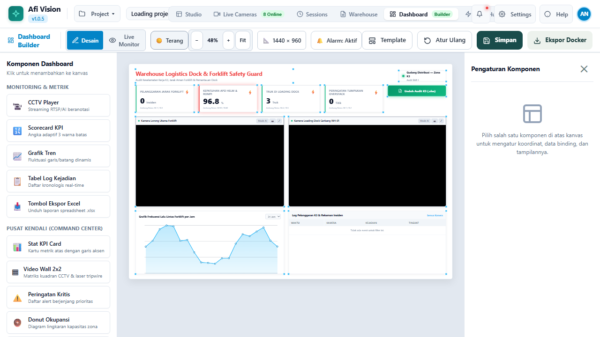

---

### 7. Modern Camera Settings & Workflow Auto-Binding
Dialog konfigurasi kamera CCTV kontras tinggi dengan fitur *Auto-generate Workflow* dari template industri dan tombol shortcut langsung [📐 Gambar Poligon Area].


---

### 8. Central Model Registry Manager
Panel manajemen model AI terpusat dengan tabel metadata terstruktur (YOLOv8, YOLOv11, ONNX, TensorRT, RF-DETR), status aktif, serta modal upload model baru.


---

### 9. Model Quantizer & Optimizer Tool (TFLite & ONNX)
Alat visual terintegrasi di Model Registry untuk mengompresi model AI ke presisi INT8 / FP16 dengan kalibrasi sintetis otomatis, menampilkan rasio kompresi, unduh file, dan tombol 1-klik terapkan ke node aktif.


---

### 10. Database Wajah Terdaftar (Face Gallery) & UniFace Integration
Halaman manajemen identitas profil wajah terpadu di Left Rail navigasi untuk melihat daftar wajah terdaftar, status ArcFace embedding, live search pencarian nama/role, dan penghapusan profil.
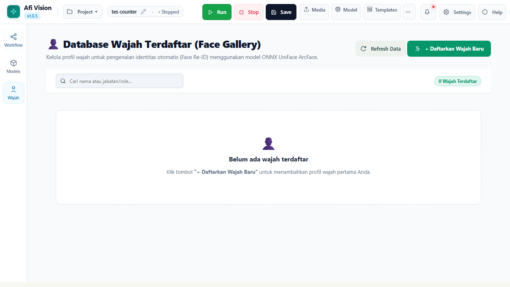

---

### 13. Modal Pendaftaran Profil Wajah Baru (ArcFace 512-D)
Dialog pendaftaran profil baru dengan area drag-and-drop unggah foto wajah, ekstraksi otomatis embedding 512-D L2 cosine ArcFace, serta pembuatan thumbnail avatar otomatis.
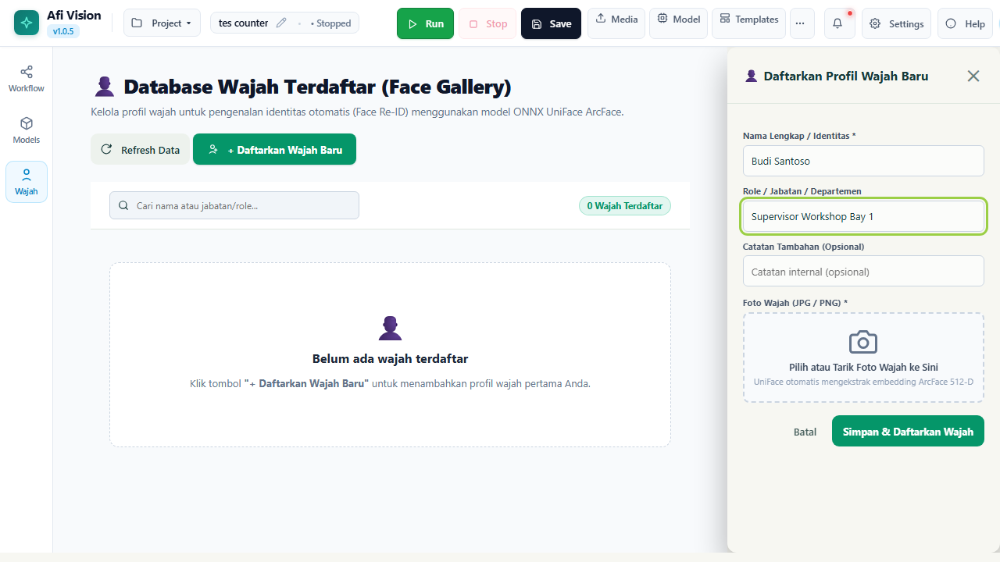

---

### 14. Node AI Face Detector & Face Re-ID Tracker di Canvas Studio
Penyusunan alur kerja analitik wajah visual: Face Detector (RetinaFace 5-point landmarks) disambungkan ke Face Re-ID Tracker (ArcFace) dengan shortcut langsung ke Database Wajah di inspector.
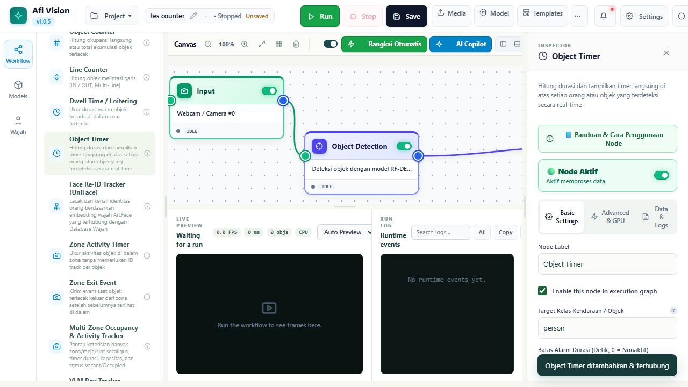

---

### 15. Pelacakan Durasi Kehadiran & Object Timer
Node Object Timer melacak waktu keberadaan setiap objek terdeteksi di frame video secara individual (format mm:ss) lengkap dengan badge visual fleksibel dan ambang batas peringatan overstay.
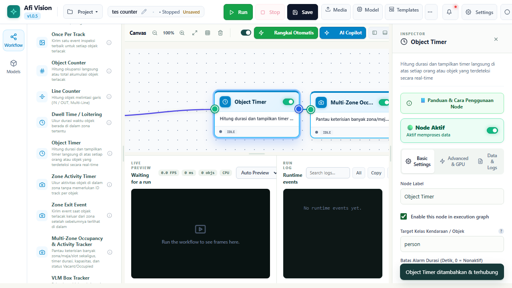

---

### 16. 5 Node Industri Dunia Nyata di Kanvas Alur Kerja Studio
Penyusunan alur kerja visual komprehensif menggabungkan kelima node industri: Dominant Color Inspector, Class Replacement, Man Down & Fall Detector, License Plate Reader (LPR), dan Overstack Clearance Detector.


---

### 17. Man Down & Fall Detector Inspector (K3 Keselamatan Kerja)
Panel inspector konfigurasi deteksi kecelakaan kerja: ambang rasio aspek rebahan horizontal, jeda konfirmasi stillness (detik), dan toleransi pergerakan piksel mikro.


---

### 18. License Plate Reader (LPR) & Gate Access Control
Konfigurasi otomatisasi gerbang logistik: filter kelas armada kendaraan, daftar Whitelist / Blacklist, dan voting konsensus frame stabil.
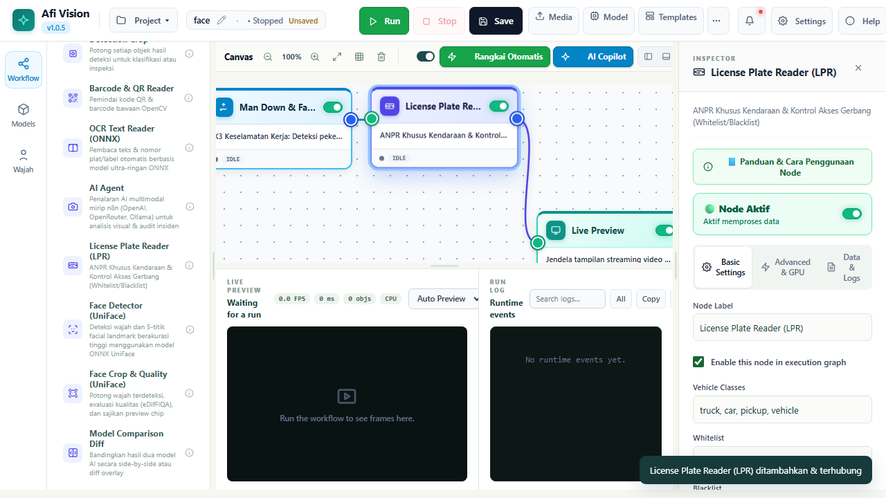

---

### 19. Dominant Color Inspector (Kepatuhan Warna Rompi & APD)
Pengaturan inspeksi warna APD: pemotongan area torso untuk rompi, pemilihan preset warna keselamatan (Hi-Vis Green/Orange), dan penegakan ambang persentase wajib.
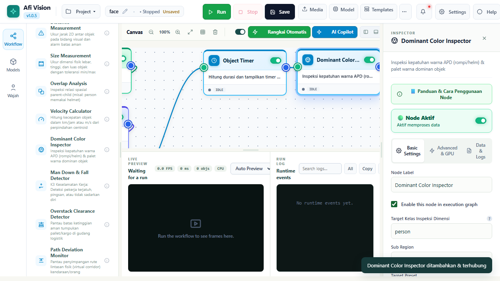

---

### 20. Overstack Clearance Detector (Batas Ketinggian Tumpukan Gudang)
Pemantau batas tumpukan kargo aman di koridor gudang: koordinat garis batas virtual langit-langit (Ceiling Y), kalibrasi rasio piksel ke meter, dan waktu persistensi debouncing.
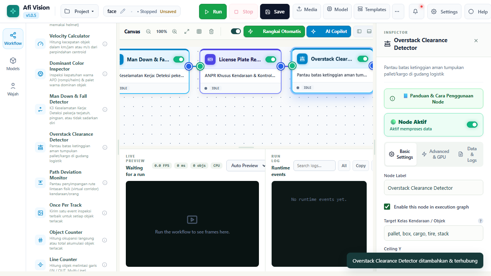

---

### 21. No-Code Web Dashboard Builder (Elementor Pro & Redesigned Light Mode)
Kanvas visual drag-and-drop dengan 3-Tab Inspector (Konten, Gaya, Lanjutan), floating Layers Navigator tree, pengaturan dimensi kanvas 1080p, dan kartu komponen dengan styling kontras tinggi.


---

### 22. Elementor Pro Layers Navigator & Glassmorphism Styling
Panel pohon lapisan widget mengambang untuk manajemen hierarki, penguncian komponen (lock protection), serta efek frosted glassmorphism semi-transparan modern.
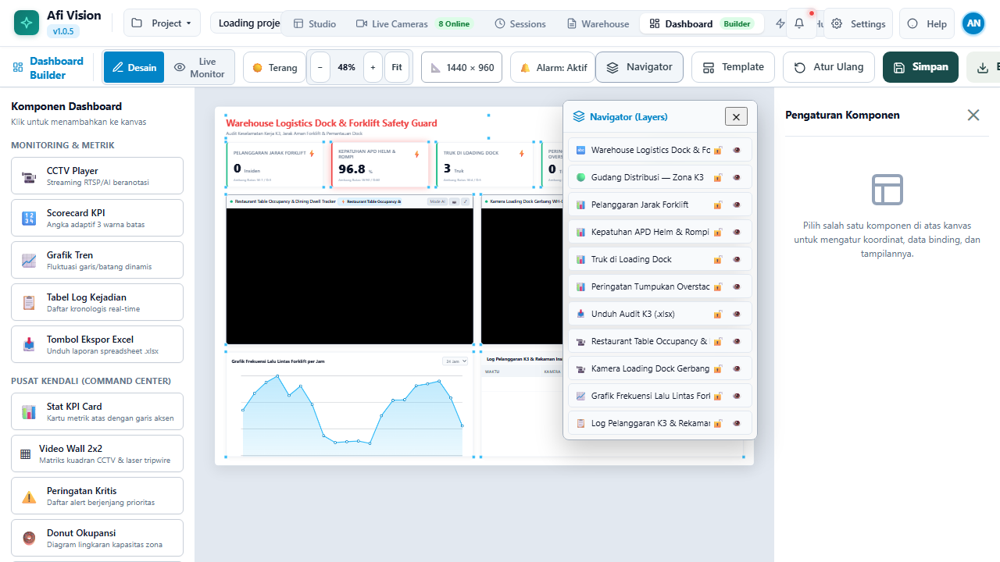

---

### 23. Dashboard AI Copilot & Vision-to-Dashboard Image Replicator
Asisten AI cerdas untuk merancang dasbor otomatis dari prompt teks natural atau unggahan referensi gambar/sketsa JPEG/PNG dengan pengikatan langsung ke telemetri dan CCTV nyata.
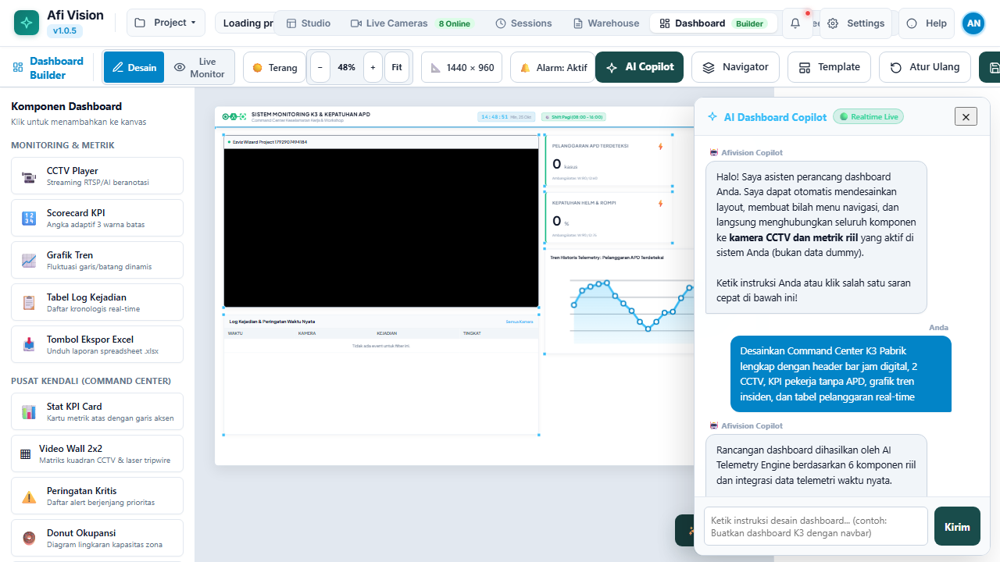

---

### 24. Interactive CCTV Camera Switcher, Filmstrip & Auto-Patrol
Pengalih siaran kamera CCTV langsung di widget player dengan menu dropdown, strip gulir thumbnail kamera horizontal, dan mode patroli otomatis siklikal.
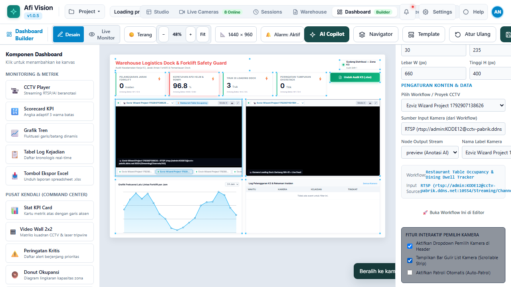

---

### 25. Standalone Docker Code Export Modal
Modal ekspor 1-klik yang mengemas seluruh dasbor, alur kerja aktif, dependensi, dan file Docker Compose ke dalam arsip ZIP siap deploy ke server produksi.
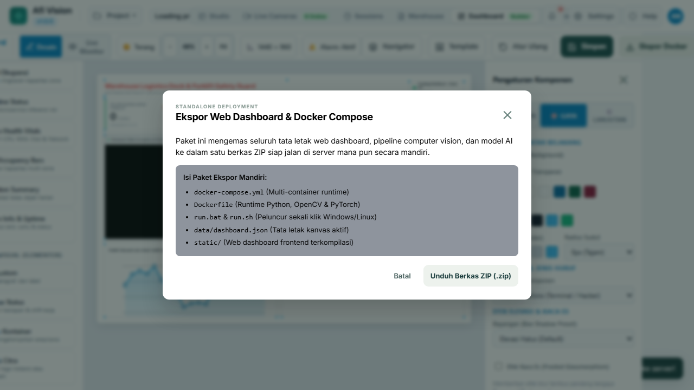

---

## ⚡ Instalasi & Eksekusi (1-Click)

### 🪟 Pengguna Windows (Disarankan)

AFI Vision Builder dirancang portabel dengan skrip launcher otomatis:

1. **Persyaratan**: Pastikan **Python 3.10, 3.11, atau 3.12** terpasang *(Centang "Add Python to PATH" saat instalasi)*.
2. **Instalasi Dependensi (Cukup 1x di awal)**:
   Klik dua kali berkas:
   ```cmd
   install.bat
   ```
   > Skrip ini otomatis membuat virtual environment (`.venv`), memasang PyTorch, Ultralytics, Supervision, OpenCV, FastAPI, dan seluruh modul pendukung.
3. **Menjalankan Aplikasi**:
   Klik dua kali berkas:
   ```cmd
   run.bat
   ```
   > Server lokal akan langsung aktif dan otomatis membuka peramban web ke:  
   > 👉 **http://127.0.0.1:8765**

---

### 🐧 Pengguna Linux & macOS

1. Berikan izin eksekusi pada berkas skrip:
   ```bash
   chmod +x install.sh run.sh
   ```
2. Jalankan instalasi:
   ```bash
   ./install.sh
   ```
3. Jalankan aplikasi:
   ```bash
   ./run.sh
   ```

---

## 🧩 Katalog 89+ Node Lengkap

Seluruh node dikelompokkan ke dalam 5 kategori fungsional dengan parameter berlabel Bahasa Indonesia dan panduan interaktif:

| Kategori | Node Siap Pakai | Fungsi & Deskripsi Utama |
| :--- | :--- | :--- |
| 📹 **Sources (Input)** | `Web Camera`, `IP Camera (RTSP)`, `Daheng Industrial Camera`, `Video File`, `Static Image`, `YouTube Live Stream (yt-dlp)` | Akuisisi citra/streaming frame dari berbagai tipe kamera fisik, live video URL YouTube, dan berkas multimedia. |
| 🧠 **AI Vision Models** | `Ultralytics YOLO`, `YOLO-World (Zero-Shot)`, `Roboflow Universe (Model ID)`, `Face Detector (UniFace)`, `RF-DETR Object Detection`, `SAM 3 Segmentation`, `ConvNeXt Classifier`, `EfficientAD Anomaly`, `ONNX Model`, `TFLite Model`, `AI Agent (VLM Multimodal)`, `Detections Consensus`, `Model Comparison Diff`, `OCR Text Reader (ONNX)`, `License Plate Reader (LPR / ANPR)` | Deteksi objek real-time, zero-shot open-vocabulary text prompt via CLIP, hosted inference Roboflow Universe 50.000+ model, deteksi wajah & 5 facial landmarks UniFace, segmentasi instan, klasifikasi citra, inspeksi anomali cacat visual, analisis multimodal VLM, konsensus multi-model, komparasi dual-model side-by-side & diff overlay, dan OCR ONNX PP-OCRv3/v4. |
| 🎯 **Tracking, Kinematics & Spatial** | `ByteTrack`, `BoT-SORT`, `OC-SORT`, `Face Re-ID Tracker (UniFace)`, `Object Timer`, `Multi-Zone Occupancy & Table Tracker`, `Zone Activity Timer`, `Zone Exit Event`, `Multi-Line Counter (A↔B)`, `Object Counter`, `Dwell Time Zone`, `ROI Filter (Polygon Area)`, `Distance Measurement`, `Size Measurement`, `Velocity Calculator`, `Path Deviation`, `Detections Difference`, `Dynamic Zone Tracking`, `PTZ Controller (ONVIF)`, `Dominant Color Inspector`, `Man Down & Fall Detector`, `Overstack Clearance Detector` | Pelacakan ID konsisten objek bergerak, pelacakan & pengenalan identitas wajah terdaftar (ArcFace 512-D), timer durasi visual objek di frame (mm:ss), penghitungan keluar-masuk garis dua arah, timer durasi terisi meja restoran, verifikasi transisi gerbang, kalkulasi jarak fisik & ukuran objek dengan kalibrasi cm, perhitungan kecepatan km/h, koridor deviasi lintasan, komparator selisih status sebelum vs sesudah (baseline comparator), dan auto-following kamera PTZ fisik. |
| 🎨 **Preprocessing, Classical CV & Drawing** | `Overlay / Annotate (Layers)`, `Interactive Object Zoom (PiP)`, `Resize Frame`, `Crop Region`, `Rotate & Flip`, `Color Convert`, `Brightness & Contrast (CLAHE)`, `Blur & Sharpen`, `Perspective Correction`, `Privacy Blur`, `Camera Focus Score`, `Auto Rotate Edges`, `Python Script Editor` | Manipulasi citra, night-vision CLAHE, sensor otomatis wajah/plat nomor, compositing anotasi gambar (termasuk Motion Trail fading dan Halo Glow corner brackets), penilaian ketajaman fokus lensa kamera (Laplacian variance), perataan sudut kemiringan kontur otomatis, dan script Python kustom. |
| 🔀 **Logic, Flow & Outputs** | `If / Else Branch`, `Compare Value`, `Confidence Threshold`, `Timer Delay`, `Debounce Filter`, `Rate Limiter`, `AND / OR Gate`, `Trigger Once`, `Overlap Analysis`, `Delta Frame Filter`, `Switch-Case Router`, `Class Replacement (Relabeler)`, `Live Preview`, `Event Alert Popup`, `Image / Crop Exporter`, `SQLite Database Logger`, `HTTP Webhook`, `Data Aggregator (Rollup)`, `CSV Formatter`, `S3 Cloud Sink`, `Notification Dispatcher` | Percabangan logika alur kerja, gerbang pembanding angka, inspeksi kepatuhan APD (overlap parent-child), penghemat komputasi 70%+ via delta frame, router multi-jalur switch-case, penampil preview real-time, perekaman event ke SQLite database, webhook REST API, akumulasi rollup statistik waktu, ekspor tabular CSV, sink cloud AWS S3/MinIO, dan notifikasi instan Telegram/Slack/WhatsApp. |

---

## 🏗️ Arsitektur Sistem

```text
afivisionbuilder/
├── 📁 engine/                     # Core Runtime Computer Vision & AI Engine
│   ├── core.py                    # Pipeline execution loop, threading, & Node Graph dispatcher
│   ├── uniface_runtime.py         # RetinaFace face detector, ArcFace 512-D Re-ID tracker, & Face Registry
│   ├── object_timer.py            # Object presence duration timer & alert thresholding
│   ├── multi_zone_occupancy.py    # Multi-Zone table tracking, FSM states, & geometric centroid testing
│   ├── project_nodes.py           # Specialized nodes (Zone Activity Timer, Zone Exit Event, Dynamic Zone)
│   ├── detections_consensus.py    # Multi-model consensus voting & IoU bounding box clustering
│   ├── model_comparison.py        # Dual-model side-by-side & diff overlay evaluation
│   ├── detections_difference.py   # State difference comparator (added, removed, unchanged)
│   ├── spatial_measurement.py     # Real-world distance measurement & physical object sizing
│   ├── classical_cv.py            # Laplacian camera focus score & auto-rotate deskewing
│   ├── video_kinematics.py        # Centroid velocity calculation & path corridor deviation
│   ├── advanced_logic.py          # Overlap analysis, delta frame throttler, & switch-case router
│   ├── data_aggregation.py        # Sliding window metrics rollup & CSV tabular exporter
│   ├── cloud_sinks.py             # S3 Object Storage sink & multi-channel notification dispatcher
│   ├── ptz_controller.py          # ONVIF continuous move PTZ auto-follower & deadzone filter
│   ├── dominant_color.py          # HSV sub-region color inspector & safety vest compliance
│   ├── class_replacement.py       # Hierarchical cascade relabeler with attribute preservation
│   ├── man_down_detector.py       # 3-stage worker fall & stillness emergency detector
│   ├── lpr_license_plate.py       # Dedicated ANPR parser & gate whitelist/blacklist policy
│   ├── overstack_detector.py      # Warehouse pallet clearance ceiling & stack height telemetry
│   ├── ocr_engine.py              # Ultra-lightweight ONNX OCR engine (PP-OCRv3/v4)
│   ├── roboflow_tracker.py        # Track Class Lock & EMA bounding box stabilizer
│   ├── ai_agent.py                # VLM multimodal agent (Decision, Detector, Strict Classifier)
│   ├── custom_model_runtime.py    # YOLO / YOLO-World / Roboflow Universe / PyTorch Fallback Manager
│   ├── vlm_box_tracker.py         # Multimodal Vision-Language Model interface
│   ├── node_catalog.py            # Registry 70+ Node, metadata, & skema parameter
│   ├── main.py                    # Algoritma image processing OpenCV, YouTube resolver & spatial filters
│   └── camera_daheng.py           # Driver SDK kamera industri Daheng
├── 📁 static/                     # Frontend Single Page Application (SPA)
│   ├── index.html                 # Struktur markup Studio, Dashboard, & Hub
│   ├── app.js                     # State management, Bézier canvas routing, & UI interactions
│   ├── style.css                  # Desain visual modern, tema dark, & glassmorphism
│   └── logo.png                   # Brand identitas AFI Vision Builder
├── 📁 docs/                       # Dokumentasi Teknis & Showcase Media
│   ├── PRD.md                     # Product Requirements Document
│   ├── TASK_LIST.md               # Riwayat pengerjaan, handoff log, & roadmap
│   └── screenshots/               # Koleksi 10 tangkapan layar antarmuka resolusi tinggi
├── 📁 tests/                      # Automated E2E Test Suites (@e2e-dev/web & Playwright)
│   ├── yolo_world_roboflow.e2e.ts         # YOLO-World zero-shot prompt & Roboflow Universe E2E
│   ├── template_youtube_sources.e2e.ts    # 5 Production templates & YouTube stream input E2E
│   ├── wire_port_alignment.e2e.ts         # Canvas wire alignment & port center connection E2E
│   ├── project_switcher.e2e.ts            # Topbar project switcher dropdown E2E
│   ├── hub_redesign.e2e.ts                # Modern Hub landing page & template cards E2E
│   ├── ocr_reader.e2e.ts                  # OCR Text Reader ONNX pipeline E2E
│   ├── phase5_sinks_and_aggregation.e2e.ts # S3 sink, notifications, aggregator, & PTZ E2E
│   ├── five_realworld_nodes.e2e.ts        # 5 Real-world industrial nodes canvas & guide modal E2E
│   ├── vlm_and_visualization.e2e.ts        # Model comparison diff & state difference E2E
│   ├── consensus_and_filter.e2e.ts         # Model consensus & confidence filter E2E
│   ├── spatial_and_classical_cv.e2e.ts     # Spatial measurement & focus score E2E
│   ├── advanced_logic_and_kinematics.e2e.ts # Kinematics, overlap, delta filter E2E
│   ├── restaurant_cafe_running.e2e.ts      # Video pipeline & live table dwell time tracking
│   ├── template_restaurant_table.e2e.ts    # Template instansiasi meja restoran
│   ├── dashboard_operations.e2e.ts         # Topbar navigation (Studio, Dashboard Builder, Fleet Hub)
│   ├── camera_settings_workflow.e2e.ts     # Camera modal, auto-binding, & polygon drawing
│   ├── multi_zone_occupancy.e2e.ts         # Visual polygon editor & inspector verification
│   ├── node_overlay_annotate.e2e.ts        # Overlay layers inspector verification
│   ├── projects_and_models_hub.e2e.ts      # Hub landing page & Model registry
│   ├── test_yolo_world_roboflow.py         # Pytest unit tests YOLO-World & Roboflow Universe
│   └── unit/                               # Pytest Unit Test Suites (157/157 Passed)
│       ├── test_five_realworld_nodes.py
│       ├── test_ocr_node.py
│       ├── test_phase5_sinks_and_aggregation.py
│       ├── test_vlm_and_visualization.py
│       ├── test_detections_consensus.py
│       ├── test_spatial_and_classical_cv.py
│       ├── test_video_kinematics_and_advanced_logic.py
│       └── test_nodes.py
├── 📁 data/                       # Penyimpanan Lokal Terisolasi
│   ├── models/                    # Bobot model AI lokal (.pt, .onnx)
│   ├── projects/                  # File alur kerja JSON proyek
│   ├── cameras.json               # Konfigurasi 8 kamera CCTV industri
│   ├── outputs/                   # Folder hasil ekspor frame & crop event
│   └── visonode.db                # SQLite database log sesi & event
├── 📄 server.py                   # REST API & WebSocket Streaming Server (FastAPI / Starlette)
├── 📄 e2e.config.ts               # Konfigurasi pengujian otomatis E2E
├── 📄 requirements.txt            # Daftar pustaka Python terverifikasi
├── ⚙️ install.bat / run.bat       # Skrip instalasi & launcher otomatis Windows
└── ⚙️ install.sh / run.sh         # Skrip instalasi & launcher Linux/macOS
```

---

## 🧪 Pengujian Kualitas (Unit & E2E Tests)

AFI Vision Builder menerapkan standar rekayasa perangkat lunak ketat dengan pengujian berlapis:

- **266 Unit Tests (100% Passed)**: Pengujian unit menyeluruh via Pytest untuk menguji logika fungsional internal (FSM multi-zone, tracking, konsensus model, kalibrasi jarak, variansi Laplacian, kalkulator kecepatan, throttler delta, komparasi model dual-stream, state comparator, rolling window aggregation, CSV formatting, S3 mock upload, notification cooldown, ONVIF PTZ velocity deadzone, pengenalan teks ONNX OCR, zero-shot YOLO-World text prompting, integrasi Roboflow Universe hosted inference, serta engine kuantisasi model TFLite INT8/FP16 & ONNX Dynamic INT8).
- **34+ Automated E2E Test Suites**: Menguji seluruh fungsionalitas dari perspektif pengguna nyata menggunakan runner modern `e2e` dengan engine Playwright dan model AI `cx/gpt-5.6-luna`.
- **Verifikasi Real-Browser & Visual**: Memvalidasi kelayakan kanvas flow, video stream live, modal pengaturan kamera, editor poligon, filter shift, dan ekspor CSV.
- **Tangkapan Layar Otomatis**: Setiap proses pengujian secara otomatis mendokumentasikan bukti screenshot visual ke folder `.e2e/artifacts/`.

Jalankan pengujian unit:
```bash
.venv\Scripts\pytest tests/ -v
```

Jalankan seluruh pengujian E2E:
```bash
npm run test:e2e
```
Atau jalankan skenario spesifik:
```bash
npx e2e run tests/model_quantizer.e2e.ts
```

---

## 🛠️ Persyaratan Sistem

- **Sistem Operasi**: Windows 10/11 (64-bit), Ubuntu 20.04/22.04 LTS, atau macOS.
- **Prosesor**: Minimal Intel Core i5 / AMD Ryzen 5 (disarankan 6 core ke atas).
- **RAM**: Minimal 8 GB (disarankan 16 GB untuk multi-camera matrix).
- **GPU (Opsional)**: NVIDIA GeForce GTX 1060 ke atas dengan CUDA 11.8 / 12.x untuk inferensi real-time maksimal. *Jika tidak ada GPU, aplikasi otomatis menggunakan akselerasi CPU dengan mulus.*

---

## 📄 Lisensi & Pengembang

Dikembangkan dengan dedikasi tinggi oleh **Anas Khadafi** ([@Annaskhadafi](https://github.com/Annaskhadafi)) dan tim untuk kebutuhan inspeksi visual industri, analitik CCTV cerdas, dan automasi Computer Vision modern.

Hak Cipta © 2026 **AFI Vision Builder**. Seluruh hak cipta dilindungi undang-undang.
