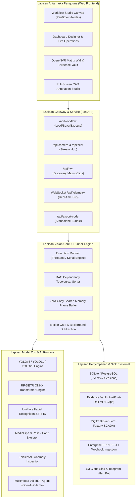
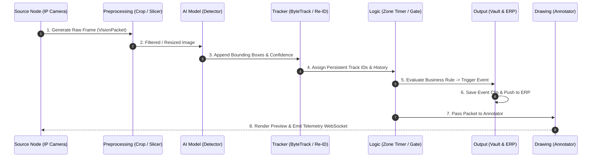

# BAGIAN I: PENGENALAN DAN ARSITEKTUR SISTEM
## Afi Vision Builder & Integrated Open-NVR Platform

---

## 1.1 Latar Belakang & Visi Produk

Sistem Computer Vision industri sering kali menghadapi kesenjangan besar antara tahap eksperimen di laboratorium (*Jupyter Notebook / Python script*) dan implementasi operasional nyata di pabrik, workshop, tambang, atau pergudangan. Beberapa tantangan kritis di lapangan meliputi:

1. **Kompleksitas Integrasi Kamera**: Variasi protokol video (RTSP, RTMP, WebRTC, ONVIF), inkonsistensi frame rate, fluktuasi bandwidth jaringan, dan frame drop.
2. **Ketergantungan Kode Kaku (*Hardcoded Pipelines*)**: Setiap kali zona monitoring berubah, batas waktu toleransi berganti, atau logika peringatan disesuaikan, teknisi harus merevisi kode Python mentah dan merestart proses secara manual.
3. **Keterbatasan Sumber Daya Perangkat Keras**: Tidak semua lokasi operasional memiliki server dengan GPU NVIDIA kelas server (*datacenter*). Banyak lokasi hanya memiliki PC industri tanpa GPU terdedikasi (CPU-only, RAM 16-32 GB), sehingga membutuhkan pipeline yang hemat memori, asynchronous, dan mendukung optimasi ONNX/OpenVINO.
4. **Isolasi Antara VMS (Video Management System) dan AI**: Sistem CCTV tradisional terpisah dari sistem kecerdasan buatan, membutuhkan dua infrastruktur terpisah yang meningkatkan biaya dan latensi transmisi.

**Afi Vision Builder** hadir untuk menyelesaikan seluruh permasalahan tersebut melalui satu platform terpadu (*All-in-One AI-Powered VMS & Workflow Automation Engine*). 

```
+-----------------------------------------------------------------------------------+
|                        AFI VISION BUILDER ECOSYSTEM                                |
|                                                                                   |
|  +--------------------+   +-----------------------+   +------------------------+  |
|  |  WORKFLOW STUDIO   |   |   DASHBOARD BUILDER   |   |   INTEGRATED OPEN-NVR  |  |
|  | Visual Node-Graph  |   | Real-time Telemetry   |   | Matrix Live Wall       |  |
|  | 98 Processing Nodes|   | 24+ Live Widgets      |   | Evidence Clip Vault    |  |
|  | CAD Annotations    |   | Looker Cross-Filter   |   | ONVIF Auto-Discovery   |  |
|  +---------+----------+   +-----------+-----------+   +-----------+------------+  |
|            |                          |                           |               |
|  +---------v--------------------------v---------------------------v------------+  |
|  |                         UNIFIED ENGINE & RUNTIME CORE                       |  |
|  |  * Async FastAPI Gateway          * Dual Execution Engine (Threaded/Serial) |  |
|  |  * Multi-Stream RTSP Demuxer      * Zero-Copy Frame Ring Buffer             |  |
|  |  * Model Zoo (YOLO/ONNX/UniFace)  * Roboflow ReID Tracking Engine           |  |
|  |  * WebSocket Telemetry Bus        * Headless Standalone Python Code Export  |  |
|  +------------------------------------+----------------------------------------+  |
+-----------------------------------------------------------------------------------+
```

---

## 1.2 Arsitektur Tingkat Tinggi (High-Level Architecture)

Arsitektur Afi Vision Builder dibangun dengan model berlapis (*layered architecture*) yang modular, modularitas ini memastikan bahwa kegagalan satu komponen (misalnya hilangnya sinyal satu kamera) tidak akan meruntuhkan keseluruhan sistem.



### 1. Lapisan Antarmuka Pengguna (Frontend Layer)
Frontend dirancang menggunakan HTML5, Tailwind CSS, dan JavaScript murni (*vanilla ES6+*) berkinerja tinggi tanpa ketergantungan framework berat. Komponen utamanya meliputi:
- **Workflow Studio**: Kanvas visual berbasis drag-and-drop dengan *smooth pan-and-zoom*, visualisasi kabel penghubung node dengan kurva bezier, dan indikator status live frame.
- **Dashboard Designer**: Lingkungan desain visual ala Elementor yang memungkinkan pengguna menyusun dashboard monitoring industri dengan widget drag-and-drop.
- **Open-NVR Matrix Wall**: Konsol monitoring CCTV multi-grid (1, 2x2, 3x3, 1+5) dengan latensi sub-detik melalui Motion JPEG over HTTP atau WebSocket streaming.
- **CAD Annotation Studio**: Studio anotasi layar penuh (*full-screen 90vw*) dengan pembesar sub-pixel (*3x loupe magnifier*) untuk penempatan zona polygon, garis crossing, dan ROI dengan akurasi piksel mutlak.

### 2. Lapisan API Gateway & Kontrol Layanan (FastAPI)
Menggunakan framework **FastAPI** di atas Python `asyncio` dan `uvicorn`. Gateway ini melayani:
- Sinkronisasi status alur kerja (*live workflow state synchronization*).
- Penemuan kamera jaringan melalui protokol ONVIF WS-Discovery.
- Streaming video multi-klien dengan buffer terpisah agar klien lambat tidak membebani proses vision engine.
- WebSocket bus untuk telemetri berlatensi rendah (< 50 ms) ke antarmuka dashboard.

### 3. Lapisan Vision Core & Execution Engine (`engine/core.py` & `engine/main.py`)
Inti komputasi vision yang mengeksekusi topologi graf node. Engine ini mendukung dua mode operasional:
- **Threaded Execution Engine**: Setiap node atau kelompok node sumber/inferensi dijalankan dalam *worker thread* terisolasi yang dihubungkan melalui *thread-safe ring buffer*. Cocok untuk memaksimalkan throughput pada CPU multi-core.
- **Serial Deterministic Runner**: Node dieksekusi secara berurutan sesuai urutan topologi graf (*Topological Sort*). Sangat ideal untuk debugging, analisis frame-by-frame, dan replay rekaman historis.

### 4. Lapisan Model Zoo & AI Runtime
Mesin inferensi multi-arsitektur yang mendukung:
- **Ultralytics PyTorch / ONNX Runtime**: Mendukung YOLOv8, YOLO11, dan YOLO26n secara *native*.
- **RF-DETR ONNX Runtime**: Model Transformer deteksi objek tanpa NMS (*Non-Maximum Suppression*).
- **UniFace**: Stack komprehensif pengenalan wajah berkecepatan tinggi (SCRFD untuk deteksi, ArcFace untuk embedding, dan atribut usia/gender/ekspresi).
- **EfficientAD**: Model deteksi cacat visual industri berbasis pembelajaran tanpa pengawasan (*unsupervised anomaly detection*).
- **Multimodal AI Agent**: Penghubung langsung ke Vision LLM (OpenAI GPT-4o / GPT-5, Ollama LLaVA/Qwen-VL) untuk penalaran semantik kompleks dari frame CCTV.

### 5. Lapisan Storage, Event Vault & Integrasi Industri
- **SQLite / Postgres Storage**: Menyimpan metadata kejadian (*events*), log sesi zona kerja, dan jejak audit pengguna.
- **Evidence Vault**: Perekam video lokal yang menyimpan buffer rekaman berkelanjutan (*rolling ring buffer*). Ketika sebuah anomali atau pelanggaran terjadi, sistem otomatis mengekstrak 5 detik sebelum kejadian (*pre-roll*) dan 10 detik setelah kejadian (*post-roll*) menjadi file MP4 permanen.
- **Industrial Gateways**: Pengirim kejadian ke sistem ERP perusahaan, SCADA/PLC melalui MQTT, dan bot peringatan instan Telegram.

---

## 1.3 Dataflow Pipeline & Siklus Hidup Paket Data (`VisionPacket`)

Setiap data yang mengalir dari satu node ke node lainnya di dalam graf dibungkus dalam sebuah struktur data standar yang disebut **`VisionPacket`**.

### 1. Struktur Data `VisionPacket`
Di dalam `engine/core.py`, struktur data ini membawa informasi komprehensif:

```python
class VisionPacket:
    frame_id: int               # Nomor urut frame global (monotonik naik)
    timestamp: float            # Timestamp waktu presisi tinggi (time.time())
    source_id: str              # Identitas sumber kamera (misal: "CAM_BAY_01")
    image: np.ndarray           # Matriks citra mentah (BGR format, OpenCV numpy array)
    annotated_image: np.ndarray # Citra yang telah ditimpa anotasi visual
    detections: List[Detection] # Daftar deteksi bounding box yang teridentifikasi
    tracks: List[Tracklet]      # Objek hasil pelacakan temporal dengan ID stabil
    events: List[VisionEvent]   # Kejadian diskrit yang dipicu pada frame ini
    metadata: Dict[str, Any]    # Data konteks dinamis antar-node (misal: suhu, OCR)
```

### 2. Siklus Eksekusi Node (Execution Lifecycle)
Ketika satu siklus frame dieksekusi:



1. **Inisiasi Sumber (*Source Ingestion*)**: Node sumber (`ip_camera` atau `input`) mengambil frame dari buffer kamera RTSP melalui OpenCV atau hardware-accelerated GStreamer/FFmpeg decoder.
2. **Pra-pemrosesan (*Preprocessing*)**: Citra dapat dipotong (ROI Crop), diubah rasio kontrasnya (CLAHE), atau diiris (*tiled*) menggunakan SAHI (*Slicing Aided Hyper Inference*) untuk mendeteksi objek mikroskopis/kecil.
3. **Inferensi AI (*AI Inference*)**: Frame diteruskan ke model neural network (misal: YOLOv8). Model mendeteksi koordinat *bounding box*, kelas objek, dan nilai keyakinan (*confidence*).
4. **Pelacakan Temporal (*Temporal Tracking*)**: Deteksi dicocokkan dengan lintasan sebelumnya menggunakan algoritma pelacak (ByteTrack, BoT-SORT, atau Appearance Re-ID) sehingga setiap objek mempertahankan ID numerik yang stabil melintasi waktu.
5. **Evaluasi Logika Bisnis (*Business Logic & Spatial Analysis*)**: Node analisis seperti `zone_activity_timer` memeriksa apakah objek target berada di dalam koordinat polygon zona kerja. Jika kondisi terpenuhi, timer bertambah dan jika selesai, sebuah `VisionEvent` dibuat.
6. **Eksekusi Output Berprioritas Tinggi (*High-Priority Sinks*)**: Output kejadian diskrit (pengiriman webhook ke ERP, penyimpanan klip rekaman ke Vault, notifikasi Telegram) **dieksekusi langsung sebelum** proses rendering visual. Hal ini menjamin bahwa fluktuasi kinerja tampilan antarmuka web tidak akan pernah menghilangkan data kejadian penting.
7. **Rendering Anotasi Visual (*Visual Annotation*)**: Node `overlay_annotate` atau `draw_boxes` menggambar kotak pembatas, garis pelacak, label nama objek, dan HUD status langsung di atas frame citra.
8. **Pengiriman Telemetri (*Telemetry Dispatch*)**: Citra teranotasi dikirim ke antarmuka pengguna via HTTP MJPEG, sementara metadata numerik dipancarkan via WebSocket ke Dashboard Bus.

---

## 1.4 Konsep Node-Graph & Topologi Graf Terarah (DAG)

Afi Vision Builder mengadopsi prinsip **Directed Acyclic Graph (DAG)**. Dalam graf terarah ini:
- **Node**: Unit komputasi mandiri yang memiliki fungsi spesifik (misal: mendeteksi, memotong, menghitung waktu, mengirim data).
- **Pin Input**: Titik masuk data pada node, hanya dapat menerima tipe data yang kompatibel (misalnya: citra menerima citra, daftar deteksi menerima daftar deteksi).
- **Pin Output**: Titik keluar hasil komputasi node untuk diteruskan ke satu atau banyak node penerima (*one-to-many branching*).
- **Kabel / Koneksi (*Wire Edge*)**: Saluran data yang menghubungkan Pin Output sebuah node ke Pin Input node lainnya.

```
       +--------------------+
       |  IP Camera (RTSP)  |
       +---------+----------+
                 |
        [Raw Image Frame]
                 |
        +--------v----------+
        |  Object Detector  |
        +--------+----------+
                 |
      [Detections List & Image]
                 |
        +--------v----------+
        |   Object Tracker  |
        +---+------------+--+
            |            |
 [Tracked Object]     [Tracked Object]
            |            |
+-----------v-----+    +-v-----------------+
| Zone Act. Timer |    |  Overstack Sensor |
+-----------+-----+    +-------+-----------+
            |                  |
      [Timer Event]     [Violation Event]
            |                  |
+-----------v------------------v-----------+
|          Telegram / ERP Webhook          |
+------------------------------------------+
```

### Aturan Topologi & Validasi Graf
Sistem memiliki validator topologi internal di `engine/core.py` yang secara otomatis mencegah:
1. **Circular Dependency (Loop Tertutup)**: Sebuah node tidak diizinkan mengirim output kembali ke dirinya sendiri atau leluhurnya, yang dapat menyebabkan *infinite execution loop*.
2. **Type Mismatch (Inkompatibilitas Tipe Data)**: Menolak penyambungan data yang tidak masuk akal (misalnya menghubungkan output string dari node OCR langsung ke input frame citra).
3. **Dead Branch Elimination**: Cabang graf yang tidak memiliki node output (sink/preview) akan dieksekusi secara efisien tanpa pemborosan alokasi memori anotasi.

---

## 1.5 Paradigma Edge-Ready & Zero Cloud Dependency

Salah satu keunggulan terbesar Afi Vision Builder adalah kemampuan operasional penuh secara **100% lokal (*on-premises*)** tanpa membutuhkan koneksi internet publik (*air-gapped environment*).

| Aspek | Afi Vision Builder | Cloud Vision Services Tradisional |
|---|---|---|
| **Ketergantungan Internet** | **Nol (Zero)**; Berjalan penuh di LAN / Server Lokal | Wajib koneksi internet berkecepatan tinggi terus-menerus |
| **Biaya Bandwidth Video** | **Gratis**; Video resolusi 4K diproses langsung di jaringan lokal | Sangat mahal; Mengirim stream video CCTV ke cloud membebani biaya kuota ISP |
| **Privasi & Keamanan Data** | **Sangat Aman**; Video dan wajah karyawan tidak pernah meninggalkan gedung | Rentan; Rekaman sensitif tersimpan di server pihak ketiga |
| **Latensi Respon Kejadian** | **< 30 milidetik**; Respon real-time di tepi jaringan (*edge*) | 500 ms – 3000 ms tergantung latensi server cloud |
| **Model Biaya Operasional** | **Lisensi Server Lokal / Open Runtime** tanpa biaya per-frame | Biaya *Pay-per-API-Call* yang membengkak seiring bertambahnya kamera |

Dengan fondasi arsitektur yang tangguh ini, Afi Vision Builder siap diterapkan di lokasi dengan tantangan jaringan ekstrem seperti area tambang pedalaman, lantai pabrik tertutup, dan pelabuhan peti kemas.

---

*Lanjutkan ke **Bagian II: Panduan Instalasi dan Deployment** untuk instruksi pengaturan lingkungan server.*
