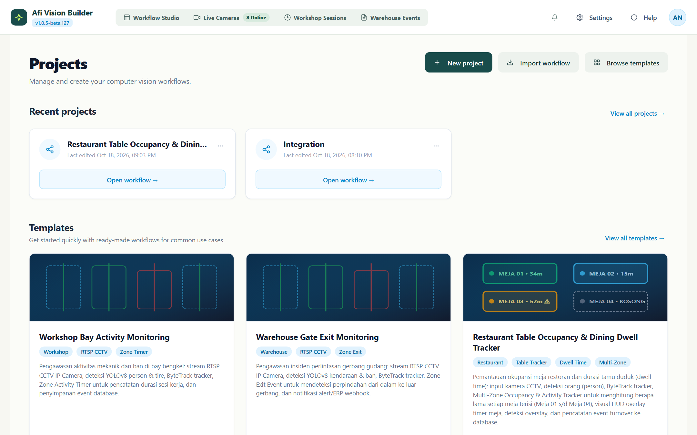
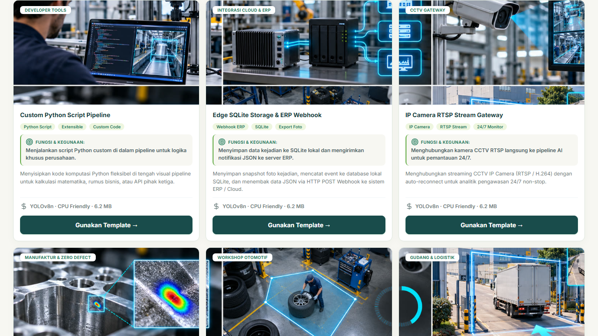
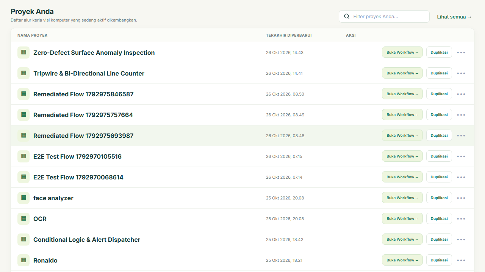
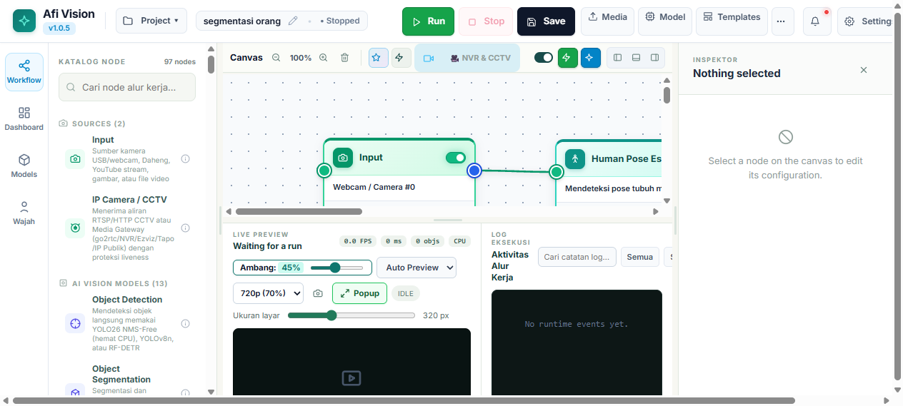
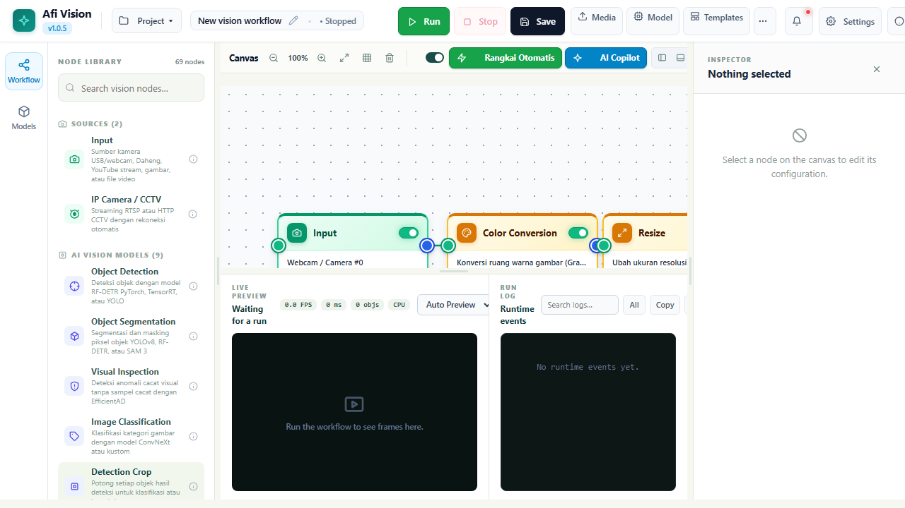
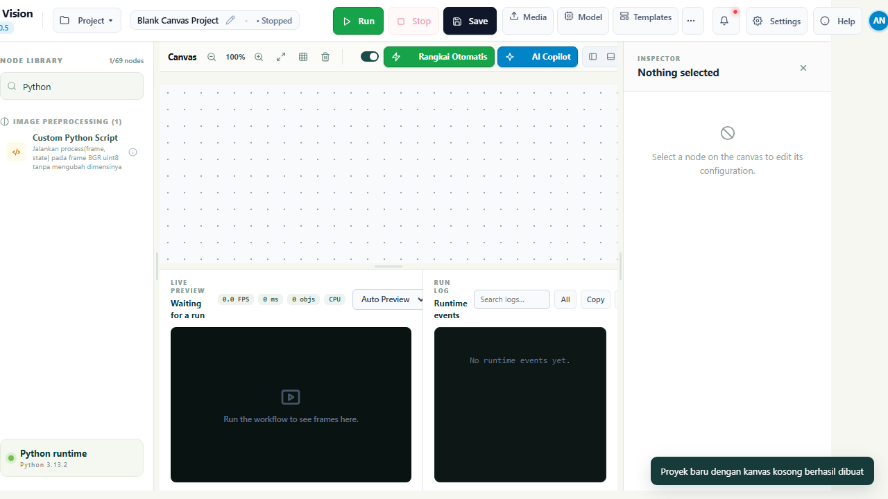
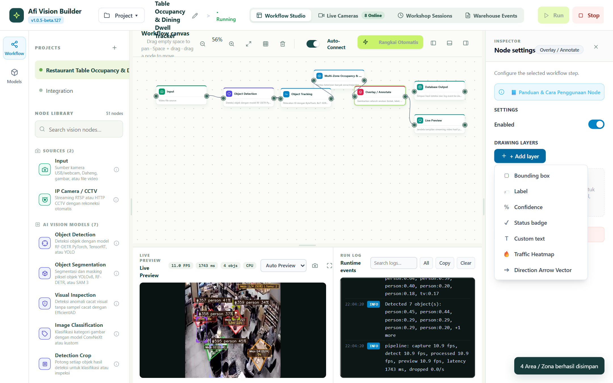
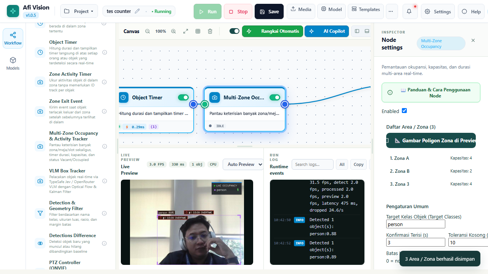

# BAGIAN III: WORKSPACE STUDIO DAN NAVIGASI ANTARMUKA PENGGUNA
## Afi Vision Builder & Integrated Open-NVR Platform

---

## 3.1 Projects Hub & Katalog Template Industri

Saat Anda mengakses URL root sistem (`http://localhost:8765`), Anda akan disambut oleh antarmuka **Projects Hub**. Halaman ini dirancang sebagai pusat komando operasional untuk mengelola proyek alur kerja komputer vision dan memilih template solusi siap pakai.


*Gambar 3.1: Tampilan Utama Projects Hub dengan Header Telemetri dan Navigasi Segmented Bar.*

### 1. Struktur Navigasi Beranda
Antarmuka Projects Hub terdiri dari beberapa bagian utama:
- **Header Telemetri & Status**: Menampilkan statistik ringkas sistem secara langsung:
  - Jumlah Alur Kerja Aktif (*Active Pipelines*)
  - Total Kamera Terkoneksi (*Online RTSP Streams*)
  - Penggunaan Memori RAM & Ketersediaan Akselerasi Grafis (GPU / CPU Mode)
  - Versi Build Sistem Terpasang
- **Segmented Control Tab**: Membagi navigasi menjadi dua tab utama:
  1. **Tab Template Industri (37+ Pre-configured Blueprints)**: Solusi vision siap pakai yang dikurasi oleh para pakar industri.
  2. **Tab Proyek Saya (My Projects Table)**: Daftar seluruh alur kerja kustom yang pernah Anda buat atau simpan.


*Gambar 3.2: Grid Kartu Template Vision Industri dengan Thumbnail Asli 16:9.*

---

### 2. Memilih dan Menggunakan Template Bawaan
Sistem menyediakan **37+ Template Alur Kerja** yang mencakup berbagai sektor:
- **Manufaktur & Heavy Equipment**:
  - *Tire Workshop Zone Activity Timer*: Pemantauan durasi kerja mekanik pada bay ban alat berat.
  - *Welding Quality & Thermal Monitoring*: Deteksi kestabilan proses pengelasan.
  - *Assembly Line Bottle / Package Counter*: Penghitungan konveyor kecepatan tinggi.
- **Logistik & Pergudangan (Warehouse)**:
  - *Warehouse Gate Exit Violation*: Deteksi truk/palet keluar tanpa izin resmi.
  - *Overstack Clearance Detection*: Sensor batas ketinggian tumpukan kardus/palet di rak gudang.
  - *Forklift & Pedestrian Safety Zone*: Zona interaksi bahaya antara manusia dan alat berat.
- **K3 & Keselamatan Kerja (Safety & Compliance)**:
  - *PPE Compliance Matrix*: Verifikasi pemakaian Helm (Hardhat), Rompi Pantul, dan Sarung Tangan.
  - *Man Down & Fall Detector*: Deteksi dini pekerja jatuh pingsan atau tergeletak darurat.
- **Smart City & Manajemen Gedung**:
  - *LPR (License Plate Recognition) Barrier Gate*: Pembaca plat nomor kendaraan otomatis.
  - *Crowd Heatmap & Dwell Time Analytics*: Analisis kepadatan pengunjung di ruang publik.

Untuk menggunakan template, cukup arahkan kursor ke kartu yang diinginkan lalu klik tombol **"Buka Template"**. Sistem akan memuat topologi node yang telah terhubung sempurna ke dalam Workspace Studio.

---

### 3. Manajemen Proyek: Duplikasi, Ekspor & Impor
Pada tab **Proyek Saya**, Anda dapat mengelola alur kerja yang tersimpan:


*Gambar 3.3: Tabel Manajemen Proyek dengan Tombol Aksi Duplikasi Cepat.*

- **Duplikasi Proyek Instan (*Quick Clone*)**: Klik tombol bertanda ikon dokumen gandakan di samping proyek. Sistem akan menyalin seluruh struktur topologi graf, konfigurasi parameter, dan koordinat polygon zona kerja ke dalam proyek baru dengan akhiran nama `(Salinan)` dan ID acak baru.
- **Ekspor JSON Workflow**: Mengunduh skema alur kerja ke dalam file `.json` lokal sebagai backup atau untuk dipindahkan ke server lain.
- **Impor JSON**: Mengunggah kembali file konfigurasi alur kerja JSON secara langsung tanpa kehilangan setelan apapun.

---

## 3.2 Workflow Studio: Kanvas Visual Interaktif

**Workflow Studio** adalah ruang kerja utama tempat Anda merancang, menguji, dan mengamati proses inferensi *Computer Vision*.


*Gambar 3.4: Kanvas Visual Workflow Studio dengan Jalur Koneksi Kabel Bezier dan Preview Frame Aktif.*

### 1. Anatomi Kanvas Visual
- **Infinite Panning**: Geser kanvas ke segala arah dengan cara **klik kiri dan tahan** pada area kosong kanvas lalu seret kursor, atau gunakan **tombol tengah mouse (wheel drag)**.
- **Semantic Zooming**: Putar roda mouse (*scroll wheel*) ke atas untuk memperbesar (*zoom-in*) hingga detail pin terkecil, atau ke bawah untuk memperkecil (*zoom-out*) melihat keseluruhan arsitektur graf.
- **Background Grid Snapping**: Latar belakang bermotif titik kisi (*dot grid*) memandu penataan node agar rapi dan simetris secara otomatis.

---

### 2. Topbar Command Center (Pusat Komando)
Topbar horizontal di bagian atas kanvas menyediakan kontrol eksekusi alur kerja:


*Gambar 3.5: Toolbar Terpadu dengan Kontrol Play, FPS Live, Tombol Open-NVR, dan Export Code.*

| Ikon / Elemen | Nama Aksi | Fungsi Teknis |
|---|---|---|
| ▶️ / ⏸️ | **Run / Pause Engine** | Memulai eksekusi alur kerja di latar belakang atau menghentikan runner sementara waktu. |
| 🔄 | **Hot-Reload Graph** | Mengirim pembaruan konfigurasi parameter ke runner aktif tanpa merestart stream kamera. |
| ⚡ **FPS Meter** | **Live Performance Counter** | Menampilkan kecepatan frame per detik (*Frames Per Second*) riil dan latensi pemrosesan milidetik. |
| 📹 **NVR Hub** | **Buka Open-NVR Modal** | Membuka jendela kokpit NVR untuk penemuan kamera ONVIF, pengaturan RTSP, dan Evidence Vault. |
| 🖥️ **CAD Studio** | **Full-Screen Calibration** | Membuka mode layar penuh 90vw untuk kalibrasi zona polygon dan garis crossing tingkat presisi CAD. |
| 📦 **Export Code** | **Unduh Python Standalone** | Mengemas alur kerja aktif menjadi file ZIP mandiri berisi skrip `run.py` untuk deployment edge. |
| 📊 **Dashboard** | **Buka Dashboard Viewer** | Membuka antarmuka dashboard operasional yang terikat dengan alur kerja ini. |

---

### 3. Anatomi Sebuah Node Visual
Setiap node pada kanvas direpresentasikan sebagai kartu modular dengan struktur terstandardisasi:

```
+------------------------------------------+
|  [Ikon]  Object Detector (YOLO)          |  <-- Header Node (Nama & Tipe)
+------------------------------------------+
| (o) Input Image                          |  <-- Pin Input (Kiri)
|                               (o) Image  |  <-- Pin Output (Kanan)
|                          (o) Detections  |  <-- Pin Output (Kanan)
+------------------------------------------+
| Model: yolov8n.pt | Conf: 0.45           |  <-- Ringkasan Parameter Cepat
+------------------------------------------+
```

- **Pin Input (Lingkaran di Sisi Kiri)**: Menerima aliran data dari node sebelumnya.
- **Pin Output (Lingkaran di Sisi Kanan)**: Memancarkan hasil pemrosesan ke node downstream berikutnya.
- **Kabel Penghubung (*Wire Edge*)**: Klik dan seret dari Pin Output sebuah node, lalu lepaskan kursor tepat di atas Pin Input node target. Garis kurva bezier akan terbentuk dengan animasi aliran data saat runner aktif.
- **Menghapus Sambungan**: Klik kanan pada kabel atau klik ikon silang kecil pada kabel untuk memutus aliran data.

---

## 3.3 Sidebar Palette & Pencarian Cerdas Node

Di sisi kiri kanvas terdapat **Sidebar Palette** yang menampung seluruh 98 node bawaan sistem.


*Gambar 3.6: Kanvas Bersih dengan Sidebar Palette Terbuka Menampilkan Kategori Node.*

### 1. Kategori Node Terstruktur
Node dikelompokkan ke dalam 7 kategori fungsional:
1. **Sources (Sumber Input)**: Pintu masuk video (Kamera RTSP, File Video MP4, YouTube Stream).
2. **Image Preprocessing**: Pemrosesan awal citra (Crop, Slicer SAHI, Rotate, Privacy Mask).
3. **AI Vision Models**: Model kecerdasan buatan (YOLO Detector, Pose, UniFace, LPR, LLM Agent).
4. **Tracking & Analysis**: Pelacakan objek temporal dan logika spasial (ByteTrack, Zone Timer, Line Counter).
5. **Logic & Flow Control**: Pengatur alur dan filter kondisi (Motion Gate, Cooldown Gate, If/Else).
6. **Annotations & Drawing**: Visualisasi kotak, garis, teks, dan heatmap kepadatan.
7. **Outputs & Export**: Pengiriman hasil (Evidence Vault, ERP Webhook, MQTT, Telegram, CSV).

### 2. Fitur Pencarian Cerdas (*Fuzzy Search*)
Cukup ketik kata kunci pada kotak pencarian di bagian atas sidebar (misalnya ketik `"timer"`, `"plate"`, `"face"`, atau `"mqtt"`). Daftar node akan tersaring seketika. Anda cukup **menyeret (drag)** node yang diinginkan dan **melepaskannya (drop)** di area kanvas visual.

---

## 3.4 Node Inspector Drawer (Panel Konfigurasi Interaktif)

Saat Anda mengklik sebuah node pada kanvas, panel **Node Inspector** akan terbuka secara mulus di sisi kanan layar. Panel ini memungkinkan pengaturan parameter rinci yang terikat langsung ke *schema* node tersebut.


*Gambar 3.7: Node Inspector untuk Pengaturan Komprehensif Lapisan Overlay dan Anotasi.*

### Tipe Kontrol Input pada Inspector:
- **Numeric Slider & Stepper**: Mengatur nilai ambang batas dengan presisi (misal: *Confidence Threshold* `0.00` hingga `1.00`, atau *IOU Threshold*).
- **Dropdown Selector**: Memilih bobot model AI (`yolov8n.pt`, `yolov8s.pt`, `yolo11n.pt`, `yolo26n.pt`), algoritma tracking (`bytetrack`, `botsort`, `cbiou`), atau mode warna.
- **Toggle Switch**: Mengaktifkan atau menonaktifkan fitur secara cepat (misal: *Appearance Re-ID Lock*, *Draw Skeleton*, *Save Video Clip*).
- **Text & JSON Input**: Mengonfigurasi URL RTSP kamera, alamat Broker MQTT, Token API Webhook, atau custom prompt untuk AI Agent.
- **Interactive Coordinate Button**: Tombol "Edit Polygon" atau "Edit Line" yang langsung meluncurkan CAD Annotation Studio untuk kalibrasi koordinat visual.

Setiap perubahan nilai di Inspector disimpan secara otomatis dan langsung dipropagasikan ke backend tanpa perlu menekan tombol simpan berulang kali.

---

## 3.5 Full-Screen Calibration & Annotation Studio (CAD-Grade)

Menggambar koordinat zona atau garis pada kotak kecil preview video di monitor resolusi tinggi sering kali tidak presisi. Afi Vision Builder menyediakan **Full-Screen Calibration Studio**, sebuah kanvas anotasi berukuran masif (90% viewport width) dengan fitur presisi kelas CAD/Figma.


*Gambar 3.8: Full-Screen CAD Annotation Studio untuk Menggambar Multi-Zona Polygon Presisi Tinggi.*

### Fitur Kunci CAD Annotation Studio:
1. **Sub-Pixel Loupe Magnifier (Kaca Pembesar 3x)**:
   Saat kursor mouse mendekati titik sudut (*vertex*) polygon, kaca pembesar bundar akan muncul di sekitar kursor, menampilkan perbesaran 300% dari piksel frame video di bawahnya. Hal ini memastikan titik zona diletakkan tepat pada garis lantai atau batas gerbang tanpa meleset satu piksel pun.
2. **Auto-Freeze & Live Stream Toggle**:
   Tersedia tombol untuk membekukan (*freeze*) frame sementara saat Anda menggambar objek yang sedang bergerak cepat di kamera, lalu mengembalikannya ke mode siaran langsung (*unfreeze live*) saat verifikasi zona.
3. **Pena Polygon Interaktif (*Smart Polygon Pen*)**:
   - Klik kiri pada area video untuk meletakkan titik sudut baru.
   - Klik dan seret titik yang sudah ada untuk memindahkan posisi koordinat.
   - Klik kanan pada titik untuk menghapusnya.
   - Klik titik awal kembali untuk menutup (*close*) loop polygon.
4. **Normalisasi Rasio Aspek (Aspect Ratio Letterbox Normalization)**:
   Sistem secara otomatis menghitung offset koordinat normalisasi (0.0 hingga 1.0) bebas distorsi, bahkan jika rasio layar monitor Anda (16:10 / 21:9) berbeda dengan rasio asli stream kamera (16:9 / 4:3).
5. **Validasi Geometri Otomatis**:
   Sistem menolak polygon yang berpotongan sendiri (*self-intersecting bowtie polygon*) untuk menjamin algoritma penentuan objek *Point-in-Polygon (Ray Casting)* tidak pernah mengalami error matematis.

---

## 3.6 Daftar Pintasan Papan Ketik (Keyboard Shortcuts & Hotkeys)

Untuk mempercepat alur kerja profesional, gunakan tombol pintas berikut saat berada di Workflow Studio:

| Kombinasi Tombol | Aksi yang Dijalankan |
|---|---|
| `Space` + **Drag Mouse** | Menggeser kanvas (*Pan Canvas View*) |
| `Ctrl` + `Scroll Wheel` | Memperbesar / Memperkecil Kanvas (*Zoom In / Zoom Out*) |
| `Ctrl` + `Z` | Membatalkan aksi terakhir (*Undo Node/Connection*) |
| `Ctrl` + `Y` / `Ctrl` + `Shift` + `Z` | Mengulang aksi yang dibatalkan (*Redo*) |
| `Delete` / `Backspace` | Menghapus node atau kabel koneksi yang sedang dipilih |
| `Ctrl` + `A` | Memilih seluruh node di kanvas (*Select All Nodes*) |
| `Ctrl` + `C` & `Ctrl` + `V` | Menyalin (*Copy*) dan Menempel (*Paste*) node terpilih |
| `Ctrl` + `S` | Menyimpan perubahan proyek ke basis data server |
| `F` | Memfokuskan tampilan kanvas ke seluruh node (*Fit View to Screen*) |
| `Esc` | Menutup jendela modal / keluar dari CAD Annotation Studio |

---

*Lanjutkan ke **Bagian IV: Ensiklopedia Lengkap Seluruh 98 Node** untuk memahami spesifikasi teknis dan parameter setiap modul.*
