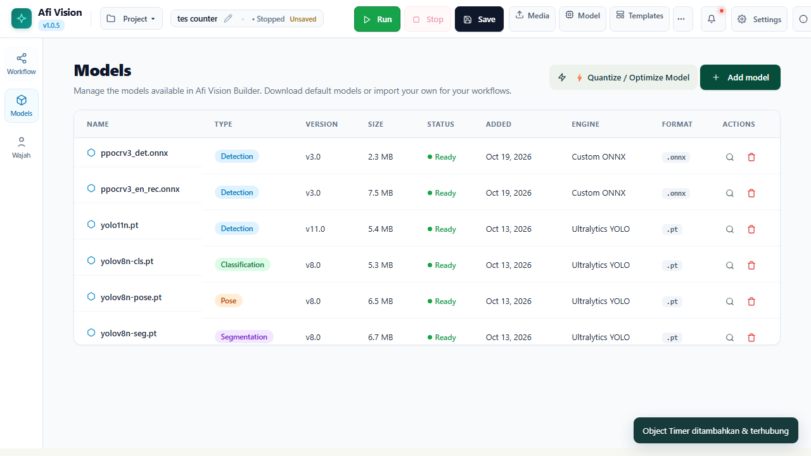
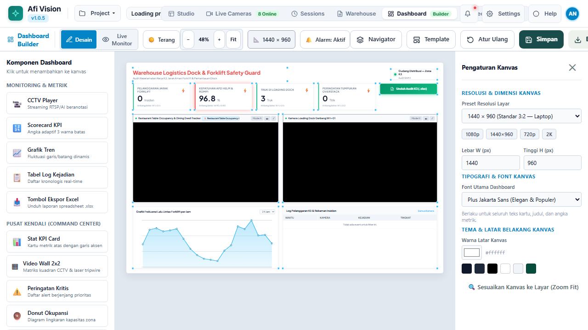
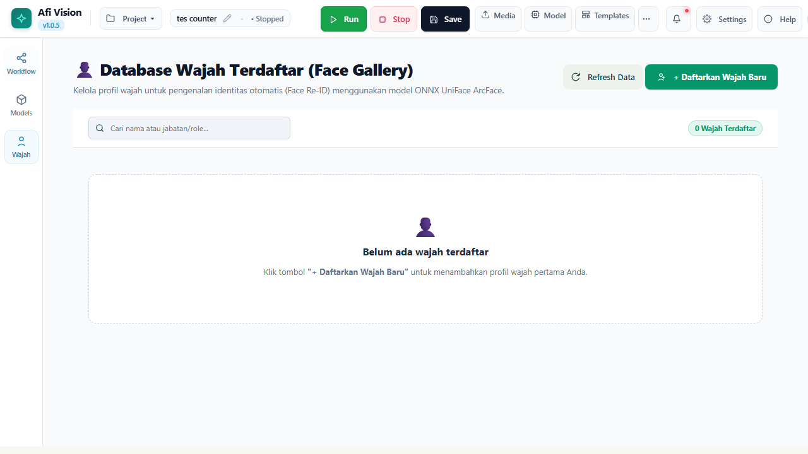
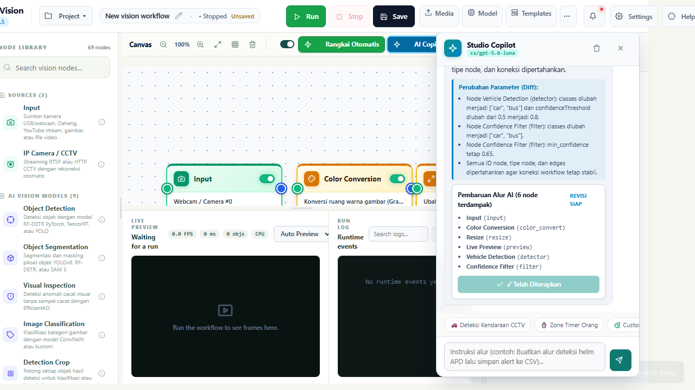

# ENSIKLOPEDIA NODE: BAGIAN 4.2
# AI VISION MODELS (15 NODES)

---

## DAFTAR ISI BAGIAN 4.2

- 4.2.1 `detector`: Object Detection (YOLOv8 / YOLO11 / YOLO26n / RF-DETR)
- 4.2.2 `classifier`: Image Classification (Pengelompokan Kelas Citra Global)
- 4.2.3 `segmenter`: Object Segmentation & Pixel-Level Mask (YOLO-Seg / SAM)
- 4.2.4 `pose_detector`: Human Pose Estimator & Keypoint Skeleton (17 Titik Sendi)
- 4.2.5 `hand_skeleton`: Hand Tracking & Gesture Recognition (21 Titik Sendi Tangan)
- 4.2.6 `lpr_license_plate`: License Plate Reader (Pengenal Plat Kendaraan Otomatis)
- 4.2.7 `ocr_reader`: OCR Text Reader (Optical Character Recognition ONNX)
- 4.2.8 `barcode_reader`: Barcode & QR Code Scanner Multi-Format
- 4.2.9 `efficientad`: Visual Anomaly & Defect Inspection (Pembelajaran Tanpa Pengawasan)
- 4.2.10 `face_detector`: Face Detector (UniFace SCRFD Arsitektur Presisi Tinggi)
- 4.2.11 `face_analyzer`: Face Analyzer (Prediksi Atribut Usia, Gender, & Emosi)
- 4.2.12 `face_crop`: Face Crop & Aligning with Quality Assessment Score
- 4.2.13 `detection_crop`: Pemotong Bounding Box Dinamis untuk Inferensi Bertingkat
- 4.2.14 `model_comparison`: Model Comparison Diff & Benchmarking Visual
- 4.2.15 `ai_agent`: Autonomous Multimodal Vision AI Agent (LLM Integration)

---

## 4.2.1 `detector`: Object Detection (YOLO & RF-DETR)

### Deskripsi Fungsional
Node inti inferensi penglihatan komputer untuk melokalisasi dan mengklasifikasikan multi-objek secara simultan di dalam frame citra. Node ini mengembalikan koordinat kotak pembatas (*bounding boxes*), label kelas objek, dan skor keyakinan (*confidence score*).


*Gambar 4.2.1: Panel Registrasi Model AI dengan Dukungan YOLOv8, YOLO11, dan YOLO26n.*

### Diagram Alur Data & Pin Koneksi
```
+------------------------------------------+
|  [Icon]  Object Detector (YOLO)          |
+------------------------------------------+
| (o) Input Image                          |
|                               (o) Image  |
|                          (o) Detections  |
+------------------------------------------+
```
- **Pin Input**: `image` (`np.ndarray` citra BGR)
- **Pin Output**:
  - `image` (`np.ndarray`): Citra asli yang diteruskan.
  - `detections` (`List[Detection]`): Struktur objek berisi koordinat `[x1, y1, x2, y2]`, `confidence` (0.0-1.0), `class_id` (int), dan `class_name` (str).

### Parameter Konfigurasi (Config Schema)
| Parameter | Tipe Data | Nilai Default | Pilihan / Rentang | Penjelasan Fungsional |
|---|---|---|---|---|
| `modelWeights` | String | `"yolov8n.pt"` | `"yolov8n.pt"`, `"yolov8s.pt"`, `"yolo11n.pt"`, `"yolo26n.pt"`, File Kustom `.onnx` | Nama bobot model AI yang dimuat dari direktori `weights/`. |
| `confidenceThreshold` | Float | `0.45` | `0.05` s/d `0.99` | Nilai probabilitas keyakinan minimum agar deteksi dianggap valid. |
| `iouThreshold` | Float | `0.45` | `0.10` s/d `0.90` | Ambang batas Intersection-over-Union untuk algoritma Non-Maximum Suppression (NMS). |
| `filterClasses` | List[String] | `[]` | Nama kelas COCO | Daftar kelas spesifik yang diizinkan lewat (misal: `["person", "truck", "tire"]`). Jika kosong, seluruh kelas diloloskan. |
| `device` | String | `"auto"` | `"auto"`, `"cpu"`, `"cuda:0"`, `"directml"` | Backend komputasi hardware yang digunakan untuk eksekusi model. |

---

## 4.2.2 `classifier`: Image Classification

### Deskripsi Fungsional
Mengklasifikasikan keseluruhan frame citra atau potongan objek ke dalam kategori probabilitas tertinggi (misalnya mengklasifikasikan apakah kondisi cuaca hujan/cerah, atau status mesin hidup/mati).

### Parameter Konfigurasi
- `modelWeights` (String, Default: `"yolov8n-cls.pt"`): Bobot model arsitektur klasifikasi.
- `topK` (Integer, Default: `3`): Jumlah prediksi probabilitas teratas yang dikembalikan.
- `confidenceThreshold` (Float, Default: `0.50`): Nilai keyakinan kelas minimum.

---

## 4.2.3 `segmenter`: Object Segmentation (YOLO-Seg / SAM)

### Deskripsi Fungsional
Melakukan segmentasi semantik tingkat piksel (*instance segmentation*), menghasilkan masker poligon yang presisi mengikuti lekukan bentuk asli objek (misalnya permukaan ban yang rusak, tumpahan oli di lantai, atau siluet kendaraan).

### Parameter Konfigurasi
- `modelWeights` (String, Default: `"yolov8n-seg.pt"`): Model segmentasi berbasis YOLO atau Segment Anything Model (SAM).
- `retinaMasks` (Boolean, Default: `true`): Menghasilkan masker beresolusi tinggi sesuai dimensi frame asli.
- `maskThreshold` (Float, Default: `0.50`): Ambang batas binarisasi probabilitas piksel masker.

---

## 4.2.4 `pose_detector`: Human Pose Estimator (17 Keypoints)

### Deskripsi Fungsional
Mengekstraksi kerangka tubuh manusia (*skeleton keypoints*) yang terdiri dari 17 titik sendi anatomis standar COCO: Hidung, Mata Kiri/Kanan, Telinga Kiri/Kanan, Bahu, Siku, Pergelangan Tangan, Pinggul, Lutut, dan Pergelangan Kaki.


*Gambar 4.2.2: Deteksi Kerangka Pose Manusia untuk Analisis Ergonomi dan K3.*

### Parameter Konfigurasi
- `modelWeights` (String, Default: `"yolov8n-pose.pt"`): Bobot model estimasi pose.
- `keypointThreshold` (Float, Default: `0.50`): Keyakinan minimum agar satu sendi digambar dan dihitung.
- `drawSkeleton` (Boolean, Default: `true`): Menggambar garis penghubung antar-sendi pada frame preview.

---

## 4.2.5 `hand_skeleton`: Hand Tracking & Gesture Recognition

### Deskripsi Fungsional
Melacak posisi tangan secara 3D dengan 21 koordinat sendi jari per tangan. Mendukung pengenalan gestur tangan (*gesture recognition*) seperti Jempol Atas (*Thumbs Up*), Tanda Kemenangan (*Victory / Peace*), Tangan Terbuka (*Open Palm*), dan Kepalan Tangan (*Fist*).

### Parameter Konfigurasi
- `maxHands` (Integer, Default: `2`, Rentang: `1` s/d `4`): Jumlah maksimum tangan yang dilacak bersamaan.
- `detectionConfidence` (Float, Default: `0.70`): Ambang keyakinan inisiasi deteksi tangan.
- `trackingConfidence` (Float, Default: `0.50`): Ambang batas kesinambungan pelacakan temporal.
- `hideNoneLabel` (Boolean, Default: `true`): Menyembunyikan label preview saat tidak ada gestur khusus yang cocok (`None`), menjaga kebersihan visual tampilan.

---

## 4.2.6 `lpr_license_plate`: License Plate Reader (LPR)

### Deskripsi Fungsional
Node terpadu dua tahap (*two-stage detector*) yang pertama-tama mendeteksi lokasi plat nomor kendaraan menggunakan model deteksi spesifik plat, lalu membaca karakter alfanumerik plat menggunakan OCR berbasis transformasi perspektif otomatis.


*Gambar 4.2.3: Konfigurasi Inspector Node License Plate Reader (LPR).*

### Parameter Konfigurasi
- `detectorWeights` (String, Default: `"weights/plate_detector.onnx"`): Model pelokalisasi plat.
- `ocrEngine` (String, Default: `"onnx_crnn"`): Engine pembaca karakter alfanumerik.
- `confidenceThreshold` (Float, Default: `0.60`): Keyakinan deteksi plat nomor.
- `countryRegexPattern` (String, Default: `^[A-Z]{1,2}\s?[0-9]{1,4}\s?[A-Z]{1,3}$`): Pola regex plat nomor standar Indonesia (contoh: `B 1234 CD`).

---

## 4.2.7 `ocr_reader`: OCR Text Reader (ONNX-CRNN)

### Deskripsi Fungsional
Mengekstraksi teks umum dari area tertentu pada frame, seperti membaca nomor seri kontainer (*ISO 6346 Container Code*), label barcode tercetak, atau teks pada papan nama industri.

### Parameter Konfigurasi
- `languages` (List[String], Default: `["en"]`): Bahasa teks yang dikenali.
- `textScoreThreshold` (Float, Default: `0.50`): Ambang batas probabilitas karakter teks.
- `allowlist` (String, Default: `""`): Karakter yang diizinkan (misal: `"0123456789ABCDEFGHIJKLMNOPQRSTUVWXYZ"`).

---

## 4.2.8 `barcode_reader`: Barcode & QR Code Reader

### Deskripsi Fungsional
Memindai dan mendecode berbagai format kode optik berkecepatan tinggi: QR Code, Data Matrix, Aztec, UPC-A, EAN-13, Code 128, dan Code 39.

### Parameter Konfigurasi
- `tryHarder` (Boolean, Default: `true`): Mengaktifkan rotasi multi-sudut dan peningkatan kontras untuk membaca kode yang rusak atau tergores.
- `formatFilter` (String, Default: `"ALL"`): Membatasi format pemindaian untuk meningkatkan kecepatan (misal: `"QR_CODE"`).

---

## 4.2.9 `efficientad`: Visual Anomaly & Defect Inspection

### Deskripsi Fungsional
Mengimplementasikan arsitektur **EfficientAD** untuk inspeksi cacat manufaktur tanpa supervisi (*unsupervised visual inspection*). Model dilatih hanya dengan menggunakan sampel produk normal (bebas cacat). Pada saat pengujian, model menandai setiap piksel yang menyimpang sebagai anomali (retak, goresan, perubahan warna, benda asing).

### Parameter Konfigurasi
- `modelPath` (String): Lokasi bobot model anomali spesifik komponen produk.
- `anomalyThreshold` (Float, Default: `0.55`): Ambang batas batas skor keparahan cacat visual.
- `generateHeatmap` (Boolean, Default: `true`): Menghasilkan visualisasi peta panas (*anomaly heatmap*) yang menyoroti area cacat.

---

## 4.2.10 `face_detector`: Face Detector (UniFace SCRFD)

### Deskripsi Fungsional
Mendeteksi wajah manusia dalam kondisi ekstrem (pencahayaan rendah, sudut miring ekstrem, dan wajah berjarak jauh) menggunakan arsitektur **SCRFD (Sample and Computation Redistribution for Efficient Face Detection)**.


*Gambar 4.2.4: Galeri Registrasi Wajah Karyawan untuk Face Recognition & Access Control.*

### Parameter Konfigurasi
- `confidenceThreshold` (Float, Default: `0.60`): Keyakinan deteksi wajah.
- `minFaceSizePixels` (Integer, Default: `30`): Mengabaikan wajah yang berukuran lebih kecil dari 30x30 piksel.

---

## 4.2.11 `face_analyzer`: Face Analyzer (Atribut Demografis)

### Deskripsi Fungsional
Memprediksi atribut komprehensif dari setiap wajah yang terdeteksi, meliputi estimasi rentang usia (*age prediction*), estimasi jenis kelamin (*gender prediction*), dan analisis ekspresi wajah (*happy, neutral, sad, angry, surprised*).

### Parameter Konfigurasi
- `hudScalePercent` (Integer, Default: `100`, Rentang: `50` s/d `200`): Skala ukuran badge HUD informasi atribut di atas kepala.
- `estimateAge` (Boolean, Default: `true`): Menghitung perkiraan usia.
- `estimateGender` (Boolean, Default: `true`): Menghitung probabilitas jenis kelamin.

---

## 4.2.12 `face_crop`: Face Crop & Quality Assessment

### Deskripsi Fungsional
Memotong bounding box wajah dengan rotasi otomatis berdasarkan garis mata (*eye alignment*) dan menghitung skor kualitas citra (*Image Quality Assessment / IQA*) untuk memastikan wajah memenuhi standar sebelum disimpan ke database absensi.

### Parameter Konfigurasi
- `targetResolution` (Integer, Default: `112`): Resolusi piksel hasil crop persegi (standar ArcFace 112x112).
- `minQualityScore` (Float, Default: `0.70`): Skor ambang batas ketajaman dan pencahayaan wajah.

---

## 4.2.13 `detection_crop`: Pemotong Deteksi Dinamis

### Deskripsi Fungsional
Menerima daftar deteksi dari node `detector`, lalu memotong setiap objek satu per satu (*crop each detection*) dan mengalirkannya ke pipeline sekunder (misalnya memotong setiap orang lalu meneruskannya ke model klasifikasi pemakaian rompi pengaman).

### Parameter Konfigurasi
- `paddingPercent` (Float, Default: `0.10`): Menambahkan margin kelonggaran 10% di sekitar bounding box agar tepi objek tidak terpotong.
- `targetClass` (String, Default: `""`): Memfilter hanya memotong kelas tertentu (misal: `"person"`).

---

## 4.2.14 `model_comparison`: Model Comparison Diff & Benchmarking

### Deskripsi Fungsional
Menerima keluaran deteksi dari dua model AI yang berbeda (misalnya YOLOv8n vs YOLO11n) pada frame yang sama, lalu menampilkan visualisasi perbandingan langsung: deteksi yang disepakati bersama (*consensus*), deteksi yang hanya ditemukan Model A, dan deteksi yang hanya ditemukan Model B.

### Parameter Konfigurasi
- `iouMatchThreshold` (Float, Default: `0.50`): Ambang IoU untuk menganggap dua kotak dari dua model mewakili objek yang sama.
- `modelLabelA` (String, Default: `"Model-A"`): Nama penanda visual model pertama.
- `modelLabelB` (String, Default: `"Model-B"`): Nama penanda visual model kedua.

---

## 4.2.15 `ai_agent`: Autonomous Multimodal Vision AI Agent

### Deskripsi Fungsional
Node paling mutakhir yang menggabungkan kemampuan **Multimodal Vision Large Language Model (VLM)** ke dalam aliran video CCTV (terinspirasi dari konsep n8n AI Agent). Node ini mengirimkan frame gambar beserta ringkasan metadata deteksi ke model LLM (seperti GPT-4o, GPT-5, atau Ollama LLaVA lokal) untuk menjawab pertanyaan penalaran kompleks, mendeteksi anomali tidak terduga, atau mengambil keputusan operasional otomatis.


*Gambar 4.2.5: Antarmuka AI Agent Drawer untuk Konfigurasi Instruksi Semantik LLM.*

### Parameter Konfigurasi (Config Schema)
| Parameter | Tipe Data | Nilai Default | Pilihan / Rentang | Penjelasan Fungsional |
|---|---|---|---|---|
| `provider` | String | `"openai"` | `"openai"`, `"openrouter"`, `"ollama"`, `"custom"` | Penyedia layanan inferensi Large Language Model. |
| `modelName` | String | `"gpt-4o-mini"` | `"gpt-4o"`, `"gpt-4o-mini"`, `"llava:13b"`, `"qwen2-vl"` | Model multimodal yang digunakan. |
| `systemPrompt` | String | `"Anda adalah AI Pengawas Keamanan Industri..."` | Teks Instruksi Lengkap | Peran dan batasan etika operasional sistem pengawasan. |
| `userPrompt` | String | `"Periksa apakah ada personil yang melanggar batas keselamatan..."` | Teks Kueri Analisis | Pertanyaan semantik spesifik yang harus dievaluasi pada frame. |
| `triggerMode` | String | `"on_event"` | `"on_event"`, `"periodic"`, `"continuous"` | Mode pemicu: hanya berjalan saat ada event anomali, setiap $N$ detik, atau setiap frame. |
| `intervalSeconds`| Integer | `10` | `1` s/d `300` | Jeda waktu inferensi untuk mode periodic guna menghemat token API. |
| `maxTokens` | Integer | `300` | `50` s/d `2048` | Batas panjang respons teks penjelasan yang dihasilkan model. |

---

*Lanjutkan ke **Bagian 4.3: Ensiklopedia Node - Tracking & Kinematic Analysis** untuk mempelajari modul pelacakan temporal dan kalkulasi kinematika spasial.*
