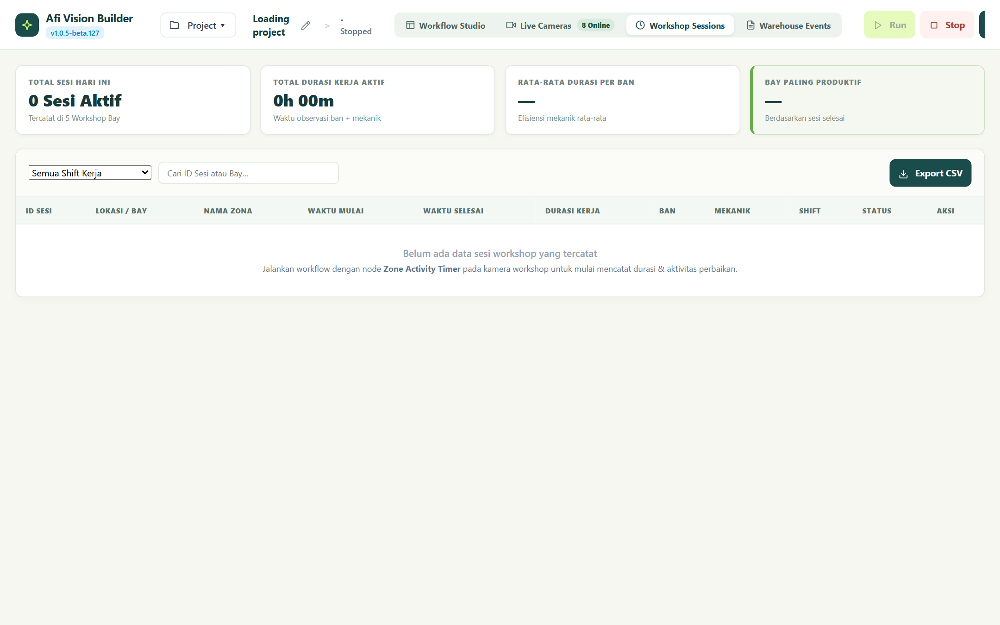
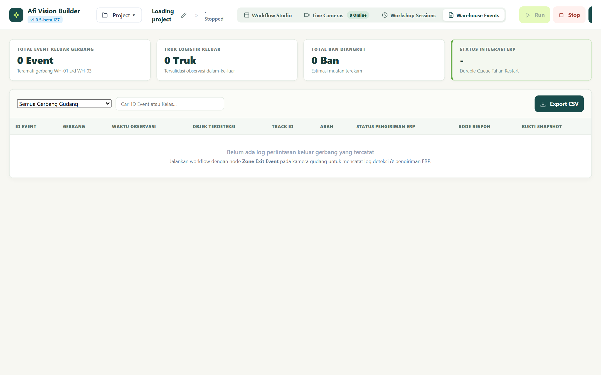
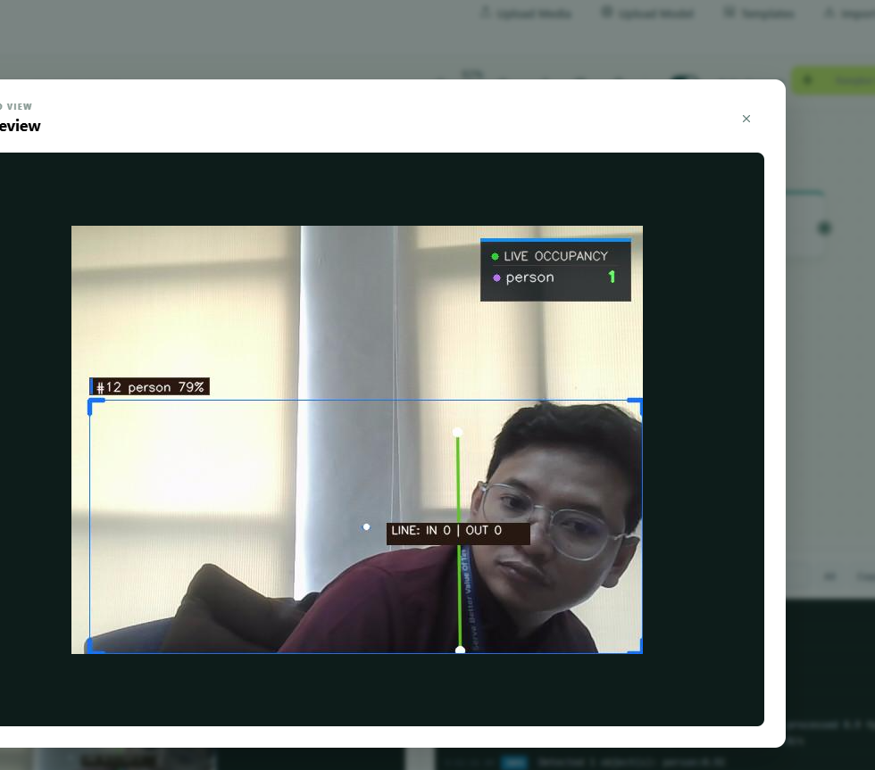
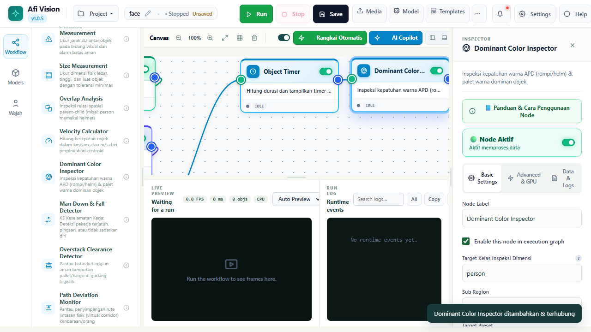
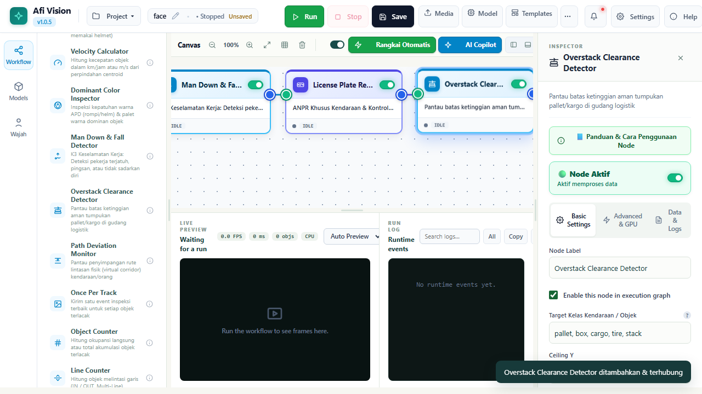

# ENSIKLOPEDIA NODE: BAGIAN 4.3
# TRACKING & KINEMATIC ANALYSIS (25 NODES)

---

## DAFTAR ISI BAGIAN 4.3

- 4.3.1 `tracker`: Multi-Algorithm Object Tracker (ByteTrack, BoT-SORT, C-BIoU, Roboflow Re-ID)
- 4.3.2 `zone_activity_timer`: Zone Activity Timer (Perhitungan Durasi Kerja Berbasis Waktu Elapsed)
- 4.3.3 `zone_exit_event`: Zone Exit Event (Deteksi Perpindahan Teramati Dari Dalam ke Luar)
- 4.3.4 `multi_zone_occupancy`: Multi-Zone Occupancy & Activity Tracker (Matriks Okupansi Multi-Area)
- 4.3.5 `line_counter`: Line Counter (Penghitung Garis Melintas Dua Arah / Tripwire)
- 4.3.6 `object_counter`: Object Counter (Akumulator Jumlah Objek Total dalam Frame)
- 4.3.7 `object_timer`: Object Timer (Pelacak Usia Eksistensi Setiap Objek Individu)
- 4.3.8 `dwell_time`: Dwell Time / Loitering (Pendeteksi Diam Mencurigakan / Diam Terlalu Lama)
- 4.3.9 `overlap_analysis`: Overlap Analysis (Analisis Tumpang Tindih Spasial Dua Kelas Objek)
- 4.3.10 `detections_consensus`: Detections Consensus (Konsensus Voting Multi-Model Deteksi)
- 4.3.11 `dominant_color`: Dominant Color Inspector (Ekstraksi Warna Dominan Objek Berbasis K-Means)
- 4.3.12 `face_tracker`: Face Re-ID Tracker (Pelacak Identitas Wajah Menggunakan Cosine Distance)
- 4.3.13 `homography_projector`: Homography Ground Projector (Proyeksi Koordinat Lantai 2D Dunia Nyata)
- 4.3.14 `man_down_detector`: Man Down & Fall Detector (Detektor Pekerja Jatuh / Pingsan Darurat)
- 4.3.15 `overstack_detector`: Overstack Clearance Detector (Sensor Pelanggaran Batas Ketinggian Tumpukan)
- 4.3.16 `path_deviation`: Path Deviation Monitor (Pemantau Penyimpangan Koridor Lintasan Kendaraan)
- 4.3.17 `ppe_compliance_matrix`: PPE Compliance Matrix (Matriks Kepatuhan APD K3: Helm & Rompi)
- 4.3.18 `ptz_controller`: PTZ Controller (Pengendali Motor Pan-Tilt-Zoom Otomatis via ONVIF)
- 4.3.19 `size_measurement`: Size Measurement (Pengukuran Dimensi Panjang/Lebar Metrik Objek)
- 4.3.20 `distance_measurement`: Distance Measurement (Pengukuran Jarak Antar-Objek / Proximity Alert)
- 4.3.21 `velocity_calculator`: Velocity Calculator (Estimasi Kecepatan Tempuh Objek km/jam atau m/s)
- 4.3.22 `vlm_box_tracker`: VLM Box Tracker (Pelacak Objek Fleksibel Berbasis Deskripsi Teks Semantik)
- 4.3.23 `badminton_analytics`: Badminton Match Analytics (Pelacak Kok & Analisis Lapangan Bulutangkis)
- 4.3.24 `filter`: Detection & Geometry Filter (Penyaring Deteksi Berdasarkan Ukuran & Skor)
- 4.3.25 `track_snapshot`: Once Per Track (Penyimpan Foto Bukti Terbaik Satu Kali per Objek)

---

## 4.3.1 `tracker`: Multi-Algorithm Object Tracker (Roboflow Re-ID Integrated)

### Deskripsi Fungsional
Node pelacak objek temporal yang bertanggung jawab menetapkan dan mempertahankan ID numerik unik (*Track ID*) untuk setiap objek saat mereka bergerak melintasi frame video dari waktu ke waktu.

Node ini mendukung 4 algoritma pelacakan kelas dunia:
1. **ByteTrack**: Algoritma pelacakan berkecepatan tinggi yang memanfaatkan deteksi berkeyakinan rendah (*low-confidence boxes*) untuk memulihkan objek yang tertutup bayangan atau oklusi sebagian.
2. **BoT-SORT**: Menggabungkan kalman filter terdistribusi dengan kompensasi gerakan kamera (*Camera Motion Compensation / CMC*) untuk kamera yang bergetar atau bergerak.
3. **C-BIoU**: Menggunakan Complete Bounding IoU untuk mencocokkan objek dengan presisi geometri tingkat piksel.
4. **Appearance Re-ID (Roboflow OSNet Integration)**: Mengekstrak vektor embedding fitur visual citra (512 dimensi) menggunakan deep convolutional neural network untuk memulihkan ID yang sama bahkan ketika objek menghilang di balik dinding selama beberapa detik.

*Gambar 4.3.1: Konfigurasi Inspector Node Pelacak Objek Temporal.*

### Parameter Konfigurasi (Config Schema)
| Parameter | Tipe Data | Nilai Default | Pilihan / Rentang | Penjelasan Fungsional |
|---|---|---|---|---|
| `algorithm` | String | `"bytetrack"` | `"bytetrack"`, `"botsort"`, `"cbiou"` | Algoritma utama asosiasi temporal bounding box. |
| `trackBuffer` | Integer | `30` | `5` s/d `300` | Jumlah frame toleransi mengingat objek yang hilang sebelum ID dihapus. |
| `matchThreshold` | Float | `0.70` | `0.10` s/d `0.99` | Nilai batas kesamaan jarak asosiasi Hungarian algorithm. |
| `enableReid` | Boolean | `false` | `true` / `false` | Mengaktifkan ekstraksi embedding visual Re-ID per kamera. |
| `reidModel` | String | `"osnet_x0_25"` | `"osnet_x0_25"`, `"osnet_x1_0"`, `"mobilenetv2_reid"` | Model neural network pengekstrak fitur visual penampilan. |
| `reidScoreThreshold` | Float | `0.65` | `0.30` s/d `0.95` | Ambang batas kemiripan cosinus (*cosine similarity*) embedding Re-ID. |
| `trackClassLock` | Boolean | `true` | `true` / `false` | Mengunci kelas objek agar tidak berkedip (*class flickering*) saat inferensi berubah-ubah, menggunakan sistem voting mayoritas (*majority voting*). |
| `smoothingAlgorithm` | String | `"ema"` | `"ema"`, `"kalman"`, `"none"` | Algoritma penghalus pergerakan koordinat kotak (EMA / Kalman). |

---

## 4.3.2 `zone_activity_timer`: Zone Activity Timer (Elapsed Time Engine)

### Deskripsi Fungsional
Dirancang khusus untuk workshop alat berat dan pabrik manufaktur. Node ini menghitung **durasi riil aktivitas pekerjaan mekanik** di dalam zona polygon tertentu tanpa ketergantungan rapuh pada satu Track ID yang dapat terputus.

Prinsip operasional:
- Pekerjaan dianggap terjadi jika ada **Objek Primer (Ban / Alat)** DAN **Objek Sekunder (Orang / Mekanik)** berada bersamaan di dalam zona polygon.
- Perhitungan berbasis waktu elapsed nyata (*monotonic clock*), bukan perhitungan frame sintetis.
- Menyediakan *Grace Period*: Toleransi jika mekanik keluar sejenak mengambil alat (misal 5 detik) agar sesi kerja tidak langsung tertutup.
- Menghasilkan event awal (*Session Started*), event berkala (*Session Progress*), dan event penutupan resmi (*Session Completed*) yang siap dikirim ke sistem ERP.

*Gambar 4.3.2: Rekapitulasi Sesi Kerja Riil Hasil Pencatatan Node Zone Activity Timer.*

### Parameter Konfigurasi
- `zonePolygon` (List[Point]): Titik-titik sudut polygon area kerja yang digambar melalui CAD Studio.
- `primaryClass` (String, Default: `"tire"`): Kelas target objek kerja utama.
- `secondaryClass` (String, Default: `"person"`): Kelas pelaku pekerjaan.
- `minDurationSeconds` (Float, Default: `5.0`): Durasi minimum interaksi sebelum status resmi dihitung sebagai sesi kerja.
- `gracePeriodSeconds` (Float, Default: `10.0`): Toleransi waktu kosong sementara sebelum menutup sesi kerja.
- `maxSessionDurationSeconds` (Integer, Default: `0`): Batas peringatan jika satu sesi berlangsung tidak wajar (0 = dinonaktifkan).

---

## 4.3.3 `zone_exit_event`: Zone Exit Event (Warehouse Exit Detection)

### Deskripsi Fungsional
Mendeteksi **perpindahan fisik dari dalam ke luar (*observed inside-to-outside transition*)**. Sangat penting untuk pergudangan (warehouse gate) guna mendeteksi truk atau palet barang yang keluar melewati batas gerbang.

> [!IMPORTANT]
> Sistem secara ketat membedakan antara *objek yang keluar nyata* dengan *objek yang sekadar menghilang dari kamera*. Kepergian objek hanya memicu event keluar jika objek tersebut terbukti berada di dalam zona pada frame sebelumnya dan teramati melintasi garis batas ke arah luar (*confirmed transition*).

*Gambar 4.3.3: Log Kejadian Barang Keluar Gudang yang Tercatat oleh Zone Exit Event.*

### Parameter Konfigurasi
- `zonePolygon` (List[Point]): Koordinat polygon batas gerbang gudang.
- `targetClasses` (List[String], Default: `["truck", "car", "tire"]`): Kelas objek yang diawasi pergerakan keluarnya.
- `directionFilter` (String, Default: `"outward_only"`): Pilihan: `"outward_only"`, `"inward_only"`, `"both"`.
- `rearmCooldownSeconds` (Float, Default: `3.0`): Jeda waktu pencegahan alarm ganda untuk objek berukuran panjang seperti truk trailer.

---

## 4.3.4 `multi_zone_occupancy`: Multi-Zone Occupancy & Activity Tracker

### Deskripsi Fungsional
Memantau banyak zona secara simultan (misalnya 4 bay workshop atau 6 jalur parkir) dalam satu kamera, menghitung jumlah orang/kendaraan di setiap zona, serta memancarkan telemetri okupansi real-time ke dashboard.

### Parameter Konfigurasi
- `zones` (JSON Array): Definisi setiap zona berisi `id`, `name`, dan `points`.
- `targetClass` (String, Default: `"person"`): Kelas objek yang dihitung jumlahnya.
- `overcrowdLimit` (Integer, Default: `5`): Batas kapasitas maksimum per zona sebelum memicu peringatan kelebihan kapasitas.

---

## 4.3.5 `line_counter`: Line Counter (Virtual Tripwire Crossing)

### Deskripsi Fungsional
Menghitung jumlah objek yang memotong garis virtual (*tripwire*) dua arah. Algoritma menghitung vektor perpotongan antara segmen garis virtual dengan segmen lintasan gerak titik tengah objek dari frame $t-1$ ke frame $t$.

*Gambar 4.3.4: Visualisasi Penghitung Garis Dua Arah dengan Statistik Masuk dan Keluar.*

### Parameter Konfigurasi
- `linePoints` (Array 2-Titik): Koordinat titik awal `[x1, y1]` dan titik akhir `[x2, y2]`.
- `targetClasses` (List[String], Default: `["person", "vehicle"]`): Objek yang dihitung.
- `showDirectionBadge` (Boolean, Default: `true`): Menampilkan panah arah perlintasan (Arah A->B vs B->A).

---

## 4.3.6 `object_counter`: Object Counter (Akumulator Total)

### Deskripsi Fungsional
Menghitung jumlah absolut seluruh objek yang sedang terlihat pada frame saat ini, dikelompokkan berdasarkan nama kelasnya (misal: "3 person, 2 forklift").

### Parameter Konfigurasi
- `targetClasses` (List[String], Default: `[]`): Filter kelas yang ingin dihitung.
- `emitPerClass` (Boolean, Default: `true`): Mengeluarkan metadata jumlah per kelas secara terpisah.

---

## 4.3.7 `object_timer`: Object Timer (Lifespan Tracker)

### Deskripsi Fungsional
Menghitung waktu keberadaan individual dari setiap objek yang dilacak sejak pertama kali terdeteksi hingga menghilang dari frame video.

*Gambar 4.3.5: Penghitung Waktu Individual Objek dengan HUD Usia di Atas Bounding Box.*

### Parameter Konfigurasi
- `alertThresholdSeconds` (Float, Default: `60.0`): Batas waktu keberadaan sebelum warna kotak berubah menjadi merah dan memicu peringatan.

---

## 4.3.8 `dwell_time`: Dwell Time / Loitering Monitor

### Deskripsi Fungsional
Mendeteksi perilaku berkeliaran atau berdiam diri (*loitering*) di area terlarang jika sebuah objek bergerak dalam radius kecil (< 1 meter) selama durasi tertentu.

### Parameter Konfigurasi
- `maxMoveRadiusPixels` (Integer, Default: `50`): Radius batas toleransi pergerakan minimal.
- `loiteringDurationSeconds` (Float, Default: `30.0`): Waktu minimum berdiam diri untuk memicu status `LOITERING_DETECTED`.

---

## 4.3.9 `overlap_analysis`: Overlap Analysis (Interaksi Dua Kelas)

### Deskripsi Fungsional
Menganalisis rasio tumpang tindih (*Intersection over Union* atau *Intersection over Target Area*) antara dua kelas berbeda, misalnya mengukur apakah pekerja mendekati mesin berputar terlalu dekat.

### Parameter Konfigurasi
- `classA` (String, Default: `"person"`): Kelas objek pertama.
- `classB` (String, Default: `"machinery"`): Kelas objek kedua.
- `minOverlapRatio` (Float, Default: `0.15`): Rasio batas tumpang tindih untuk memicu kondisi bahaya.

---

## 4.3.10 `detections_consensus`: Detections Consensus (Multi-Model Voting)

### Deskripsi Fungsional
Menerima deteksi dari beberapa model AI sekaligus (misal YOLOv8 dan EfficientDet) dan hanya meloloskan deteksi yang disepakati oleh mayoritas model dengan melakukan peleburan kotak (*Weighted Box Fusion / WBF*).

---

## 4.3.11 `dominant_color`: Dominant Color Inspector

### Deskripsi Fungsional
Mengekstraksi warna dominan dari objek di dalam bounding box menggunakan algoritma K-Means Clustering pada ruang warna LAB, lalu memetakannya ke palet warna standar (Merah, Biru, Hijau, Kuning, Putih, Hitam, Abu-abu). Sangat berguna untuk mengidentifikasi warna kendaraan atau seragam kerja.

*Gambar 4.3.6: Inspector Ekstraksi Warna Dominan Objek Berbasis K-Means.*

### Parameter Konfigurasi
- `numClusters` (Integer, Default: `3`): Jumlah klaster warna K-Means.
- `ignoreBackgroundMargin` (Float, Default: `0.15`): Mengabaikan 15% tepi bounding box agar warna latar belakang tidak ikut terhitung.

---

## 4.3.12 `face_tracker`: Face Re-ID Tracker (UniFace)

### Deskripsi Fungsional
Melacak pergerakan wajah secara temporal dengan mencocokkan vektor embedding wajah ArcFace (512 dimensi) menggunakan metrik *Cosine Distance*. Mempertahankan identitas orang yang sama meskipun wajah sempat membelakangi kamera.

### Parameter Konfigurasi
- `cosineThreshold` (Float, Default: `0.60`): Batas kemiripan embedding wajah.
- `maxLostFrames` (Integer, Default: `50`): Batas toleransi wajah tidak terlihat sebelum ID dilepas.

---

## 4.3.13 `homography_projector`: Homography Ground Projector

### Deskripsi Fungsional
Memproyeksikan titik kaki objek pada frame kamera ke koordinat 2D lantai dunia nyata (meter) menggunakan matriks planar homografi yang telah dikalibrasi.

### Parameter Konfigurasi
- `calibrationPointsCamera` (List[Point]): 4 titik acuan pada citra kamera.
- `calibrationPointsWorld` (List[Point]): 4 koordinat meter nyata di lapangan (contoh: `[0,0], [5,0], [5,10], [0,10]`).

---

## 4.3.14 `man_down_detector`: Man Down & Fall Detector

### Deskripsi Fungsional
Mendeteksi keadaan darurat pekerja jatuh atau tergeletak pingsan berdasarkan perubahan rasio aspek bounding box (dari vertikal menjadi horizontal) serta kecepatan perubahan orientasi sudut kerangka tubuh tubuh manusia.

*Gambar 4.3.7: Inspector Pengaturan Ambang Batas Man Down & Fall Detector.*

### Parameter Konfigurasi
- `aspectRatioThreshold` (Float, Default: `1.30`): Rasio lebar terhadap tinggi kotak ($W/H \ge 1.30$ menandakan posisi berbaring).
- `immobilityDurationSeconds` (Float, Default: `5.0`): Waktu pekerja tergeletak tanpa bergerak sebelum memicu alarm darurat K3.

---

## 4.3.15 `overstack_detector`: Overstack Clearance Detector

### Deskripsi Fungsional
Memonitor tumpukan palet barang atau ban pada rak pergudangan. Jika puncak tumpukan melewati garis batas toleransi atas (*clearance line*), node akan memicu peringatan risiko roboh.

*Gambar 4.3.8: Konfigurasi Garis Batas Ketinggian Maksimum Tumpukan.*

---

## 4.3.16 `path_deviation`: Path Deviation Monitor

### Deskripsi Fungsional
Memverifikasi apakah kendaraan (misalnya AGV atau Forklift) tetap berada di dalam jalur marka koridor yang ditentukan atau menyimpang ke area pejalan kaki.

---

## 4.3.17 `ppe_compliance_matrix`: PPE Compliance Matrix (K3 Safety)

### Deskripsi Fungsional
Memverifikasi kepatuhan alat pelindung diri (APD) pekerja secara terpadu. Memeriksa keberadaan helm pengaman (*hard hat*), rompi visibilitas tinggi (*safety vest*), dan sepatu bot pada setiap personil yang terdeteksi.

---

## 4.3.18 `ptz_controller`: PTZ Controller (ONVIF Pan-Tilt-Zoom)

### Deskripsi Fungsional
Mengirim perintah motor mekanis kamera PTZ melalui protokol ONVIF untuk mengarahkan kamera secara otomatis mengikuti (*auto-tracking*) objek target di tengah frame (*centering*).

### Parameter Konfigurasi
- `deadzoneRadiusPercent` (Float, Default: `0.10`): Zona toleransi tengah frame agar kamera tidak bergetar halus terus-menerus.
- `panSpeed` (Float, Default: `0.50`): Kecepatan motor geser horizontal.
- `tiltSpeed` (Float, Default: `0.50`): Kecepatan motor geser vertikal.

---

## 4.3.19 `size_measurement`: Size Measurement (Pengukuran Metrik)

### Deskripsi Fungsional
Menghitung dimensi fisik nyata objek (panjang dan lebar dalam satuan sentimeter atau meter) berdasarkan kalibrasi rasio piksel-ke-metrik.

---

## 4.3.20 `distance_measurement`: Distance Measurement (Jarak Antar-Objek)

### Deskripsi Fungsional
Mengukur jarak fisik antara dua objek (misalnya jarak antara forklift dan pejalan kaki) dan memicu peringatan jika jarak kurang dari radius batas keselamatan (misal < 2 meter).

---

## 4.3.21 `velocity_calculator`: Velocity Calculator (Kecepatan Objek)

### Deskripsi Fungsional
Menghitung kecepatan linier objek bergerak dalam satuan km/jam atau meter/detik menggunakan pergeseran koordinat dunia nyata dibagi delta waktu timestamp frame.

---

## 4.3.22 `vlm_box_tracker`: VLM Box Tracker (Vision-Language)

### Deskripsi Fungsional
Melacak objek berdasarkan perintah teks semantik terbuka (misalnya: *"kotak kardus yang rusak di pojok"*), menghubungkan deteksi zero-shot ke tracker temporal.

---

## 4.3.23 `badminton_analytics`: Badminton Match Analytics

### Deskripsi Fungsional
Node analisis olahraga spesialis untuk melacak posisi kok (*shuttlecock*) kecepatan tinggi, mendeteksi garis lapangan, dan mencatat pergerakan posisi kedua pemain bulutangkis.

---

## 4.3.24 `filter`: Detection & Geometry Filter

### Deskripsi Fungsional
Menyaring daftar deteksi berdasarkan kriteria ukuran luas minimum/maksimum piksel, rentang rasio aspek, atau kelas tertentu sebelum dialirkan ke node kalkulasi.

---

## 4.3.25 `track_snapshot`: Once Per Track

### Deskripsi Fungsional
Menangkap satu foto (*snapshot*) berkualitas terbaik untuk setiap ID objek baru (misalnya saat objek berada di tengah frame dengan skor keyakinan tertinggi), lalu menyimpannya agar tidak terjadi redundansi penyimpanan ratusan frame untuk objek yang sama.

---

*Lanjutkan ke **Bagian 4.4: Ensiklopedia Node - Logic & Flow Control** untuk mempelajari modul gerbang logika dan filter alur kerja.*
