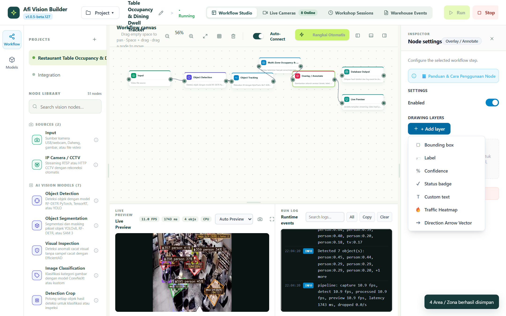
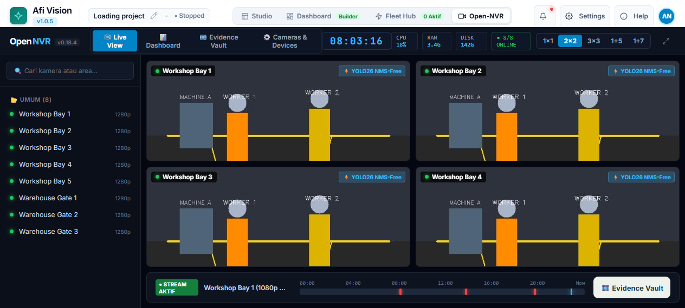

# ENSIKLOPEDIA NODE: BAGIAN 4.5
# ANNOTATIONS, DRAWING & VISUALISASI (7 NODES)

---

## DAFTAR ISI BAGIAN 4.5

- 4.5.1 `overlay_annotate`: Overlay & Annotate Engine (Manajer Multi-Lapisan Grafis & HUD)
- 4.5.2 `draw_boxes`: Draw Boxes (Rendering Kotak Pembatas & Label Skor Keyakinan)
- 4.5.3 `draw_text`: Draw Text (Pencetakan Teks Dinamis & Watermark Informasi)
- 4.5.4 `blur_anonymizer`: Privacy Blur & Anonymizer (Pengabur Wajah & Plat Otomatis)
- 4.5.5 `crowd_density_heatmap`: Crowd Density Heatmap (Peta Panas Kepadatan Temporal)
- 4.5.6 `bev_visualizer`: BEV Map Visualizer (Peta Denah Lantai 2D Bird's Eye View)
- 4.5.7 `interactive_zoom`: Interactive Object Zoom (Pembesaran Fokus Otomatis Objek Bergerak)

---

## 4.5.1 `overlay_annotate`: Overlay & Annotate Engine (Multi-Layer HUD)

### Deskripsi Fungsional
Node rendering grafis paling canggih di dalam sistem Afi Vision Builder. Node ini menggabungkan berbagai lapisan visual (*visual layers*) langsung di atas matriks citra video sebelum dikirim ke Live Preview, Dashboard, atau rekaman video MP4.

Mendukung penggambaran kotak deteksi, garis jejak lintasan masa lalu (*trajectory trails*), badge status, efek halo menyala (*neon glow*), dan HUD telemetri bergaya aerospace.


*Gambar 4.5.1: Konfigurasi Inspector Node Overlay & Annotate dengan Beragam Lapisan Visual.*

### Diagram Alur Data & Pin Koneksi
```
+------------------------------------------+
|  [Icon]  Overlay / Annotate              |
+------------------------------------------+
| (o) Input Image                          |
| (o) Detections                           |
| (o) Tracks                               |
|                               (o) Image  |
+------------------------------------------+
```

### Parameter Konfigurasi (Config Schema)
| Parameter | Tipe Data | Nilai Default | Pilihan / Rentang | Penjelasan Fungsional |
|---|---|---|---|---|
| `showBoxes` | Boolean | `true` | `true` / `false` | Menampilkan kotak pembatas bounding box di sekitar objek. |
| `boxThickness` | Integer | `2` | `1` s/d `10` | Ketebalan garis tepi kotak dalam satuan piksel. |
| `boxCornerStyle`| String | `"rounded"` | `"square"`, `"rounded"`, `"corner_brackets"` | Bentuk sudut kotak (persegi standar, sudut melengkung, atau braket sudut taktis). |
| `showLabels` | Boolean | `true` | `true` / `false` | Menampilkan label nama kelas dan ID di atas objek. |
| `showConfidence`| Boolean | `true` | `true` / `false` | Menampilkan nilai probabilitas persen (contoh: `Person 94%`). |
| `colorPalette` | String | `"rainbow"` | `"rainbow"`, `"emerald"`, `"cyberpunk"`, `"single"` | Skema palet warna pembeda antar-kelas objek. |
| `showTrails` | Boolean | `false` | `true` / `false` | Menggambar garis ekor jejak pergerakan objek (*tracking history trail*). |
| `trailLength` | Integer | `20` | `5` s/d `100` | Jumlah koordinat historis titik tengah yang digambar sebagai garis ekor. |
| `showHudBadge` | Boolean | `true` | `true` / `false` | Menampilkan panel informasi semi-transparan di pojok frame (waktu, FPS, total objek). |

---

## 4.5.2 `draw_boxes`: Draw Boxes (Kotak Pembatas Cepat)

### Deskripsi Fungsional
Versi ringan (*lightweight*) dari node penampil kotak pembatas tanpa overhead HUD teks yang kompleks. Sangat ideal untuk pipeline edge dengan sumber daya CPU terbatas yang hanya membutuhkan indikator visual kotak deteksi.

### Parameter Konfigurasi
- `lineColor` (String, Default: `"#00FF00"`): Kode warna hex garis kotak.
- `thickness` (Integer, Default: `2`): Ketebalan piksel garis.

---

## 4.5.3 `draw_text`: Draw Text (Pencetakan Teks Dinamis)

### Deskripsi Fungsional
Mencetak teks dinamis, stempel waktu (*timestamp overlay*), nama kamera, atau variabel konteks pada posisi piksel absolut di atas frame citra.

### Parameter Konfigurasi
- `textTemplate` (String, Default: `"CAM: {source_id} | WAKTU: {timestamp}"`): Template teks dengan variabel yang diekspansi secara otomatis.
- `x` (Integer, Default: `20`): Koordinat horizontal penempatan teks.
- `y` (Integer, Default: `40`): Koordinat vertikal penempatan teks.
- `fontSize` (Float, Default: `0.8`): Ukuran font Hershey OpenCV.
- `fontColor` (String, Default: `"#FFFFFF"`): Warna font.
- `backgroundColor` (String, Default: `"#000000"`): Kotak latar belakang teks untuk keterbacaan tinggi.

---

## 4.5.4 `blur_anonymizer`: Privacy Blur & Anonymizer

### Deskripsi Fungsional
Secara otomatis mengaburkan (*blur*) atau mem-pixelate area sensitif (seperti wajah manusia atau plat nomor kendaraan) untuk kepatuhan regulasi privasi data sebelum video disiarkan ke publik atau disimpan ke server.

### Parameter Konfigurasi
- `targetClasses` (List[String], Default: `["face", "license_plate"]`): Kelas objek yang harus disensor.
- `blurMethod` (String, Default: `"gaussian"`): Pilihan: `"gaussian"`, `"pixelate"`, `"blackout"`.
- `pixelateBlockSize` (Integer, Default: `12`): Ukuran blok mozaik untuk mode pixelate.

---

## 4.5.5 `crowd_density_heatmap`: Crowd Density Heatmap

### Deskripsi Fungsional
Mengakumulasi posisi keberadaan objek melintasi waktu untuk menghasilkan visualisasi **Peta Panas Kepadatan (*Accumulated Density Heatmap*)**. Area yang sering dilalui atau disinggahi orang akan berwarna merah menyala (*hot spot*), sedangkan area yang jarang dilewati berwarna biru dingin (*cold spot*).


*Gambar 4.5.2: Visualisasi Peta Panas Kepadatan Menggunakan Peta Warna Jet/Inferno.*

### Parameter Konfigurasi
- `colormap` (String, Default: `"JET"`): Pilihan palet warna: `"JET"`, `"TURBO"`, `"INFERNO"`, `"HOT"`.
- `decayRate` (Float, Default: `0.98`, Rentang: `0.90` s/d `0.999`): Laju peluruhan panas per frame (0.98 = jejak panas bertahan sekitar 5-10 detik).
- `pointRadius` (Integer, Default: `25`): Radius sebaran panas Gaussian per objek.
- `alphaBlend` (Float, Default: `0.40`): Tingkat transparansi overlay peta panas di atas video asli.

---

## 4.5.6 `bev_visualizer`: BEV Map Visualizer (Denah Lantai 2D)

### Deskripsi Fungsional
Menampilkan kanvas denah lantai arsitektur 2D (*Bird's Eye View Plan*) berdampingan dengan stream kamera. Setiap objek yang terdeteksi di kamera dipetakan sebagai titik ikon bergerak di atas denah denah bangunan secara real-time.

### Parameter Konfigurasi
- `floorplanImagePath` (String): Path file gambar cetak biru denah lantai (PNG/JPG).
- `pointColor` (String, Default: `"#00E5FF"`): Warna titik posisi objek pada denah lantai.
- `showObjectLabels` (Boolean, Default: `true`): Menampilkan ID objek di samping titik denah.

---

## 4.5.7 `interactive_zoom`: Interactive Object Zoom (Auto-Focus PiP)

### Deskripsi Fungsional
Menampilkan jendela kecil di dalam jendela besar (*Picture-in-Picture / PiP*) pada pojok layar yang secara otomatis memperbesar (*digital crop & zoom*) objek yang sedang menjadi perhatian utama (misal: orang yang sedang memanjat pagar atau truk yang sedang melintas).

### Parameter Konfigurasi
- `zoomFactor` (Float, Default: `2.5`): Pengali tingkat perbesaran optik digital.
- `pipPosition` (String, Default: `"top_right"`): Posisi jendela: `"top_right"`, `"bottom_right"`, `"top_left"`, `"bottom_left"`.
- `pipWidthPercent` (Float, Default: `0.25`): Lebar jendela PiP terhadap ukuran layar video (25%).

---

*Lanjutkan ke **Bagian 4.6: Ensiklopedia Node - Outputs, Cloud Sinks & Code Export** untuk mempelajari penyimpanan data, integrasi cloud, dan ekspor kode mandiri.*
