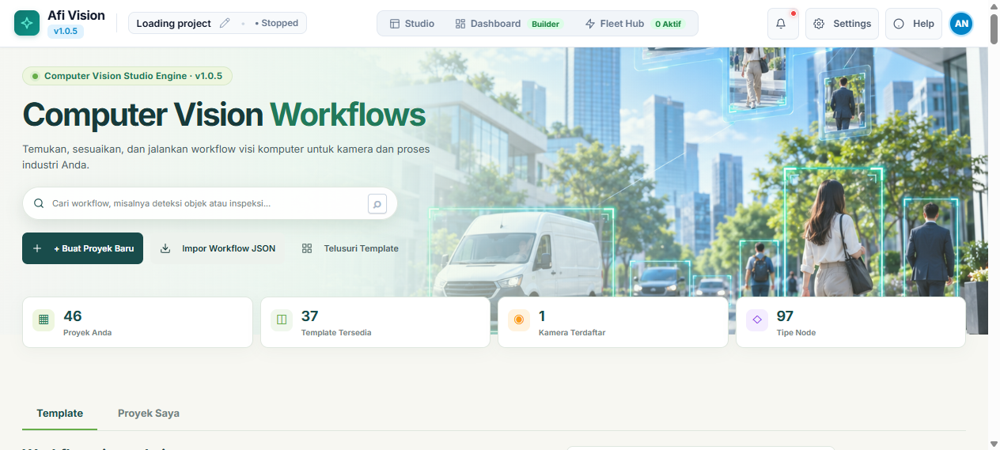
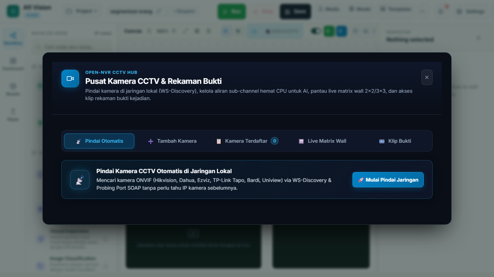
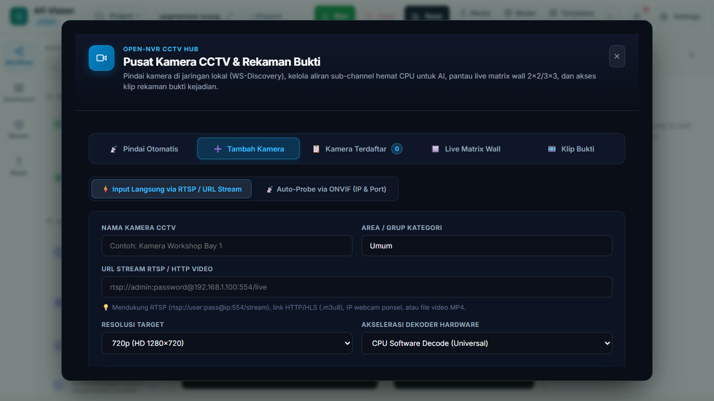
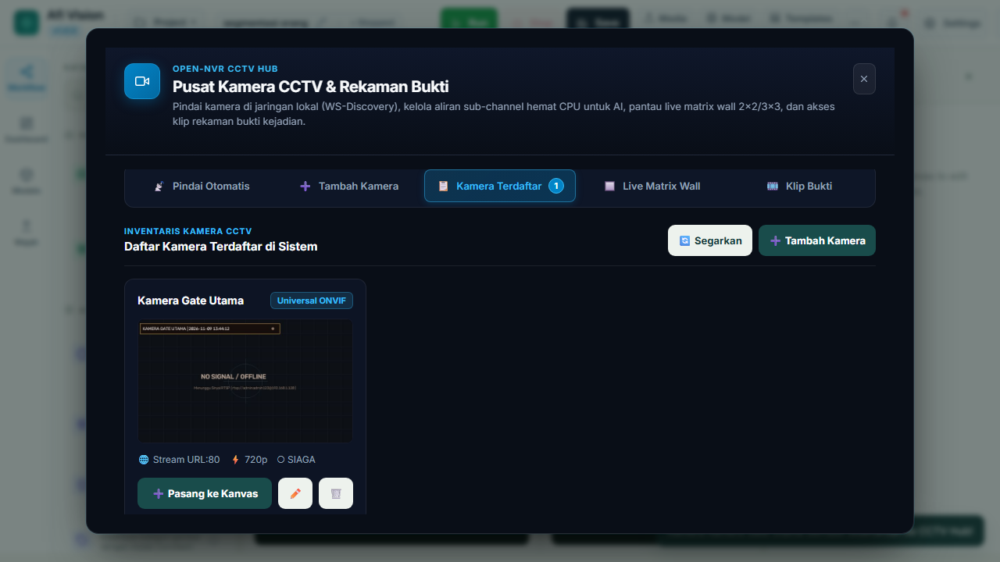
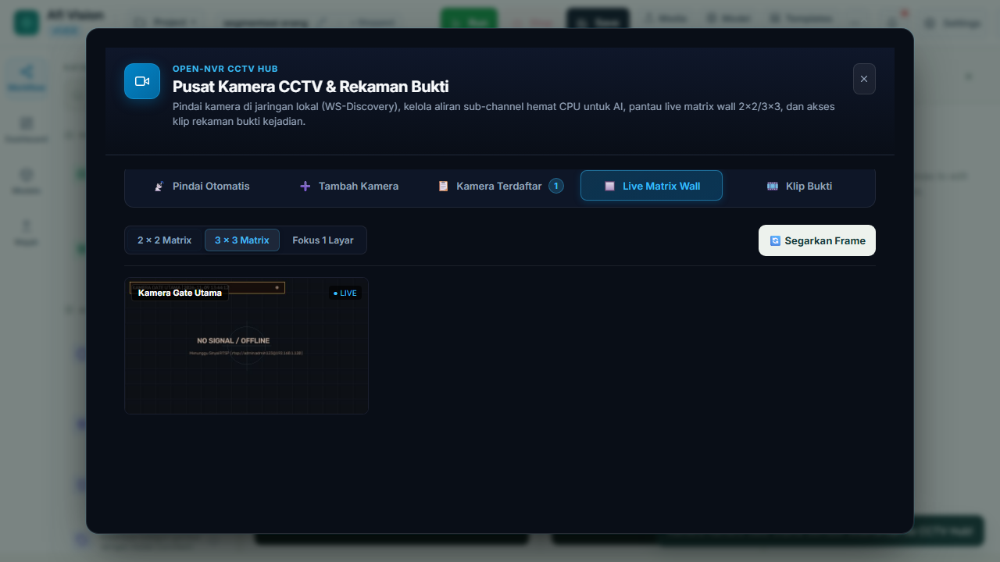
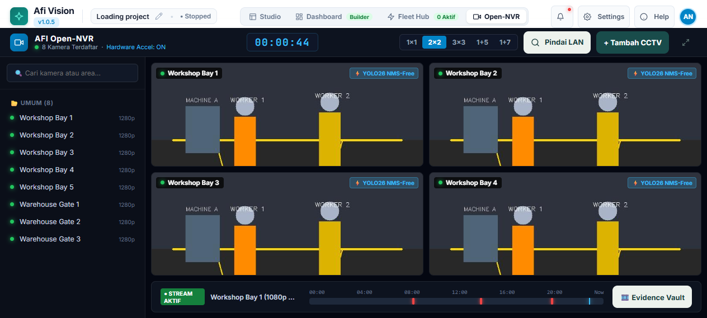
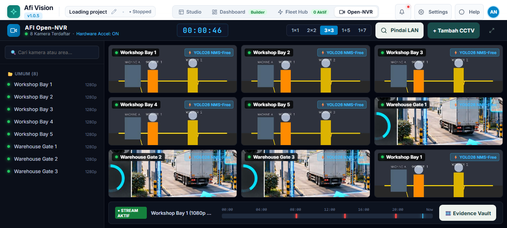
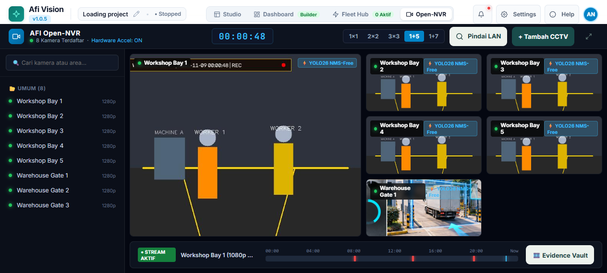
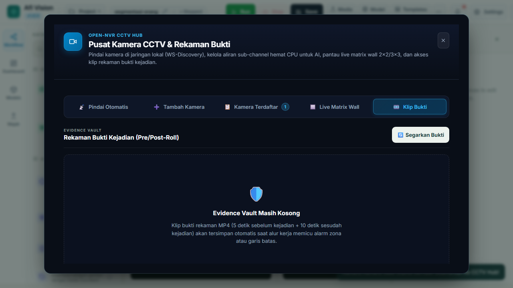

# BAGIAN V: EKOSISTEM OPEN-NVR DAN CCTV HUB TERINTEGRASI
## Afi Vision Builder & Integrated Open-NVR Platform

---

## 5.1 Arsitektur Terpadu Open-NVR Hub (Dual-Engine Architecture)

Secara tradisional, perusahaan harus membeli dan mengoperasikan dua sistem perangkat lunak yang terpisah:
1. **VMS (Video Management System)** komersial (seperti Milestone, Genetec, Synology Surveillance) untuk mencatat rekaman, mengatur kamera, dan menampilkan matriks video wall.
2. **AI Computer Vision Server** terpisah yang menarik stream video sekunder dari VMS untuk menjalankan inferensi analitik.

Pemisahan ini menciptakan inefisiensi besar: konsumsi bandwidth jaringan berlipat ganda, latensi transmisi tinggi, dan ketidakmampuan VMS untuk merespons secara langsung terhadap deteksi kecerdasan buatan.

**Afi Vision Builder menghadirkan Integrated Open-NVR Hub**, sebuah arsitektur hibrida (*Dual-Engine Architecture*) yang menyatukan fungsi VMS enterprise dan AI Vision Pipeline langsung di dalam satu mesin tunggal.

```
+-----------------------------------------------------------------------------------+
|                         INTEGRATED OPEN-NVR PLATFORM                              |
|                                                                                   |
|  +--------------------+   +-----------------------+   +------------------------+  |
|  |  ONVIF WS-DISCOVERY|   |  LIVE STREAM ROUTER   |   |   EVIDENCE CLIP VAULT  |  |
|  | Auto Scan LAN 3702 |   | TCP/UDP Demuxing      |   | Pre/Post-Roll Buffer   |  |
|  | Digest Auth Probe  |   | Multi-Client Fanout   |   | MP4 Lossless Storage   |  |
|  +---------+----------+   +-----------+-----------+   +-----------+------------+  |
|            |                          |                           |               |
|  +---------v--------------------------v---------------------------v------------+  |
|  |                       MATRIX LIVE WALL CONTROLLER                           |  |
|  |  * Single Focus (1x1)             * Standard Surveillance (2x2 Grid)        |  |
|  |  * High-Density (3x3 Grid)        * Command Center Patrol (1+5 Dynamic)     |  |
|  |  * Lossless Sub-Second Latency    * Offline Fallback (CCTV NO SIGNAL)       |  |
|  +------------------------------------+----------------------------------------+  |
+-----------------------------------------------------------------------------------+
```

### Akses Menuju Open-NVR Hub
Untuk membuka modul Open-NVR Hub dari Workflow Studio, klik tombol **"OpenNVR Hub"** berikon kamera video pada toolbar atas kanvas:


*Gambar 5.1: Tombol Akses Open-NVR Hub pada Toolbar Utama Workflow Studio.*

Jendela modal kokpit Open-NVR akan terbuka dengan tema gelap kedirgantaraan (*aerospace dark theme* `#090e17`) yang dirancang khusus untuk kenyamanan mata operator ruang kontrol pengawasan (*Security Operations Center / SOC*).

---

## 5.2 Pencarian Kamera Otomatis (ONVIF WS-Discovery)

Fitur pencarian otomatis (*Auto-Discovery*) membebaskan Anda dari keharusan menghafal alamat IP dan port setiap kamera yang terpasang di jaringan.


*Gambar 5.2: Tab Pindai Otomatis ONVIF Menemukan Kamera Jaringan Secara Instan.*

### 1. Cara Kerja Protokol WS-Discovery
1. Modul backend `engine/onvif_engine.py` mengirim paket probe multicast UDP standar ke alamat **`239.255.255.250:3702`**.
2. Setiap kamera CCTV yang mendukung standar ONVIF (Profile S, Profile G, atau Profile T) di dalam subnet LAN yang sama akan merespons dengan paket XML SOAP berisi identitas perangkat, model perangkat keras, firmware, dan endpoint service ONVIF.
3. Sistem memproses respons tersebut dan menampilkannya dalam tabel daftar penemuan rapi di Tab **1. Pindai Kamera**.

### 2. Langkah Menghubungkan Kamera dari Hasil Pindai:
1. Klik tombol **"Mulai Pemindaian Jaringan"** di tab Pindai.
2. Tunggu 3 hingga 5 detik sementara pemindai menjelajahi jaringan LAN.
3. Saat kamera ditemukan (misal: *Hikvision DS-2CD2043G2* atau *Dahua IPC-HFW2431S*), klik tombol **"Hubungkan"** di sebelah baris kamera.
4. Masukkan nama pengguna (*Username*) dan kata sandi (*Password*) kamera.
5. Sistem melakukan otentikasi *WS-Security UsernameToken Digest*, mengambil URL RTSP profil resolusi tinggi (*Main-stream*) dan profil resolusi rendah (*Sub-stream*), lalu menyimpannya ke daftar kamera terdaftar.

---

## 5.3 Pendaftaran Kamera Manual (Direct RTSP Connection)

Jika kamera CCTV berada di luar subnet lokal (misalnya di kantor cabang lain melalui VPN, menggunakan tunnel Cloudflare, atau perangkat NVR merek lama yang menonaktifkan protokol ONVIF), gunakan tab **2. Tambah Langsung RTSP**.


*Gambar 5.3: Formulir Pendaftaran Kamera Manual Menggunakan URL RTSP / Stream Jaringan.*

### Parameter Formulir Pendaftaran Manual:
- **Nama Identitas Kamera**: Label logis deskriptif (contoh: `WS-01: Workshop Bay 1 - Ban Kiri`).
- **Lokasi Fisik / Grup**: Pengelompokan area (contoh: `Lantai Produksi A`, `Gerbang Gudang Logistik`, `Area Parkir`).
- **URL Stream Utama (Main Stream RTSP)**: URL RTSP resolusi penuh (1080p/4K) untuk perekaman bukti dan deteksi detail.
- **URL Stream Sekunder (Sub Stream RTSP - Opsional)**: URL RTSP resolusi ringan (640x360 atau 720p) untuk visualisasi Matriks Live Wall multi-layar guna menghemat bandwidth monitor operator.
- **Protokol Transportasi**:
  - `TCP (Disarankan)`: Menjamin transmisi data tidak hilang (*lossless*). Mencegah artefak citra pecah (*pixelation*) dan gambar abu-abu saat jaringan sibuk.
  - `UDP`: Latensi paling rendah, namun rentan frame rusak jika terdapat interferensi kabel LAN.
- **Opsi Aktifkan Deteksi Gerakan Cerdas (Motion Gate)**: Centang opsi ini jika Anda ingin sistem hanya mengonsumsi daya komputasi AI saat kamera mendeteksi gerakan nyata.

---

## 5.4 Manajemen Kamera Terdaftar & Status Pemantauan

Tab **3. Kamera Terdaftar** menyajikan daftar lengkap seluruh perangkat kamera yang telah dikonfigurasi di dalam sistem.


*Gambar 5.4: Daftar Kamera Terdaftar dengan Telemetri Status Online, FPS, dan Tindakan Cepat.*

### 1. Indikator Status & Kesehatan Stream
Setiap kartu kamera dilengkapi indikator visual status operasional real-time:
- 🟢 **ONLINE**: Stream RTSP stabil, frame diterima secara teratur sesuai target FPS.
- 🟡 **RECONNECTING**: Koneksi terputus sesaat; backend sedang mencoba menghubungkan ulang dengan *exponential backoff*.
- 🔴 **OFFLINE**: Kamera mati atau kabel jaringan terlepas lebih dari batas toleransi waktu.

### 2. Penanganan Standby Otomatis (*CCTV NO SIGNAL*)
Afi Vision Builder tidak membiarkan layar menjadi hitam kosong atau menampilkan error browser saat kamera terputus. Sistem memiliki generator frame teknis otomatis yang langsung merender kartu status siaga profesional:

```
+-------------------------------------------------------+
|                                                       |
|                     [!] WARNING                       |
|               CCTV NO SIGNAL / OFFLINE                |
|                                                       |
|          Kamera: WS-01 (Workshop Bay 1)               |
|          Stream: rtsp://192.168.1.64:554/ch101        |
|          Status: Menunggu Re-koneksi Otomatis...      |
|                                                       |
+-------------------------------------------------------+
```

Begitu arus listrik atau kabel LAN kamera terpasang kembali, video langsung pulih secara instan tanpa perlu memuat ulang peramban web (*Zero Manual Intervention*).

---

## 5.5 Matriks Live Video Wall (Multi-Grid Monitoring)

Tab **4. Matriks Live Wall** adalah konsol pengawasan video simultan yang memungkinkan pengawas memantau banyak kamera secara bersamaan dalam tata letak kisi (*grid*) yang fleksibel.


*Gambar 5.5: Tab Matriks Live Wall dengan Pengalih Tata Letak Kisi (2x2, 3x3, 1+5).*

### 1. Pilihan Tata Letak Kisi Pemantauan

#### A. Tata Letak 2x2 Grid (4 Kamera Simultan)
Ideal untuk workstation pengawasan standar dengan 4 kamera utama.


*Gambar 5.6: Tampilan Matriks Pemantauan CCTV 2x2 Grid.*

#### B. Tata Letak 3x3 Grid (9 Kamera Simultan)
Dirancang untuk ruang kontrol berlayar lebar yang memantau hingga 9 sudut pabrik sekaligus dalam satu layar terpadu.


*Gambar 5.7: Tampilan Matriks Pemantauan CCTV 3x3 Grid Kepadatan Tinggi.*

#### C. Tata Letak 1+5 Surveillance Patrol (1 Utama Besar + 5 Sekunder Kecil)
Tata letak favorit para perwira keamanan: Satu kamera prioritas ditampilkan dalam ukuran masif di sisi kiri (misal gerbang utama), sementara 5 kamera pendukung berputar atau berjejer di sisi kanan.


*Gambar 5.8: Tampilan Matriks Pengawasan Taktis 1+5 Grid.*

---

## 5.6 Evidence Vault (Brankas Klip Bukti Forensik)

Salah satu fitur paling krusial bagi kepatuhan audit dan penyelidikan insiden adalah **Evidence Vault** pada Tab 5.


*Gambar 5.9: Brankas Bukti Forensik Menampilkan Arsip Klip Video Insiden.*

### 1. Mekanisme Perekaman Pre-Roll & Post-Roll Berbasis Ring Buffer
Ketika insiden terjadi (misalnya seseorang menyelinap melewati gerbang warehouse pada malam hari atau forklift menabrak tiang penyangga):
- Jika perekam biasa baru mulai merekam saat pemicu aktif, Anda akan kehilangan detik-detik awal penyebab terjadinya insiden.
- **Afi Vision Builder Ring Buffer** menyimpan rekaman 5 detik terakhir di memori volatil secara bergulir (*rolling circular buffer*). Saat sensor AI memicu kejadian, sistem mengambil 5 detik sebelum kejadian (*pre-roll*) dan menyambungnya dengan 10 detik setelah kejadian (*post-roll*).
- Hasilnya adalah satu rekaman video utuh 15 detik yang memperlihatkan **penyebab, momen kejadian, dan akibatnya**.

### 2. Fitur Pengelolaan Brankas Bukti:
- **Tabel Arsip Terstruktur**: Menampilkan Waktu Insiden, Nama Kamera Sumber, Tipe Pelanggaran, Skor Keyakinan AI, dan Ukuran File.
- **Pemutar Video Terpasang (*Built-in Video Player*)**: Klik tombol pemutaran untuk menonton langsung rekaman di dalam modal browser tanpa perlu mengunduh aplikasi media eksternal.
- **Pengunduhan Video Format Standar MP4**: Klip dienkode dengan codec standar H.264/MP4 sehingga dapat diputar di perangkat apa pun atau dilampirkan sebagai barang bukti resmi kepolisian/manajemen.
- **Pembersihan Otomatis Berbasis Retensi**: Klip yang usianya melampaui batas retensi (misal 30 hari) akan dihapus secara otomatis untuk menjaga ketersediaan ruang hard disk server.

---

## 5.7 Motion Gate & Optimasi Bandwidth Jaringan

Dalam jaringan CCTV perusahaan dengan puluhan kamera beresolusi tinggi, streaming video secara simultan dapat menghabiskan kapasitas switch LAN dan membebani prosesor server.

Open-NVR Hub menerapkan sistem optimasi cerdas:
1. **Dynamic Stream Switching**: Saat kamera ditampilkan dalam ukuran kecil pada matriks 3x3, sistem secara otomatis mengalihkan permintaan ke *Sub-Stream* beresolusi rendah (menghemat 75% bandwidth jaringan). Hanya saat operator memperbesar kamera ke mode layar penuh (*single focus*), sistem beralih ke *Main-Stream* resolusi 4K.
2. **Motion Gate Pre-Filtering**: Jika sebuah ruangan kosong tidak ada pergerakan, decoding frame dihentikan pada frame referensi diam. Pipeline AI tidur (*sleep mode*) dan baru terbangun saat ada piksel gerak nyata, menghemat pemakaian listrik dan memperpanjang umur perangkat keras server.

---

## 5.8 Ekspor Mandiri Paket OpenNVR Edge Bundle

Afi Vision Builder memungkinkan Anda mengekspor konfigurasi Open-NVR Hub menjadi satu paket aplikasi terpisah (*Standalone Edge Bundle*) melalui script `engine/afivision_opennvr_export.py`.

### Cara Mengekspor Paket:
1. Masuk ke terminal server Anda.
2. Jalankan perintah pembuatan bundel ekspor:
   ```bash
   python -c "import engine.afivision_opennvr_export as oe; oe.build_opennvr_bundle_zip('data/exports/opennvr_edge_bundle.zip')"
   ```
3. File ZIP yang dihasilkan dapat dipindahkan ke server edge manapun di cabang lapangan untuk langsung menjalankan VMS tanpa perlu mengonfigurasi ulang alur kerja dari awal.

---

*Lanjutkan ke **Bagian VI: Dashboard Builder dan Telemetri Enterprise** untuk merancang antarmuka pemantauan eksekutif dan KPI operasional.*
