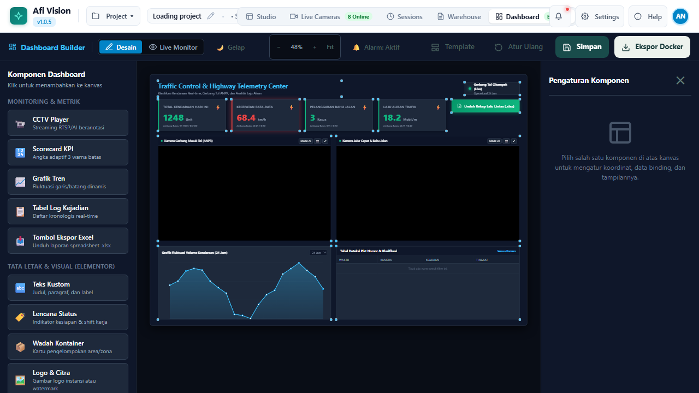
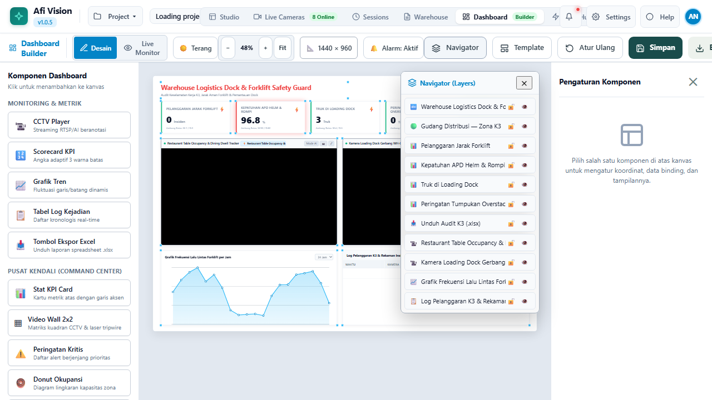
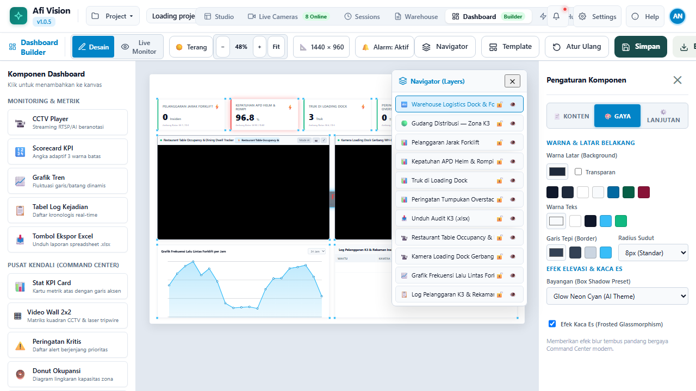
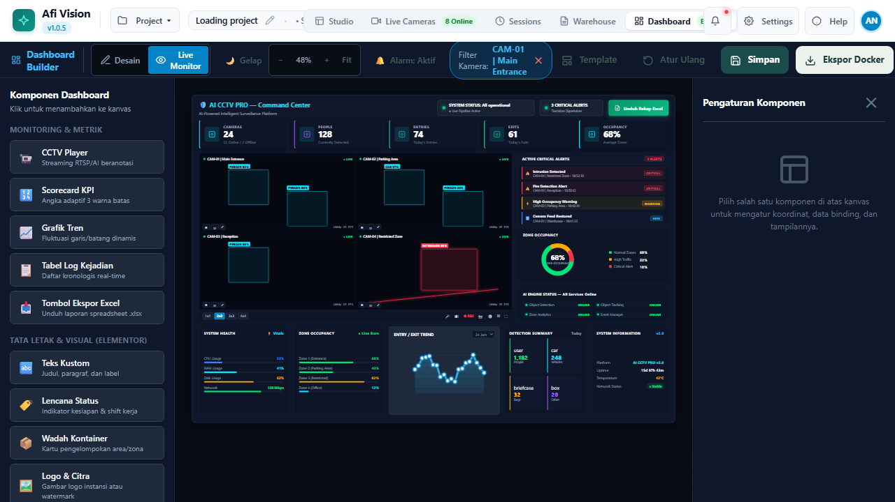
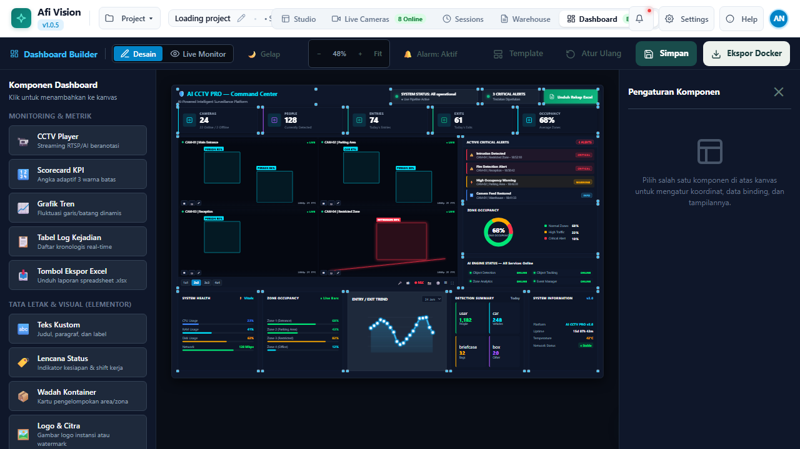

# BAGIAN VI: DASHBOARD BUILDER DAN TELEMETRI ENTERPRISE
## Afi Vision Builder & Integrated Open-NVR Platform

---

## 6.1 Filosofi No-Code Visual Dashboard Designer

Setelah alur kerja vision selesai dibangun di Workflow Studio, tantangan berikutnya adalah: **bagaimana menyajikan informasi hasil deteksi kepada manajer, supervisor, dan operator lapangan secara elegan dan mudah dipahami?**

Sebagian besar sistem AI hanya menyediakan keluaran berupa log teks JSON mentah atau konsol terminal hitam putih. Pengguna non-teknis kesulitan membaca log tersebut secara real-time.

Afi Vision Builder menghadirkan **Dashboard Designer**, lingkungan desain visual tanpa kode (*No-Code Drag-and-Drop Designer*, terinspirasi dari kemudahan arsitektur Elementor) yang memungkinkan Anda merancang dashboard operasional kelas eksekutif hanya dalam hitungan menit.


*Gambar 6.1: Antarmuka Visual Dashboard Designer dengan Kanvas Desain dan Palette Widget.*

### Keunggulan Utama Dashboard Designer:
- **Pemisahan Logika & Presentasi**: Alur kerja pemrosesan video berjalan di backend, sementara tampilan dashboard hanya berfokus pada visualisasi metrik dan kontrol operator.
- **Dukungan Tema Ganda (*Light & Dark Theme*)**: Tampilan awal menggunakan tema *Warm Operational Light Mode* yang nyaman untuk kantor berlampu terang, serta dapat dialihkan ke *Dark Aerospace Theme* untuk ruang kontrol malam hari dengan satu klik.
- **Navigator Lapisan Hirarkis (*Elementor-style Navigator Tree*)**: Memudahkan pengelolaan tata letak komponen berlapis, penguncian widget (*widget lock*), dan pengelompokan kontainer responsif.


*Gambar 6.2: Pohon Lapisan Navigator dan Pengaturan Penataan Konten Widget.*

---

## 6.2 Katalog 24+ Komponen Widget Siap Pakai

Dashboard Designer menyediakan lebih dari 24 komponen widget yang dapat Anda seret dan letakkan di kanvas:

| Kategori Widget | Nama Komponen | Deskripsi & Kegunaan Operasional |
|---|---|---|
| **Video & Visual** | **Live CCTV Stream Tile** | Menampilkan siaran langsung kamera dengan atau tanpa kotak anotasi AI secara real-time. |
| | **Multi-Camera Matrix** | Mini-grid pemantau beberapa kamera sekaligus di dalam dashboard. |
| | **Incident Snapshot Card** | Menampilkan foto resolusi tinggi dari kejadian pelanggaran terakhir yang terdeteksi. |
| | **Video Replay Tile** | Pemutar video klip rekaman insiden langsung dari Evidence Vault. |
| **KPI & Metrik** | **Total Metric Counter** | Angka besar penunjuk total objek terhitung (misal: "1.420 Ban Diproduksi"). |
| | **Gauge Meter Ring** | Indikator melingkar kapasitas okupansi atau utilisasi zona kerja (0% - 100%). |
| | **Zone Activity Timer HUD** | Status real-time sesi kerja workshop: Durasi berjalan, nama bay, dan status aktif. |
| | **Trend Sparkline** | Grafik tren garis kecil yang menunjukkan peningkatan/penurunan aktivitas per jam. |
| **Grafik Analitik** | **Real-Time Time Series** | Grafik garis interaktif yang memplot data metrik secara langsung setiap detik. |
| | **Class Distribution Pie** | Diagram lingkaran persentase persebaran kelas objek (misal: Truk vs Mobil vs Motor). |
| | **Hourly Activity Bar** | Diagram batang rekapitulasi aktivitas per jam kerja shift operasional. |
| | **Heatmap Projection Tile**| Visualisasi peta panas sebaran kerumunan di area denah lantai. |
| **Tabel & Log Data**| **Live Incident Feed** | Kartu pemberitahuan bergulir berisi insiden terbaru secara kronologis. |
| | **Virtualized Events Table**| Tabel data kejadian berkinerja tinggi yang mampu menampilkan puluhan ribu baris tanpa jeda. |
| | **LPR Plate Log** | Tabel khusus pembaca plat nomor lengkap dengan foto kendaraan dan waktu masuk. |
| | **Face Attendance Table** | Tabel absensi pengenalan wajah lengkap dengan foto wajah dan tingkat kemiripan. |
| **Kontrol Interaktif**| **Camera Switcher Bar** | Tombol navigasi cepat untuk beralih pandangan antar-kamera di lapangan. |
| | **Threshold Slider** | Penggeser sensitivitas alarm yang dapat diatur langsung oleh supervisor tanpa masuk ke studio. |
| | **Emergency Strobe Button** | Tombol pemicu sirine pabrik darurat yang terhubung ke broker MQTT. |


*Gambar 6.3: Kustomisasi Warna, Tipografi, Efek Glassmorphism, dan Border Radius pada Widget.*

---

## 6.3 Mekanisme Data Binding Menggunakan Dashboard Bus

Bagaimana sebuah widget di dashboard mengetahui nilai yang dihasilkan oleh node di alur kerja? Jawabannya adalah melalui **`Dashboard Bus`** (`engine/dashboard_bus.py`).

### Arsitektur Pub/Sub Real-Time
1. Setiap kali sebuah node kalkulasi (seperti `object_counter` atau `zone_activity_timer`) menghasilkan data baru, node tersebut mempublikasikan pesannya ke kanal lokal.
2. Modul `dashboard_bus` menyiarkan data tersebut melalui koneksi **WebSocket** (`/api/telemetry/ws`) ke seluruh peramban yang membuka dashboard.
3. Di dalam Dashboard Designer, Anda cukup mengklik widget yang bersangkutan, membuka tab **Data Binding**, lalu memilih variabel data yang ingin dihubungkan.

```
+-----------------------------------+
| Node: 'zone_activity_timer'       |
| Output: session_duration = 345.2s |
+-----------------+-----------------+
                  | (Local Bus Publish)
+-----------------v-----------------+
| Dashboard Bus (WebSocket Server)  |
+-----------------+-----------------+
                  | (WebSocket Broadcast)
+-----------------v-----------------+
| Widget: 'Zone Activity Timer HUD' |
| Tampilan: "00:05:45 (BAY 01 AKTIF)|
+-----------------------------------+
```

---

## 6.4 Interaktivitas Tingkat Lanjut: Looker-Style Cross-Filtering

Dashboard Designer mendukung fitur **Cross-Filtering Interaktif** (serupa dengan Google Looker / Power BI).


*Gambar 6.4: Interaktivitas Lintas-Widget: Memilih Bar Diagram Batang Otomatis Memfilter Tabel Kejadian.*

### Cara Kerja Cross-Filtering:
1. Saat operator mengklik salah satu batang pada diagram batang *"Aktivitas Jam 14:00"*, sistem memancarkan filter global ke seluruh widget lainnya.
2. **Tabel Kejadian Insiden** seketika menyaring barisnya hanya untuk menampilkan insiden yang terjadi pada jam 14:00.
3. **Kartu Snapshot** langsung menampilkan foto pelanggaran yang terkait dengan jam tersebut.
4. Mengklik area kosong diagram akan mereset filter kembali ke tampilan keseluruhan (*global overview*).

---

## 6.5 Template Dashboard Industri Siap Pakai

Sistem menyertakan template dashboard profesional yang telah disesuaikan dengan kebutuhan sektor operasional spesifik:


*Gambar 6.5: Penerapan Template Dashboard AI CCTV Pro dengan Telemetri Multi-Kamera.*

1. **Industrial Tire Workshop Dashboard**:
   - Menampilkan status 5 Bay Workshop alat berat secara paralel.
   - Timer durasi pekerjaan mekanik per bay.
   - Grafik produktivitas shift kerja (jumlah ban yang diservis per jam).
2. **Warehouse Logistics & Exit Portal**:
   - Monitoring gerbang keluar masuk truk logistik.
   - Pembaca plat nomor LPR otomatis yang dicocokkan dengan manifes Surat Jalan ERP.
   - Tabel peringatan pelanggaran gerbang (*unauthorized exits*).
3. **K3 Safety & Compliance Center**:
   - Indikator persentase kepatuhan pemakaian APD (Helm & Rompi) secara keseluruhan pabrik.
   - Log insiden darurat pekerja jatuh (*Man Down Emergency Alert*).
   - Tombol penghentian konveyor darurat (*E-Stop*).

---

## 6.6 Ekspor Dashboard Mandiri ke Docker Container

Jika Anda ingin mendeploy dashboard monitoring di monitor ruang direksi atau ruang operator satpam tanpa memberikan akses ke studio perancang alur kerja, gunakan fitur **Export Standalone Dashboard**.


*Gambar 6.6: Modal Pengunduhan Paket Docker Container Standalone untuk Dashboard.*

### Langkah Ekspor & Deployment:
1. Klik tombol **"Ekspor Dashboard"** di pojok kanan atas Dashboard Designer.
2. Pilih format: **Standalone Web Bundle (HTML/JS/CSS)** atau **Docker Container Package**.
3. Klik **"Unduh Paket ZIP"**.
4. Ekstrak file ZIP di server target dan jalankan perintah Docker:
   ```bash
   docker build -t dashboard-cctv-enterprise .
   docker run -d -p 8080:80 --name cctv_monitor dashboard-cctv-enterprise
   ```
Dashboard kini dapat diakses secara independen di port 8080 tanpa membebani server utama Afi Vision Builder.

---

*Lanjutkan ke **Bagian VII: Model Zoo, Quantization & Custom AI Runtime** untuk mengelola bobot model kecerdasan buatan dan teknik akselerasi inferensi.*
