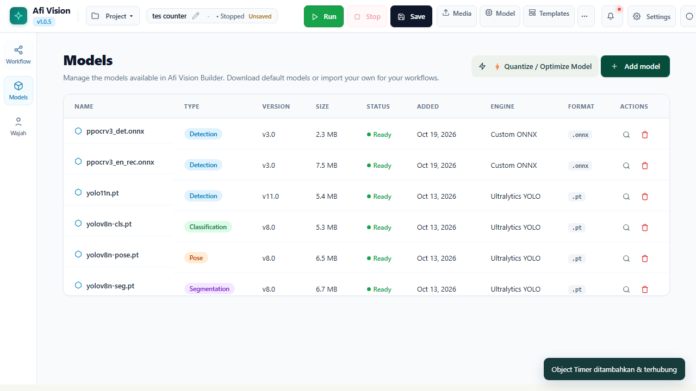
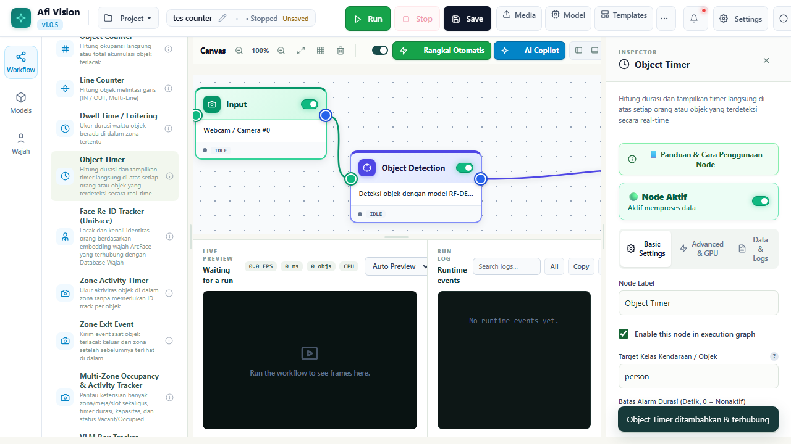
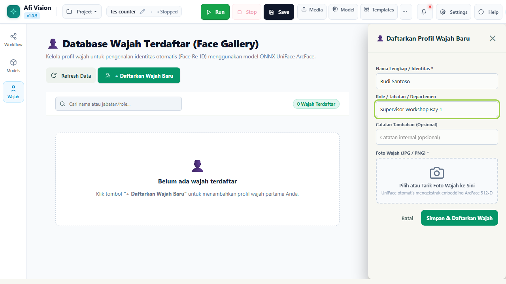
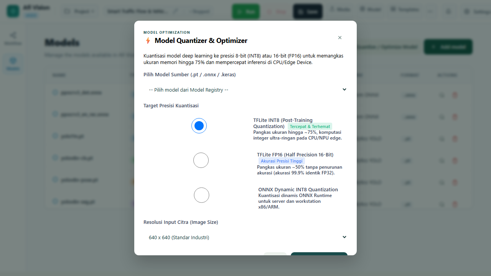

# BAGIAN VII: MODEL ZOO, QUANTIZATION & CUSTOM RUNTIME
## Afi Vision Builder & Integrated Open-NVR Platform

---

## 7.1 Model Registry & Manajemen Bobot Kecerdasan Buatan

Keberhasilan implementasi *Computer Vision* industri bergantung pada pemilihan dan optimasi arsitektur model AI yang tepat. Afi Vision Builder dilengkapi dengan modul **Model Registry** terpusat untuk memuat, memvalidasi, dan mengelola berbagai format bobot jaringan syaraf tiruan (*neural network weights*).

*Gambar 7.1: Antarmuka Model Registry Menampilkan Daftar Bobot Model AI, Versi, dan Arsitektur.*

### Format Model yang Didukung:
1. **PyTorch Checkpoint (`.pt`)**: Format fleksibel bawaan ekosistem Ultralytics (YOLOv8, YOLO11, YOLO26). Sangat mudah dimodifikasi dan mendukung inferensi langsung pada GPU NVIDIA CUDA.
2. **Open Neural Network Exchange (`.onnx`)**: Standar format terbuka industri yang mendukung akselerasi lintas platform (*cross-platform hardware acceleration*) menggunakan CPU OpenVINO, AMD ROCm, DirectML, atau TensorRT.
3. **TensorRT Engine (`.engine` / `.plan`)**: Model terkompilasi khusus untuk GPU NVIDIA (termasuk modul NVIDIA Jetson Orin) yang memberikan latensi inferensi paling rendah (*ultra-low sub-5ms latency*).

Seluruh file bobot model disimpan di dalam direktori `weights/` pada root aplikasi dan diverifikasi integritasnya menggunakan checksum hash **SHA-256** untuk mencegah kerusakan file saat pengunduhan atau transmisi jaringan.

---

## 7.2 Dukungan YOLO Generasi Terbaru (YOLOv8, YOLO11, YOLO26n)

Afi Vision Builder mendukung generasi keluarga model YOLO (*You Only Look Once*) paling mutakhir:

| Varian Model | Jumlah Parameter | Ukuran File | Target Penggunaan Industri | Kecepatan CPU (i7 12th) | Kecepatan GPU (RTX 4060) |
|---|---|---|---|---|---|
| **`yolov8n.pt`** | 3.2 Juta | ~6.5 MB | Deteksi Cepat 80 Kelas Standar COCO | ~18 ms | ~2.5 ms |
| **`yolov8s.pt`** | 11.2 Juta | ~22.5 MB | Akurasi Lebih Tinggi untuk Objek Jarak Jauh | ~45 ms | ~4.8 ms |
| **`yolo11n.pt`** | 2.6 Juta | ~5.6 MB | Efisiensi Arsitektur C3k2 Terbaru | ~14 ms | ~2.1 ms |
| **`yolo26n.pt`** | 2.4 Juta | ~5.5 MB | Arsitektur Next-Gen Ultra-Lightweight Edge | ~12 ms | ~1.8 ms |
| **`yolov8n-pose.pt`** | 3.3 Juta | ~6.8 MB | Estimasi Kerangka Pose 17 Titik Tubuh Manusia | ~22 ms | ~3.2 ms |
| **`yolov8n-seg.pt`** | 3.4 Juta | ~7.1 MB | Segmentasi Masker Poligon Piksel Presisi | ~25 ms | ~3.8 ms |
| **`yolov8n-cls.pt`** | 2.7 Juta | ~5.5 MB | Klasifikasi Gambar Global Kategori Tunggal | ~8 ms | ~1.2 ms |

### Mekanisme Pengunduhan Resmi yang Aman & Idempoten
Sistem menyediakan tombol unduh bobot resmi langsung di dalam Inspector node `detector`. Proses pengunduhan menerapkan prinsip **Idempotent Staging**: File diunduh terlebih dahulu ke direktori sementara (*staging buffer*), divalidasi ukuran dan checksum SHA-256-nya terhadap rilis resmi GitHub Ultralytics, baru kemudian dipindahkan ke folder `weights/`. Hal ini menjamin bahwa jika koneksi internet terputus di tengah jalan, sistem tidak akan mengalami *corrupted model crash*.

---

## 7.3 RF-DETR ONNX Runtime (Transformer-Based Detection)

Untuk kasus industri dengan kepadatan objek sangat tinggi dan saling bertumpuk (*extreme occlusion*, misalnya tumpukan ban bekas atau keranjang baut logam), algoritma YOLO berbasis NMS (*Non-Maximum Suppression*) terkadang tidak sengaja menghapus deteksi objek yang saling menutupi.

Afi Vision Builder menyertakan runtime khusus untuk **RF-DETR (Real-Time DEtection TRansformer)**:
- **Arsitektur End-to-End**: Menggunakan mekanisme *Self-Attention Transformer* yang memprediksi kumpulan kotak objek (*set prediction*) secara langsung tanpa memerlukan langkah heuristik NMS.
- **Eksekusi ONNX Berkecepatan Tinggi**: Dioptimasi menggunakan `rfdetr_onnx_runtime.py` yang memanfaatkan *kernel fusion* untuk berjalan mulus di prosesor multicore.

---

## 7.4 UniFace Enterprise Facial Recognition Suite

Untuk kebutuhan kontrol akses pintu gerbang, absensi mandiri karyawan, dan verifikasi identitas personil di area berbahaya, sistem menyediakan modul **UniFace** lengkap.

*Gambar 7.2: Kanvas Penggabungan Deteksi Wajah UniFace dengan Timer Aktivitas.*

### Rantai Pemrosesan Wajah Tiga Tahap:
1. **Deteksi Wajah (SCRFD)**: Menemukan wajah bahkan pada resolusi sekecil 16x16 piksel dengan sudut kemiringan hingga 60 derajat.
2. **Penyelarasan Landmark 5-Titik (Facial Alignment)**: Menemukan koordinat kedua mata, hidung, dan kedua ujung bibir, lalu memutar citra secara geometris agar wajah berada pada posisi tegak lurus sempurna.
3. **Ekstraksi Vektor Fitur (ArcFace Embedding)**: Memproyeksikan wajah ke dalam ruang bola berdimensi 512 (*512-D hypersphere vector*). Dua foto dari orang yang sama akan memiliki jarak sudut (*angular cosine distance*) yang sangat dekat.

*Gambar 7.3: Modal Registrasi Wajah Karyawan Baru dengan Kamera Web Langsung.*

### Manajemen Galeri Wajah (*Face Registry*):
Pengguna dapat mendaftarkan personil baru melalui menu **Face Registry**:
- Ambil foto menggunakan webcam langsung atau unggah foto KTP/ID Card.
- Masukkan Nama Karyawan, Departemen, dan NIK (*Nomor Induk Karyawan*).
- Sistem mengekstrak embedding wajah dan menyimpannya ke indeks pencarian vektor berkecepatan tinggi di backend.

---

## 7.5 EfficientAD Anomaly Inspection Runtime

Inspeksi cacat produk manufaktur (*defect inspection*, seperti retakan pada ban baru, goresan pada bodi mobil, atau cacat cetakan PCB) menghadapi kendala besar: **sangat sulit mengumpulkan ribuan foto produk cacat untuk melatih model supervised**.

Node `efficientad` menyelesaikan masalah ini dengan pendekatan **Unsupervised Anomaly Detection**:
- Model hanya perlu "melihat" 50 hingga 100 foto produk yang **NORMAL (Bebas Cacat)** selama fase prapelatihan.
- Sistem menggunakan arsitektur *Teacher-Student Feature Networks* berkecepatan tinggi yang digabung dengan *Autoencoder*.
- Saat produk baru berjalan di bawah kamera konveyor, model membandingkan fitur struktural produk tersebut dengan representasi ideal guru.
- Setiap goresan sekecil 1 milimeter atau perbedaan warna akan langsung menyala pada **Peta Anomali (Anomaly Heatmap)** dan memicu penolakan produk secara otomatis (*rejection solenoid trigger*).

---

## 7.6 Model Quantizer Bawaan (FP32 ke FP16 / INT8)

Sebagian besar model AI dilatih dengan presisi angka pecahan 32-bit (*Floating Point 32 / FP32*). Model ini membutuhkan memori besar dan siklus CPU yang berat.

Afi Vision Builder menyertakan **Model Quantizer bawaan** (`engine/model_quantizer.py`) yang dapat diakses langsung dari antarmuka web:

*Gambar 7.4: Antarmuka Model Quantizer untuk Konversi Model ke Format FP16 dan INT8.*

### Manfaat Kuantisasi Model:
1. **Kuantisasi FP16 (Half Precision 16-Bit)**:
   - Memotong ukuran file model hingga **50%**.
   - Meningkatkan kecepatan inferensi **1.8x hingga 2.2x** pada GPU modern tanpa penurunan akurasi sama sekali ($< 0.1\%$ mAP drop).
2. **Kuantisasi INT8 (Integer 8-Bit Dynamic Quantization)**:
   - Mengubah operasi perkalian matriks pecahan menjadi operasi bilangan bulat integer 8-bit.
   - Memotong pemakaian memori RAM hingga **75%**.
   - Memberikan lonjakan kecepatan **2.5x hingga 3.5x lebih kencang pada CPU-Only (tanpa GPU)**, sangat ideal untuk komputer industri di lapangan.

### Langkah Menjalankan Kuantisasi:
1. Buka jendela **Model Quantizer** dari menu Tools.
2. Pilih model sumber (misal: `yolov8n.onnx`).
3. Pilih metode kuantisasi target: **FP16** atau **INT8**.
4. Klik tombol **"Mulai Kuantisasi Model"**.
5. Dalam waktu 10-30 detik, model hasil optimasi (misal: `yolov8n_int8.onnx`) akan otomatis terdaftar dan siap digunakan di alur kerja.

---

*Lanjutkan ke **Bagian VIII: Integrasi Sistem Eksternal, MQTT dan Enterprise ERP** untuk mempelajari pertukaran data kejadian secara otomatis.*
